<!-- Generated by scripts/report/95_build_review.py; edit the linked Python/HTML sources. -->

[Review index and editing instructions](review/README.md)

Public-data pilot · smartphones vs. school pressure · updated 2026-10-24

# Teen Distress Pilot

Two recent accounts offer competing explanations for the post-2010 rise in adolescent anxiety and depression: Jonathan Haidt's *The Anxious Generation* attributes the shift to smartphones and social media, while Peter Gray points to intensified schooling and declining autonomy. This pilot report asks how far large-scale public microdata can go toward separating those hypotheses before any restricted or licensed datasets are requested. Every figure and table is computed from public microdata (ACS, ATUS, NHIS, NSCH, MICS, DHS, PISA 2012–2022, GSHS, IPUMS International), the CDC WONDER mortality tabulations, and published survey series. The October 2026 revision adds the Phase 2 sources planned in the first edition: parent-report and self-report surveys that bear on who reports the symptoms, monthly suicide seasonality, four PISA waves, Monitoring the Future's published series, new county survey waves and the first post-ban observations, and county broadband and early-smartphone coverage instruments.

## The four hypotheses

The study is organized around four candidate explanations, with each empirical test designed to distinguish between at least two of them.

| Hypothesis                                   | Claim                                                                                                                                                                                                                                                   | What it predicts in these data                                                                                                                                                                                                                                                                                                              |
|----------------------------------------------|---------------------------------------------------------------------------------------------------------------------------------------------------------------------------------------------------------------------------------------------------------|---------------------------------------------------------------------------------------------------------------------------------------------------------------------------------------------------------------------------------------------------------------------------------------------------------------------------------------------|
| H1 · Phones and social media (Haidt, Twenge) | Smartphone-based social media, arriving between 2010 and 2013, caused the rise in adolescent distress, particularly among girls.                                                                                                                        | Distress rises earlier where smartphones and fast mobile data arrive first; increases are much larger for girls than for boys; distress rises in developing countries as mobile internet spreads; heavy users report worse outcomes; school phone bans reduce distress.                                                                     |
| H2 · School pressure (Gray)                  | Accountability testing, heavier homework loads, and reduced free play made schooling more stressful from around 2010 onward.                                                                                                                            | No difference by local mobile-network timing; girls affected somewhat more than boys; increases concentrated in the high-stakes high-school years (15–17) and during the school year; distress rises where perceived schoolwork pressure rises; state accountability reforms (Race to the Top, Common Core testing) predict state outcomes. |
| H3 · Interaction                             | Smartphones are most harmful when combined with high-stakes schooling—social comparison and notifications running through the same school hours that carry tests and grades—so that removing phones from the school day brings disproportionate relief. | Both academic pressure and phone use rise after 2010; mobile-rollout effects are larger in high-pressure settings; school phone bans improve well-being, especially for academically anxious students; out-of-school screen use matters less.                                                                                               |
| H0 · Reporting or measurement drift          | The observed rise largely reflects changing diagnostic thresholds, mental-health awareness, or survey reporting norms.                                                                                                                                  | Older adults (including the 65+ comparison group) trend upward in the same way; behavioral, clinical, and self-report series diverge; no geographic or dose-response pattern appears.                                                                                                                                                       |

## Summary: what the public microdata support today

Each row summarizes one empirical test from the pilot, grouped by the hypothesis it addresses most directly. Full specifications, data sources, and caveats follow in Parts 1–4.

| What was measured                                                                        | What the pilot found                                                                                                                                                                                                                                                                                                                                                                                                                                                                                                                                                                                                    | Relevant to                                             |
|------------------------------------------------------------------------------------------|-------------------------------------------------------------------------------------------------------------------------------------------------------------------------------------------------------------------------------------------------------------------------------------------------------------------------------------------------------------------------------------------------------------------------------------------------------------------------------------------------------------------------------------------------------------------------------------------------------------------------|---------------------------------------------------------|
| **Is there a real rise, and is the outcome usable? (H0)**                                |                                                                                                                                                                                                                                                                                                                                                                                                                                                                                                                                                                                                                         |                                                         |
| 65+ comparison group and adult trends                                                    | The ACS cognitive-difficulty rate falls steadily for adults 65+ (12.2% → 9.4% between 2008 and 2019) and is flat at ages 50–64 while rising for all age groups under 50, ruling out generic survey-wide response drift.                                                                                                                                                                                                                                                                                                                                                                                                 | against H0                                              |
| Agreement across measures                                                                | Clinical depression interviews (NSDUH), persistent sadness (YRBS), and the ACS cognitive-difficulty item all turn upward between 2011 and 2013, with girls rising faster in every source; within-state changes move together. However, the ACS item captures only about a sixth of the proportional rise in depression.                                                                                                                                                                                                                                                                                                 | real rise; ACS usable but weak                          |
| Subgroup gradient                                                                        | Relative increases in the ACS item are steepest among affluent, private-school, Hispanic, Asian, and foreign-born teens, and smallest among low-income teens—a pattern consistent with both early smartphone adoption and differential diagnosis-seeking.                                                                                                                                                                                                                                                                                                                                                               | ambiguous                                               |
| **Phones and social media (H1)**                                                         |                                                                                                                                                                                                                                                                                                                                                                                                                                                                                                                                                                                                                         |                                                         |
| Sex pattern                                                                              | Girls' relative increase exceeds boys' across all sources: ACS +17% vs. +9% (2008–10 → 2017–19), YRBS sadness +26% vs. +19%, and post-2020 ACS increases of +45–55% for girls vs. +16–23% for boys.                                                                                                                                                                                                                                                                                                                                                                                                                     | H1 / H3                                                 |
| Timing in early vs. late LTE markets                                                     | No rollout-timing effect. Early- and late-LTE metropolitan areas track each other closely through 2013; the static DiD estimate is +0.02 pp (SE 0.15) across 279 dated metros and −0.04 pp (SE 0.19) for girls, with similarly null results across county panels in six state youth surveys.                                                                                                                                                                                                                                                                                                                            | not H1 via rollout timing                               |
| U.S. smartphone adoption                                                                 | State-level teen-household smartphone-internet share predicts YRBS girls' sadness within states (+0.92 pp per 10 points, SE 0.43), but metro adoption does not predict sadness at the county level (+0.13 pp overall across five states, SE 0.13; +0.22 pp for girls in California and Maine, SE 0.25).                                                                                                                                                                                                                                                                                                                 | weak H1                                                 |
| County broadband coverage 2010–21 and the AT&T 2010 footprint                            | Continuous county coverage (NTIA National Broadband Map and FCC Form 477) against the county youth surveys: wireline speed upgrades correlate weakly with suicidal ideation (+0.37 pp per 10 points of ≥25 Mbps availability, SE 0.10, 293 counties) and not with sadness, and mobile coverage is negative. The AT&T 2007–11 iPhone footprint that Myers and Hooper show reduced teen births predicts no post-2007 rise in Minnesota's county ideation, attempts or sadness (−1.6 pp for full coverage, SE 0.8) and no differential 2010–19 trend across six states; youth suicide follows rurality, not the footprint. | not H1 via rollout or early coverage                    |
| Phone-first countries, adult- or cluster-measured exposure                               | MICS (68 surveys with valid responses): caregiver-reported anxiety and depression show no meaningful relation to local young-adult connectivity or a teenage girl's own daily phone/internet use; the small positive cluster correlation for girls' anxiety also appears among 5–9-year-olds. GSHS (34 countries): no within-country relation to national internet users, mobile-broadband subscriptions, or 3G/4G coverage. Census cognitive-difficulty items in Kenya and Mexico are uninformative.                                                                                                                   | not H1 on adult- or cluster-measured use                |
| Adolescent self-reported phone hours                                                     | GSHS 2022–23 (five countries): girls using a phone 3+ hours/day report loneliness +8.2 pp and suicidal ideation +10.1 pp higher than lighter users, rising monotonically with hours; effects for boys are roughly half as large. Nepal 2022 DHS PHQ-9/GAD-7 self-reports point in the same direction for 15–19-year-old women. Cross-sectional self-reports, leaving causal direction open.                                                                                                                                                                                                                             | H1 pattern, not timing                                  |
| DHS-8 self-reports beyond Nepal                                                          | Pooling Nepal, Mozambique and Bangladesh (women 15–19, within sampling clusters, n up to 5,841): daily internet use +0.8 pp on PHQ-9 ≥ 10 (SE 1.5) and +1.8 pp on GAD-7 ≥ 10 (SE 1.5); smartphone ownership +0.4 (1.0) and +1.4 (1.1); zero or negative at ages 25–49. Positive only at 15–19, as in Nepal alone, but a third to a half of the GSHS gradients and not distinguishable from zero.                                                                                                                                                                                                                        | H1 pattern, weak                                        |
| U.S. caregiver reports (NSCH 2016–2025, 293,751 children 6–17)                           | Parents report a steep screen gradient in diagnosed current anxiety and depression (4+ vs. 1 weekday hours: girls 12–17 +14.5 and +10.2 pp), so the MICS null is not a general property of caregiver reports; but the gradient is equally present at ages 6–11 and for ADHD and conduct problems. Girls' current anxiety rose from 11.5% (2016) to 21.7% (2024) and fell to 17.3% in 2025, the first decline in the series.                                                                                                                                                                                             | H1 gradient, selection-prone; trend marker              |
| Parent vs. teen report on the same population (NHIS 2021–2024)                           | Parents and teenagers give the same overall anxiety rate (19.7% vs. 19.7%), but parents compress the girl–boy gap (1.6× vs. 2.7×) and the age gradient and report less than half the depression (7.9% vs. 17.8%); each informant shows a screen gradient in their own report, far shallower for parent-reported anxiety (prevalence ratio 1.29 vs. 2.21). The person-level test needs the NHIS-Teen Research Data Center file.                                                                                                                                                                                          | informant effects; MICS null partly detection           |
| **School pressure (H2)**                                                                 |                                                                                                                                                                                                                                                                                                                                                                                                                                                                                                                                                                                                                         |                                                         |
| Age pattern and time use                                                                 | Through 2019, the ACS increases at ages 12–14 and 15–17 are similar and 18–24 rises faster, showing no high-stakes high-school signature (seasonality is not available in public ACS files). In ATUS, school-weekday homework time rose nearly 40% (from ~50 to ~71 minutes) between 2003–08 and 2015–19 while sleep held steady and in-person socializing fell.                                                                                                                                                                                                                                                        | school demand rose (H2 premise)                         |
| HBSC schoolwork pressure                                                                 | Perceived schoolwork pressure and psychosomatic complaints both rose after 2009/10 across ~45 countries, and complaints rose more where pressure rose more (slope 0.14–0.24). However, the within-country slope is identical in the 2002–2010 baseline period, and most of the post-2010 increase is common across countries.                                                                                                                                                                                                                                                                                           | H2 partly pressure is a stable correlate, not the break |
| State accountability policy                                                              | ESEA waivers, Common Core–aligned testing, test-based teacher evaluation, and exit exams show no positive relation to ACS, YRBS, or NSDUH distress; the apparent static Race to the Top coefficient disappears in an event study around the award year.                                                                                                                                                                                                                                                                                                                                                                 | not H2 via U.S. policy shocks                           |
| MTF 12th-grade published trends, 1996–2012                                               | Self-reported homework fell (6.9 → 5.9 hours a week; 8th and 10th graders also fell 1991–2014) and in-person socializing fell steadily (friends almost daily 49% → 39%), while loneliness (33% → 27%) and depressive affect improved through 2012; girls' self-derogation (+1.1 pp in 2010–12) is the only early sign of the turn. The homework × social-media test is scripted, but the microdata sit behind an ICPSR login.                                                                                                                                                                                           | against the H2 premise for 12th graders                 |
| School-calendar seasonality of suicide (NVSS 1999–2024)                                  | At ages 12–17 the June–August suicide rate is 0.81× the September–May rate (no summer drop at 18–24), school days exceed weekends by 19%, and March–May 2020 was 33% below trend; yet the 2008–10 → 2015–19 rise was proportional in school months (+65%) and summer (+58%), ratio of ratios 1.04 (0.94–1.16), for girls and boys alike. A driver acting only through the school day is excluded.                                                                                                                                                                                                                       | school raises the level; the rise was year-round        |
| **Interaction (H3)**                                                                     |                                                                                                                                                                                                                                                                                                                                                                                                                                                                                                                                                                                                                         |                                                         |
| LTE × school pressure                                                                    | Early-LTE metros inside high-accountability states did not experience a larger rise in the ACS item; where identified, the interaction point estimates for girls are negative.                                                                                                                                                                                                                                                                                                                                                                                                                                          | not H3 via state policy                                 |
| School phone bans                                                                        | PISA 2022 (80 systems): school phone bans reduce daily in-school smartphone use by 12.1 pp and reported classroom distraction by 3.5 pp; girls in ban schools report 1.4 pp less loneliness, 2.0 pp less device anxiety, and +0.02–0.03 SD higher belonging and life satisfaction. Cross-sectional comparison across schools. Nationally, U.S. school prohibitions fell from 91% to 66% during 2009–16 and re-tightened after 2016 as sadness rose and then fell.                                                                                                                                                       | H1 / H3 direction, small; U.S. test pending             |
| Post-2021 waves and the first post-ban observations (PAYS 2025, CHKS 2019–25, YRBS 2025) | County sadness turned down before any mandate in Washington, Illinois, Pennsylvania, California, and Maine, and national YRBS sadness fell from 42% to 33% between 2021 and 2025 while daily-plus social-media use rose from 77% to 80%. On top of that common decline, the three states with mandates in force in 2024–25 (Indiana, Louisiana, South Carolina) fell a further −4.8 pp (SE 1.8, randomization p = 0.01) with a null pre-period placebo, but they had a larger 2021 peak and there is no first stage on in-school use.                                                                                   | downturn predates bans; H3 lead, not a result           |
| PISA 2012–2022 panel and the 2015 test-anxiety interaction (2.2 million students)        | School loneliness rose and life satisfaction fell in most systems, more for girls, and the student-level dose–response steepened between 2015 and 2018; but systems where out-of-school internet hours rose most did not see loneliness or life satisfaction worsen most (only belonging, −2.3 to −2.6 pp per hour). In 2015, in-school use relates to school loneliness and out-of-school use to lower life satisfaction, and test anxiety amplifies neither (interactions opposite in sign to H3).                                                                                                                    | H1 gradient; sharp H3 not supported                     |
| Bans × academic pressure                                                                 | PISA 2022: the association between school phone bans and lower loneliness is larger for students with above-median mathematics anxiety—the available proxy for academic pressure—(girls −1.15 vs. −0.27 pp; boys −0.81 vs. +1.12 pp), though the interaction is imprecisely estimated.                                                                                                                                                                                                                                                                                                                                  | H3 direction, not established                           |

## Part 1 · The rise, and whether public data can measure it

Testing either hypothesis requires first establishing the outcome in public data: verifying that adolescent distress rose after 2010, checking whether the increase reflects a genuine shift rather than survey reporting drift, and evaluating how closely the Census disability screener tracks clinical depression and self-reported sadness. This section combines the American Community Survey with national mental-health surveys (NSDUH, YRBS, NHANES) and county-level state youth surveys.

### The ACS cognitive-difficulty item, 2008–2024

The American Community Survey asks of every household member aged 5 and older whether the person has "serious difficulty concentrating, remembering, or making decisions" because of a physical, mental, or emotional condition. The question wording has been unchanged since 2008 (2005–07 used different wording and is excluded). Each annual wave samples roughly 240,000 adolescents aged 12–17. All standard errors are computed using the 80 Census successive-difference replicate weights.

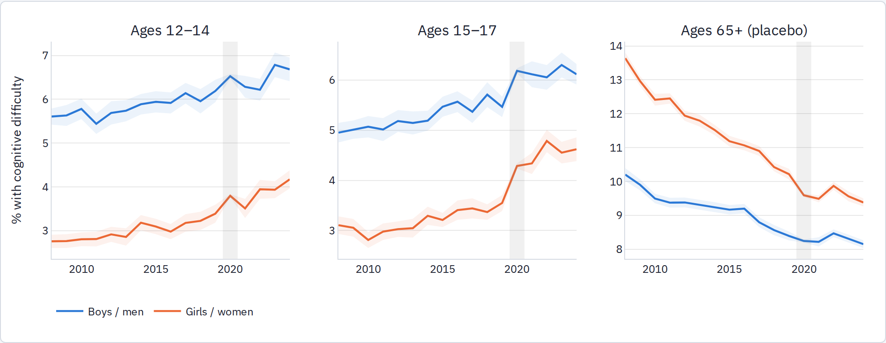

Shaded bands are 95% confidence intervals. The grey band marks the 2020 experimental ACS release, which suffered from pandemic-related nonresponse bias.

| Age   | Sex   | 2008–10 % | 2017–19 % | Rel. change | 2022–24 % | Rel. change |
|-------|-------|-----------|-----------|-------------|-----------|-------------|
| 12-14 | boys  | 5.67      | 6.10      | +7%         | 6.56      | +16%        |
| 12-14 | girls | 2.78      | 3.27      | +18%        | 4.02      | +45%        |
| 15-17 | boys  | 5.01      | 5.51      | +10%        | 6.16      | +23%        |
| 15-17 | girls | 2.99      | 3.45      | +15%        | 4.65      | +56%        |

#### Age gradient

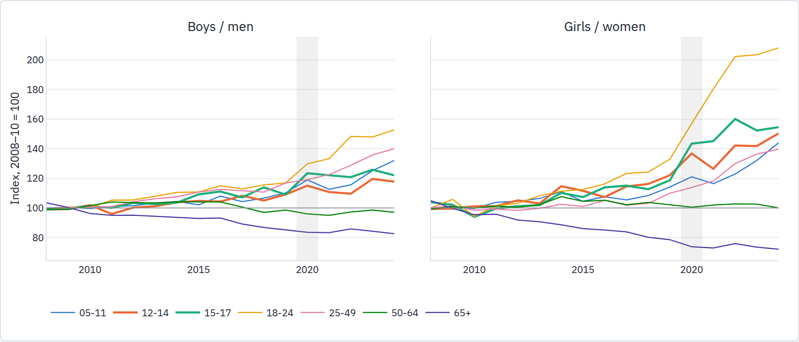

Each series plots the age group's rate indexed to its own 2008–10 mean (= 100). Thick lines highlight the adolescent age groups (12–14 and 15–17).

The ACS age series establish two basic facts. First, the pre-pandemic 2010s increase in cognitive difficulty is statistically clear but modest in absolute terms (about half a percentage point on a baseline of 3–5%), and it appears across all age groups under 50—rising fastest among 18–24-year-olds—while falling steadily among adults 65 and older. Second, the post-2020 surge is much steeper and is heavily concentrated among girls and young women. Because the ACS question is a severe disability screener, it will miss mood or anxiety disorders that do not impair daily concentration; the next section evaluates how well it tracks direct measures of adolescent depression.

### Does the ACS item measure adolescent distress?

Before using the ACS cognitive-difficulty item as an outcome, we test it against three criteria: whether its national timing matches established adolescent depression and sadness surveys, whether its increase is concentrated among girls, and whether state-level changes in the ACS item move with state-level changes in clinical depression. Because the public NHANES depression screener (PHQ-9) is released only for respondents aged 18 and older (the adolescent file is restricted), NHANES enters as an 18–24 benchmark.

#### National timing

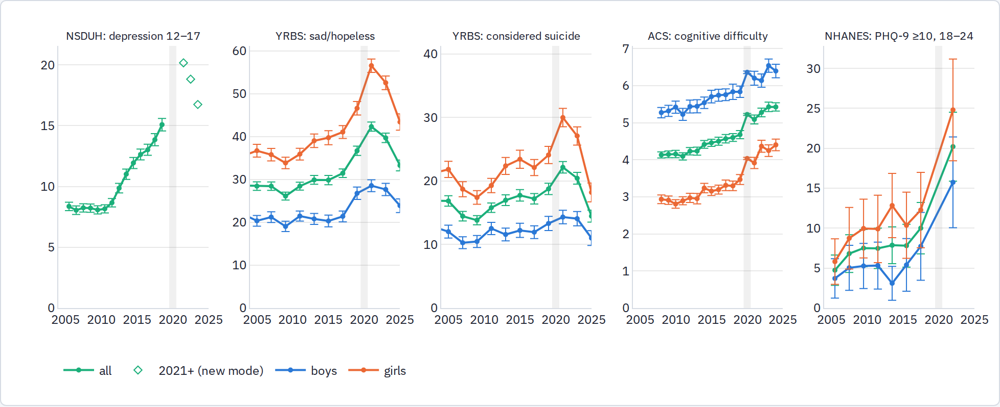

All series in percent, with 95% CIs. NSDUH points sit at the midpoint of each two-year period; the 2021+ NSDUH estimates use a new web mode and DSM-5 criteria and are not directly comparable to earlier years. YRBS sad/hopeless was first asked in 1999.

NSDUH past-year major depressive episodes among 12–17-year-olds held steady at roughly 8% from 2005 through 2010–11 and then rose in nearly every two-year wave to 15% by 2018–19. YRBS persistent sadness was flat from 1999 through 2011 before rising through 2019. The ACS cognitive-difficulty series turns upward around 2012 and accelerates after 2019. It inflects at roughly the same time as the mental-health surveys, though its relative increase over the 2010s is much smaller—about +13% overall, compared with +85% in NSDUH.

#### Sex pattern

| Series                         | Sex   | 2009–11 | 2017–19 | Relative change |
|--------------------------------|-------|---------|---------|-----------------|
| ACS cognitive difficulty 12–17 | boys  | 5.3     | 5.8     | +9%             |
| ACS cognitive difficulty 12–17 | girls | 2.9     | 3.4     | +17%            |
| YRBS sad/hopeless              | boys  | 20.3    | 24.1    | +19%            |
| YRBS sad/hopeless              | girls | 34.9    | 43.9    | +26%            |
| YRBS considered suicide        | boys  | 11.5    | 12.6    | +10%            |
| YRBS considered suicide        | girls | 18.3    | 23.1    | +26%            |
| NHANES PHQ-9 ≥10, 18–24        | boys  | 5.3     | 7.7     | +46%            |
| NHANES PHQ-9 ≥10, 18–24        | girls | 9.9     | 12.3    | +24%            |

Across all four sources, the relative increase is larger for girls than for boys. The ACS item passes this check: if the 2010s increase were driven primarily by childhood ADHD or learning-disability diagnoses, boys would dominate the change.

#### Do states move together?

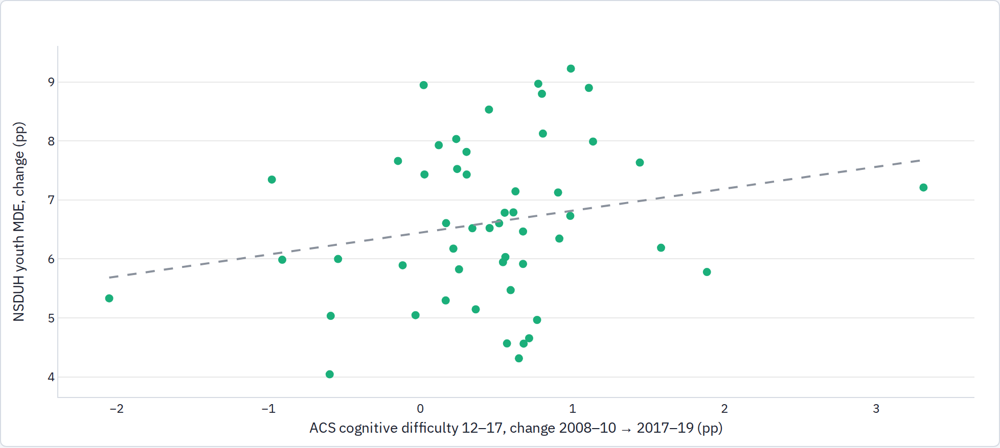

51 jurisdictions (50 states plus DC). Each point plots a state's change in both measures between 2008–10 and 2017–19; the dashed line is the OLS fit (slope 0.37, SE 0.18, r = 0.22).

In cross-section, state levels of the ACS item and NSDUH depression do not correlate, which is unsurprising given that one is a broad disability screener and the other is a diagnostic interview. Over time, however, their within-state changes move together: a state-and-period fixed-effects regression of NSDUH youth depression on the ACS cognitive-difficulty rate yields a slope of 0.14 (SE 0.05, p = 0.01) across 714 state-period observations, and the decade-long changes from 2008–10 to 2017–19 correlate at r = 0.22 (slope 0.37, SE 0.18). Against the YRBS state files (43 states, by sex), the ACS rate co-moves with persistent sadness at a slope of 0.30 (SE 0.19) with state-by-sex and year-by-sex fixed effects, though not with suicidal ideation.

**Assessment.** The ACS cognitive-difficulty item reproduces the female-led rise and co-moves with depression within states, making it usable for fine-grained geographic tests where no mental-health survey exists. Even so, it captures only about a sixth of the proportional rise in adolescent depression, and its girl-specific change is small relative to metro-level sampling error. For that reason, we pair every U.S. ACS test with state and county youth mental-health surveys.

### Geographic variation: is there anything to explain?

For a geographic rollout design to have statistical power, 2010s changes in adolescent distress must vary across local markets by more than sampling noise. Grouping the ACS into metropolitan areas (plus each state's non-metro remainder), the weighted mean change from 2008–10 to 2017–19 among 12–17-year-olds is +0.47 percentage points, the estimated true between-market standard deviation is 0.46 points, and the median market-level sampling error is 0.64 points (Cochran's Q = 218 on 116 df, I² ≈ 0.47). Real cross-market differences exist, but individual metro estimates are noisy and must be pooled in regression models.

117 markets with at least 1,500 sampled 12–17-year-olds in 2008–10. Dashed curves show the ±1.96 SE funnel around the pooled mean for a market of a given sample size.

#### States, by sex

Disaggregating state-level changes by sex reveals a major constraint for U.S. geographic designs: while boys' changes vary substantially across states (I² ≈ 0.46), girls' changes are nearly uniform nationwide (I² ≈ 0.05). Because the female series is the component that reflects internalizing distress, there is very little cross-state variation in the ACS for either a phone-rollout or a school-policy design to exploit.

#### Who is driving the rise

Relative changes by demographic and socioeconomic subgroup, ages 12–17. The largest proportional increases occur among adolescents in higher-income families and private schools.

#### By family income relative to poverty line

| Group       | Sex   | 2008–10 % | 2017–19 % | Rel. change to 2017–19 | Rel. change to 2022–24 | Share of 12–17, 2008–10 |
|-------------|-------|-----------|-----------|------------------------|------------------------|-------------------------|
| 100-199%    | boys  | 6.67      | 7.05      | +6%                    | +15%                   | 11%                     |
| 100-199%    | girls | 3.50      | 4.30      | +23%                   | +46%                   | 10%                     |
| 200-399%    | boys  | 4.55      | 5.17      | +14%                   | +31%                   | 16%                     |
| 200-399%    | girls | 2.38      | 2.91      | +22%                   | +78%                   | 16%                     |
| 400%+       | boys  | 2.95      | 3.73      | +26%                   | +48%                   | 16%                     |
| 400%+       | girls | 1.55      | 2.04      | +32%                   | +89%                   | 15%                     |
| poor \<100% | boys  | 8.61      | 9.02      | +5%                    | +11%                   | 8%                      |
| poor \<100% | girls | 4.88      | 5.45      | +12%                   | +36%                   | 8%                      |

#### By school type

| Group         | Sex   | 2008–10 % | 2017–19 % | Rel. change to 2017–19 | Rel. change to 2022–24 | Share of 12–17, 2008–10 |
|---------------|-------|-----------|-----------|------------------------|------------------------|-------------------------|
| not in school | boys  | 8.32      | 8.54      | +3%                    | +15%                   | 1%                      |
| not in school | girls | 6.21      | 5.82      | -6%                    | +25%                   | 1%                      |
| private       | boys  | 4.53      | 5.91      | +30%                   | +44%                   | 5%                      |
| private       | girls | 2.57      | 3.61      | +40%                   | +70%                   | 5%                      |
| public        | boys  | 5.33      | 5.71      | +7%                    | +17%                   | 45%                     |
| public        | girls | 2.82      | 3.26      | +16%                   | +50%                   | 43%                     |

#### By race / ethnicity

| Group          | Sex   | 2008–10 % | 2017–19 % | Rel. change to 2017–19 | Rel. change to 2022–24 | Share of 12–17, 2008–10 |
|----------------|-------|-----------|-----------|------------------------|------------------------|-------------------------|
| Asian-PI NH    | boys  | 1.66      | 2.24      | +35%                   | +90%                   | 2%                      |
| Asian-PI NH    | girls | 1.10      | 1.47      | +33%                   | +107%                  | 2%                      |
| Black NH       | boys  | 6.67      | 7.14      | +7%                    | +13%                   | 7%                      |
| Black NH       | girls | 3.69      | 3.94      | +7%                    | +26%                   | 7%                      |
| Hispanic       | boys  | 4.09      | 5.16      | +26%                   | +48%                   | 10%                     |
| Hispanic       | girls | 2.37      | 2.95      | +24%                   | +74%                   | 10%                     |
| Other-multi NH | boys  | 7.64      | 7.96      | +4%                    | -8%                    | 2%                      |
| Other-multi NH | girls | 4.50      | 4.73      | +5%                    | +7%                    | 2%                      |
| White NH       | boys  | 5.54      | 5.88      | +6%                    | +12%                   | 29%                     |
| White NH       | girls | 2.87      | 3.44      | +20%                   | +51%                   | 28%                     |

### State youth surveys at county level

To measure self-reported adolescent distress below the state level, we compiled county-level school survey tables from six states: Minnesota (1998–2019, 87 counties), Washington (2010–2025, 38 counties), Maine (2009–2023, 16 counties), California (2013–2025, 55 counties, by sex), Pennsylvania (2015–2025, 60 counties), and Illinois (2018–2024, 82 counties for sadness and 75 for suicidal ideation), totaling 40,849 county-grade-year cells with documented question wording and primary sources. Minnesota's pre-2013 sadness question asked about feeling sad over the past 30 days rather than the standard YRBS two-week item and is excluded from the sadness panel.

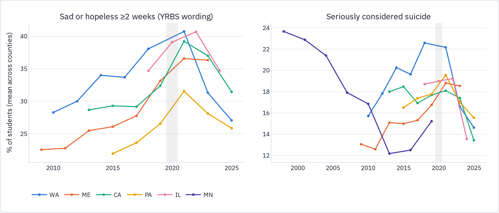

Unweighted county means across the grade levels each state reports in every survey wave (Washington grades 8, 10, and 12; Maine's 9–12 and Pennsylvania's 6–12 all-grade aggregates; Minnesota grade 9; California grades 7, 9, and 11 for sadness and 9 and 11 for suicidal ideation; Illinois grades 8, 10, and 12 for sadness and 10 and 12 for suicidal ideation). Minnesota's 2022 and 2025 county tables are behind a web portal CAPTCHA and are not yet included; California's 2019–21 to 2023–25 and Pennsylvania's 2025 waves were added in Phase 2.

The county panels highlight three notable patterns. First, persistent sadness rose across every state from roughly 2013 to a peak in 2021 (for example, from 28% to 41% in Washington, 23% to 37% in Maine, and 35% to 41% in Illinois). Second, Minnesota's 9th-grade suicidal-ideation series—the only county series extending back to the 1990s—*fell* steadily from 24% in 1998 to 12% in 2013 before turning upward to 15% by 2019. Third, the post-2021 waves show a substantial downturn: Washington's 2025 sadness rate (27%) is below its 2010 baseline, Illinois's 2024 suicidal-ideation rate (13.5%) is the lowest in its county series, Pennsylvania's 2025 sadness rate (26%) is below its 2019 level, and California's 2023–25 suicidal-ideation rate (13.4%) is its series low. Part 4 returns to these waves alongside the 2025 YRBS.

## Part 2 · Phones and social media (H1)

The phone hypothesis predicts that adolescent distress rose earlier in places where smartphones and fast mobile data arrived first, that heavier users experience worse mental health, and that similar patterns hold in developing countries where mobile phones are the primary way young people go online. The tests below move from coarse geographic exposure (metro 4G launch dates and state adoption shares, and, new in Phase 2, continuous county broadband coverage and the AT&T 2010 mobile footprint) to individual-level exposure in low- and middle-income countries, and end with the question of who reports the symptoms, using U.S. caregiver and adolescent reports from the NSCH and NHIS.

### 4G rollout across U.S. metros

If the arrival of fast mobile data drove the initial upturn in adolescent distress, teenagers in metropolitan areas that received commercial 4G LTE earliest should have experienced an earlier rise in cognitive difficulty and sadness.

We compiled commercial 4G LTE launch dates from carrier press releases and trade-press archives covering 967 carrier-market launches (Verizon 442, AT&T 243, Sprint 234, T-Mobile 47). Mapped to 2013 CBSA boundaries, these records establish a first-launch date for 98 of the 100 largest metropolitan areas and 279 of the 311 metros identified in the public ACS. Verizon's initial December 2010 rollout covered 36 of these metros, followed by 125 metros in 2011, 96 in 2012, and 14 in 2013. Each market's treatment onset is assigned to the first school year beginning after its initial commercial launch. Remaining coverage gaps (primarily Verizon's smaller 2013 rural market waves and roughly 44 AT&T launch dates outside the top 100 metros) are documented in the methods note.

#### Descriptive: onset cohorts

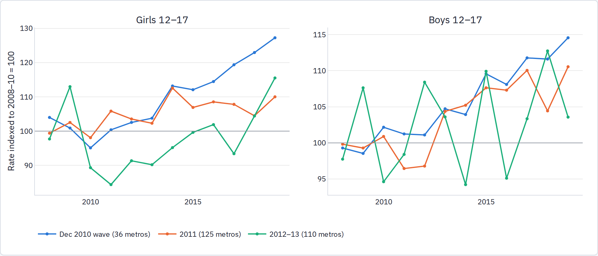

Population-weighted ACS cognitive-difficulty rate for 12–17-year-olds in metros grouped by first commercial LTE launch, indexed to each cohort's 2008–10 mean.

If early 4G availability accelerated adolescent distress, metros in the December 2010 and 2011 launch waves should have pulled ahead of the 2012–13 wave between 2011 and 2013. Through 2013, however, the three cohorts move closely together. Starting in 2014, girls in the December 2010 cohort drift higher (reaching an index of 127 by 2019 versus 110–116 in later cohorts), but that earliest cohort consists of the 36 largest metros—where the affluent-teen composition shift documented in Part 1 is concentrated—and the divergence appears three years after launch. In the event-study regressions below, the coefficients for girls four to six years after launch are +0.6 to +1.1 pp with standard errors near 1 pp.

#### Event study

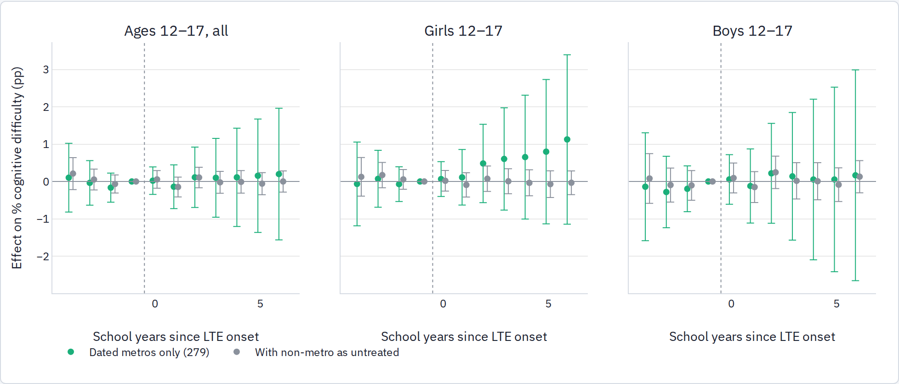

Estimated effect by school year relative to initial LTE launch (with the year prior to launch as the reference period), including market and year fixed effects, population weights, and standard errors clustered by market. Green: the 279 metros with a dated launch, identifying off rollout timing alone. Grey: adds the 32 undated metros and state non-metro remainders coded as never treated (an upper-bound contrast, since rural areas received LTE around 2013–14).

| Onset definition | Sample                    | 12–17 all    | Girls        | Boys         | 65+ placebo  | 25–49        |
|------------------|---------------------------|--------------|--------------|--------------|--------------|--------------|
| First carrier    | dated metros              | +0.02 (0.15) | −0.04 (0.19) | +0.03 (0.27) | +0.03 (0.15) | +0.11 (0.08) |
| Verizon          | dated metros              | +0.01 (0.16) | −0.11 (0.20) | +0.05 (0.29) | +0.07 (0.16) | +0.11 (0.08) |
| Second carrier   | dated metros              | −0.01 (0.15) | −0.11 (0.17) | +0.20 (0.23) | +0.28 (0.14) | +0.09 (0.07) |
| First carrier    | \+ non-metro as untreated | 0.00 (0.09)  | −0.08 (0.10) | +0.11 (0.13) | +0.12 (0.11) | −0.10 (0.06) |

Static difference-in-differences coefficient on "LTE in force" in percentage points, with standard errors in parentheses. Permuting onset dates across markets yields a placebo standard error of roughly 0.07 pp for the full panel.

**Assessment.** Staggered 4G LTE launch dates across U.S. metropolitan areas do not predict the timing of the rise in the ACS cognitive-difficulty item. For girls, the 95% confidence interval rules out effects larger than +0.33 pp on the dated-metro sample and +0.12 pp when including non-metro controls, compared with a national 2010–2019 increase of roughly 0.5 pp. Three limitations prevent this null result from ruling out H1: commercial LTE launches were compressed into a narrow 2011–2012 window across most major metros; adolescent social-media norms spread across markets through national platforms; and the ACS disability item captures only a fraction of internalizing distress. What the result does establish is that a metro-level rollout design using the ACS cannot detect a smartphone effect. In the next subsection we re-run the same geographic timing test on county-level youth mental-health surveys, and in the reconciliation section we compare our setup with Elaine Guo's British Columbia wireless study, which found a large effect on clinical school designations in rural mountain towns.

### Rollout and adoption at county level, state youth surveys

#### LTE onset at county level

We link counties to 2013 CBSAs and their initial commercial 4G LTE launch dates. The unit of observation is a county-by-grade panel series with county-by-grade and state-by-year fixed effects, ensuring that changes in which grades a state surveys cannot register as changes in distress. Non-metro and undated counties serve as the comparison group (providing an upper-bound contrast, since rural LTE arrived around 2013–14), and standard errors are clustered by CBSA (or by county outside metro areas). Because the state surveys are biennial or triennial, no single pre-launch year is observed for every cohort, so event-study specifications pool the three years prior to LTE launch as the reference period.

| Panel                                                                                                        | DiD on "LTE in force" (pp) |
|--------------------------------------------------------------------------------------------------------------|----------------------------|
| Sad/hopeless, WA + ME counties, 2009-2019 (54 counties, 26 dated-metro, 130 county-grade series)             | +0.64 (SE 0.87)            |
| Considered suicide, WA + ME + MN counties, 1998-2019 (141 counties, 59 dated-metro, 217 county-grade series) | -0.72 (SE 0.43)            |
| Considered suicide, MN counties, 1998-2019 (87 counties, 33 dated-metro, 87 county-grade series)             | -1.82 (SE 0.67)            |

#### Smartphone adoption at the metro level

| Outcome            | Sex    | Effect per +10 pp teen-household smartphone internet (SE) | Counties / CBSAs | States                 |
|--------------------|--------|-----------------------------------------------------------|------------------|------------------------|
| sad hopeless       | all    | +0.13 (0.13)                                              | 89 / 42          | CA, IL, ME, PA, WA     |
| sad hopeless       | female | +0.22 (0.25)                                              | 32 / 21          | CA, ME                 |
| sad hopeless       | male   | -0.11 (0.14)                                              | 32 / 21          | CA, ME                 |
| considered suicide | all    | +0.06 (0.15)                                              | 105 / 46         | CA, IL, ME, MN, PA, WA |
| considered suicide | female | -0.04 (0.33)                                              | 31 / 21          | CA, ME                 |
| considered suicide | male   | -0.39 (0.13)                                              | 31 / 21          | CA, ME                 |

NTIA CBSA smartphone-internet shares interpolated between waves (restricted to CBSAs with at least 30 unweighted respondents), with county-by-grade and state-by-year fixed effects and standard errors clustered by CBSA, 2011–2019.

**Assessment.** Measuring self-reported sadness and suicidal ideation at the county level yields the same conclusion as the ACS metro panel: neither 4G LTE launch timing nor metro-level smartphone adoption predicts where adolescent distress rose fastest. The only coefficient exceeding two standard errors—Minnesota suicidal ideation after LTE onset (−1.82 pp, SE 0.67)—is negative and reflects the continuation of metro counties' steeper pre-2011 decline rather than a discrete break at LTE launch. Likewise, the positive state-level YRBS correlation between smartphone adoption and girls' sadness does not carry over to the county panels (+0.13 pp per 10 points overall across five states, SE 0.13; +0.22 pp for girls in California and Maine, SE 0.25). Across counties with very different connectivity timelines, the 2010s rise occurred almost simultaneously, and the recent post-2021 waves show a broad decline.

### Continuous broadband coverage and the AT&T 2010 footprint at county level

Part 2 interpreted the null for 4G LTE launch dates as a timing problem: the 2011-13 metro upgrades came after smartphones and mobile social media had already spread, and were compressed into two years. This section replaces the launch dates with two public county series that carry more variation. The first is continuous coverage: the share of each county's population with wireline, fixed and mobile broadband available, by advertised speed tier, from the NTIA State Broadband Initiative's National Broadband Map (nine semiannual rounds, June 2010 to June 2014, block-level files aggregated with Census block populations and NTIA's county "Analyze" tables) spliced to the FCC Form 477 fixed-deployment files and county Area Tables (fourteen rounds, December 2014 to June 2021). The second is the instrument used by [Myers and Hooper (2026)](https://www.nber.org/papers/w35310): the share of county population living in 2000 Census blocks with any AT&T Mobility mobile-wireless coverage in the December 2010 release, a snapshot of the network that carried the iPhone during AT&T's June 2007 to February 2011 exclusivity. Myers and Hooper use this same public release (not a proprietary carrier map), code a block as covered if any AT&T polygon touches it, and classify counties with more than 90% of population covered as treated and under 10% as control; our reconstruction yields 892 treated, 1,447 control and 802 intermediate counties against their 822, 1,490 and 795, with a mean county share of 44%. AT&T's 2010 footprint is metropolitan (75% of population covered in metro counties versus 25% elsewhere) and only loosely related to the 4G timing used in Part 2 (correlation with the LTE onset year -0.26; counties whose metro had LTE by the 2012 school year averaged 76% coverage versus 29% for later or undated metros) or to Verizon's footprint (r = +0.22). Methods, sources and carrier roll-ups are in `notes/broadband.md`; the compiled tables are `data/compiled/broadband/county_broadband_panel.csv` and `county_att_mobile_2010.csv`.

Across all counties, wireline availability was already high in December 2010 (87% of population on average) and barely moved to 2021 (92%); the variation is in speed. Wireline service at 25 Mbps or faster reached 25% of county population in December 2010, 54% in December 2013, 67% in December 2016 and 82% in June 2021, mostly cable DOCSIS 3 upgrades that reached rural counties last. Mobile wireless covered 95% of county population in December 2010 and 98% by June 2014, when the NTIA series ends; the FCC's later mobile data are provider shapefiles without a county summary and were not used.

#### Continuous dose, 2010-2021

The design is Phase 1's: county-by-grade series with county-by-grade and state-by-year fixed effects, standard errors clustered by 2013 CBSA, each coverage measure interpolated to the survey spring. The coefficients are per 10 percentage points of county population gaining access.

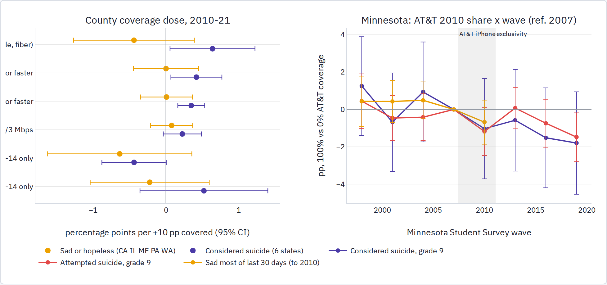

Left: effect of +10 pp of county population covered on the share of students sad or hopeless (CA, IL, ME, PA, WA) and considering suicide (CA, IL, ME, MN, PA, WA), 2010-2021, county x grade and state x year fixed effects, 95% intervals clustered by CBSA. Right: Minnesota 1998-2019, coefficient on the county's AT&T December-2010 coverage share interacted with each survey wave (2007, the last pre-iPhone wave, is the reference), county x grade and year fixed effects; a value of -1 means that a fully covered county moved 1 pp lower than an uncovered county relative to 2007.

<table>
<colgroup>
<col style="width: 12%" />
<col style="width: 12%" />
<col style="width: 12%" />
<col style="width: 12%" />
<col style="width: 12%" />
<col style="width: 12%" />
<col style="width: 12%" />
<col style="width: 12%" />
</colgroup>
<thead>
<tr class="header">
<th>County coverage measure</th>
<th>Sad/hopeless, all</th>
<th>girls (CA, ME)</th>
<th>boys (CA, ME)</th>
<th>Considered suicide, all</th>
<th>girls (CA, ME)</th>
<th>boys (CA, ME)</th>
<th>Considered suicide, all, 2010-19 only</th>
</tr>
</thead>
<tbody>
<tr class="odd">
<td>Any wireline (DSL, cable, fiber)</td>
<td>-0.44 (0.42) 
n=1752, 218 counties</td>
<td><strong>-1.43 (0.61)</strong> 
n=755, 69 counties</td>
<td>+0.01 (0.35) 
n=755, 69 counties</td>
<td><strong>+0.64 (0.30)</strong> 
n=1691, 294 counties</td>
<td>+0.43 (0.77) 
n=535, 69 counties</td>
<td>+0.81 (0.54) 
n=535, 69 counties</td>
<td>+0.59 (0.31)</td>
</tr>
<tr class="even">
<td>Wireline, 10 Mbps or faster</td>
<td>+0.00 (0.23) 
n=1752, 218 counties</td>
<td>-0.41 (0.39) 
n=755, 69 counties</td>
<td>+0.35 (0.27) 
n=755, 69 counties</td>
<td><strong>+0.42 (0.18)</strong> 
n=1691, 294 counties</td>
<td>+0.75 (0.42) 
n=535, 69 counties</td>
<td><strong>+0.78 (0.27)</strong> 
n=535, 69 counties</td>
<td><strong>+0.40 (0.19)</strong></td>
</tr>
<tr class="odd">
<td>Wireline, 25 Mbps or faster</td>
<td>+0.01 (0.18) 
n=1752, 218 counties</td>
<td>-0.25 (0.26) 
n=755, 69 counties</td>
<td>+0.04 (0.22) 
n=755, 69 counties</td>
<td><strong>+0.35 (0.09)</strong> 
n=1691, 294 counties</td>
<td>+0.40 (0.29) 
n=535, 69 counties</td>
<td>+0.29 (0.23) 
n=535, 69 counties</td>
<td><strong>+0.46 (0.12)</strong></td>
</tr>
<tr class="even">
<td>Fixed terrestrial, 25/3 Mbps</td>
<td>+0.08 (0.15) 
n=1752, 218 counties</td>
<td>-0.20 (0.21) 
n=755, 69 counties</td>
<td>-0.11 (0.20) 
n=755, 69 counties</td>
<td>+0.23 (0.13) 
n=1691, 294 counties</td>
<td>+0.38 (0.24) 
n=535, 69 counties</td>
<td>+0.22 (0.26) 
n=535, 69 counties</td>
<td>+0.17 (0.16)</td>
</tr>
<tr class="odd">
<td>Mobile wireless (3G/4G), 2010-14 only</td>
<td>-0.64 (0.51) 
n=330, 52 counties</td>
<td>-</td>
<td>-</td>
<td>-0.44 (0.23) 
n=502, 138 counties</td>
<td>-</td>
<td>-</td>
<td>-0.44 (0.23)</td>
</tr>
<tr class="even">
<td>Any technology, 10 Mbps, 2011-14 only</td>
<td>-0.22 (0.42) 
n=212, 50 counties</td>
<td>-</td>
<td>-</td>
<td>+0.52 (0.45) 
n=212, 50 counties</td>
<td>-</td>
<td>-</td>
<td>+0.52 (0.45)</td>
</tr>
</tbody>
</table>

Coefficient (SE) per +10 pp of county population covered, county x grade series 2010-2021 (the mobile measure ends in 2014). Bold: \|t\| \> 1.96. The last column repeats the all-sex ideation estimate on 2010-2019 surveys, before the pandemic waves.

Any-wireline availability, which varies little, is unrelated to sadness (-0.44 (0.42) pp per 10 pp) and weakly positive for suicidal ideation (+0.64 (0.30)). The speed tiers that did spread during the decade are positively associated with ideation: +0.42 (0.18) pp per 10 pp of population gaining 10 Mbps wireline and +0.35 (0.09) for 25 Mbps, with n = 1,691 county-grade-years in 294 counties; restricted to 2010-2019 the 25 Mbps estimate is +0.46 (0.12) and the 10 Mbps estimate +0.40 (0.19). Sadness shows nothing comparable (+0.01 (0.18) for 25 Mbps). Where sex splits exist (California and Maine), the ideation gradient is similar for girls (+0.40 (0.29)) and boys (+0.29 (0.23)), and girls' sadness is if anything negative (-0.25 (0.26)). Mobile coverage over 2010-2014, the measure closest to smartphone access, points the other way: -0.44 (0.23) for ideation and -0.64 (0.51) for sadness, in the counties (mostly rural) that were still gaining 3G/4G coverage.

Two scalings put the ideation gradient in context. Within-county variation in 25 Mbps wireline coverage over the period has a standard deviation of 14 pp, so one within-county standard deviation corresponds to +2.7% of the mean ideation rate (17.8%); [Churchill and Johnson](https://www.nber.org/papers/w34614) report 9.3-16.5% per state-level standard deviation of access. The Phase 1 metro LTE contrast on the same panels gave -0.72 (0.43) pp for ideation and +0.64 (0.87) for sadness, and the NTIA smartphone-adoption dose +0.06 (0.15) per 10 pp. The wireline-speed gradient is therefore the first positive county-level connectivity association in these panels, but it is a gradient in cable upgrades that arrived late in rural counties whose ideation rates also rose late, with state-by-year effects removing only the state-wide part of that timing; it is not a smartphone measure, and the mobile measure that is one has the opposite sign.

#### The AT&T 2010 footprint and Minnesota's 1998-2019 county series

Minnesota's biennial-to-triennial county tables (1998, 2001, 2004, 2007, 2010, 2013, 2016, 2019; 87 counties) are the only county series that bracket the iPhone-exclusivity window. If early smartphone access raised distress, counties with AT&T coverage should have pulled above uncovered counties after 2007. They did not. Relative to 2007, fully covered counties were -1.03 (1.37) pp lower in 2010, -0.58 (1.39) in 2013 and -1.80 (1.40) in 2019 on grade-9 suicidal ideation, with pre-period coefficients of +1.25 (1.35) (1998) and +0.93 (1.36) (2004). Pooled, AT&T coverage x post-2007 is -1.59 (0.82) pp for ideation (mean 21.4% before 2007), -0.72 (0.43) for attempts, and -1.02 (0.45) for the 30-day sadness item that ends in 2010; the Myers-Hooper binary contrast gives -1.66 (0.90) for ideation. Pre-trends are flat (-0.24 (0.40) pp per wave for ideation). Verizon's footprint, whose customers could not buy an iPhone until February 2011, shows no comparable pattern (+2.67 (1.95)).

| Minnesota item                               | Mean to 2007 (%) | Pre-trend 1998-2007 (pp per wave) | AT&T share x post-2007 (pp) | Treated vs control x post (pp) | Verizon share x post (pp) | n / counties |
|----------------------------------------------|------------------|-----------------------------------|-----------------------------|--------------------------------|---------------------------|--------------|
| Considered suicide (grade 9, 1998-2019)      | 21.4             | -0.24 (0.40)                      | -1.59 (0.82)                | -1.66 (0.90)                   | +2.67 (1.95)              | 684 / 87     |
| Attempted suicide (grade 9, 1998-2019)       | 6.4              | -0.16 (0.23)                      | -0.72 (0.43)                | **-0.98 (0.43)**               | -0.00 (0.78)              | 684 / 87     |
| Sad all/most of the last 30 days (1998-2010) | 11.8             | -0.13 (0.22)                      | **-1.02 (0.45)**            | **-1.18 (0.44)**               | -0.86 (0.95)              | 1291 / 87    |
| Discouraged or hopeless, 30 days (1998-2010) | 12.3             | -0.18 (0.20)                      | -0.94 (0.51)                | -0.85 (0.49)                   | -2.64 (1.10)              | 1291 / 87    |
| Nervous or worried, 30 days (1998-2010)      | 13.8             | +0.15 (0.20)                      | -0.60 (0.48)                | -0.65 (0.47)                   | -1.42 (1.18)              | 1291 / 87    |
| Under great stress, 30 days (1998-2010)      | 30.4             | -0.25 (0.34)                      | -0.81 (0.77)                | -1.04 (0.74)                   | +0.78 (1.33)              | 1291 / 87    |

Minnesota Student Survey county series, county x grade and year fixed effects, standard errors clustered by CBSA (county outside CBSAs). AT&T share is the share of county population in blocks with AT&T mobile coverage, December 2010 (0-1), so a coefficient is the difference between a fully covered and an uncovered county. The 30-day items were last asked in 2010. "Treated vs control" follows Myers and Hooper (\>90% vs \<10%, intermediate counties dropped).

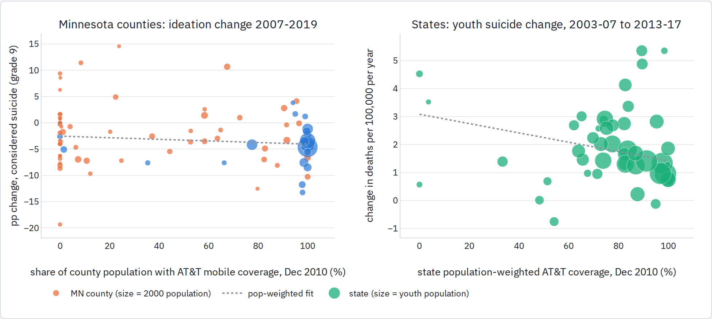

Left: Minnesota counties, change in grade-9 suicidal ideation between the 2007 and 2019 waves against the AT&T December-2010 coverage share (blue: metropolitan counties; dotted line: population-weighted fit, slope -1.52 (0.98) pp per unit share; +0.37 (1.53) with metro and log-population controls; the 2001-2007 placebo change gives +0.19 (0.81)). Right: states, change in the average annual youth (10-19) suicide rate between 2003-07 and 2013-17 against the state population-weighted AT&T share (CDC WONDER, no suppression at state level).

Extending the same test to the five states whose county series begin after 2007 can only ask whether high-AT&T counties kept diverging during 2010-2019. Pooled across all six states with county-by-grade and state-by-year effects, the differential trend is -2.01 (0.97) pp per decade for ideation (318 counties) and -0.41 (3.35) for sadness; by sex in California and Maine, -7.56 (3.48) for girls and -4.49 (2.64) for boys. Maine's 16 counties show no cross-sectional gradient in 2009 and none in the 2009-2019 change (correlations between -0.2 and +0.1).

#### County and state youth suicide

CDC WONDER's web form (the API refuses sub-national queries) supplied suicide deaths and population for ages 10-19 by county for 1999-2002, 2003-07, 2008-12, 2013-17 and 2018-22, with counts under 10 suppressed. Suppression binds hard at this age: only about 56% of youth live in counties with reportable counts in both 2003-07 and 2013-17, and the reportable set mixes large counties with small counties that happened to record zero deaths. The AT&T estimate changes sign with the treatment of suppressed cells (+1.23 (0.48) deaths per 100,000 per year, for a fully covered versus uncovered county, on reportable counties; -2.04 (0.63) when suppressed counts are set to the midpoint 5), and the 176 large counties where suppression is rare have almost no AT&T variation (mean share 99%, SD 0.01). The county suicide test is therefore not informative with public data; the state series, which has no suppression, is the usable fallback.

| Youth (10-19) suicide, change in deaths per 100,000 per year, 2003-07 to 2013-17, on AT&T share (0-1) | n (share of U.S. youth)     | No controls      | Metro + log youth population                                     |
|-------------------------------------------------------------------------------------------------------|-----------------------------|------------------|------------------------------------------------------------------|
| Counties with unsuppressed counts in both periods (zeros reported, 1-9 suppressed)                    | 903 (56% of youth)          | **+1.23 (0.48)** | +0.70 (0.56)                                                     |
| All counties, suppressed counts set to the midpoint 5                                                 | 3138 (100%)                 | **-2.04 (0.63)** | -1.04 (0.66)                                                     |
| girls, unsuppressed counties                                                                          | 1752 (28%)                  | **+0.24 (0.09)** | -0.06 (0.04)                                                     |
| girls, all counties, midpoint-imputed                                                                 | 3138 (100%)                 | **-4.06 (0.90)** | -0.18 (1.29)                                                     |
| boys, unsuppressed counties                                                                           | 959 (49%)                   | **+2.05 (0.63)** | **+1.65 (0.80)**                                                 |
| boys, all counties, midpoint-imputed                                                                  | 3138 (100%)                 | **-4.18 (1.10)** | -2.37 (1.30)                                                     |
| **States, all youth**: state AT&T share x post-2007, 1999-2024 state x year panel, state + year FE    | 1162 state-years, 50 states | **-1.87 (0.73)** | +0.68 (1.64) (non-metro share x post) |
| **States, girls**: state AT&T share x post-2007, 1999-2024 state x year panel, state + year FE        | 557 state-years, 50 states  | +0.03 (0.83)     | +3.94 (3.91) (non-metro share x post) |
| **States, boys**: state AT&T share x post-2007, 1999-2024 state x year panel, state + year FE         | 1092 state-years, 49 states | **-2.71 (1.07)** | +0.54 (2.32) (non-metro share x post) |

County rows: change in the average annual suicide rate per 100,000 youths aged 10-19 between 2003-07 and 2013-17, regressed on the AT&T December-2010 coverage share with state fixed effects and youth-population weights. State rows: state x year panel 1999-2024 (CDC WONDER, no suppression for all youth and boys), rate on the state's population-weighted AT&T share x post-2007 with state and year fixed effects, youth-population weights and standard errors clustered by state; the last column adds the state's non-metro population share x post-2007. Bold: \|t\| \> 1.96.

At state level, youth suicide rose by -1.87 (0.73) deaths per 100,000 per year more after 2007 in a fully AT&T-covered state than in an uncovered one (mean pre-2007 rate 4.4); the 1999-2007 pre-trend is +0.30 (1.24) per decade and the 1999-2002 to 2003-07 placebo change +0.17 (0.64). Girls: +0.03 (0.83); boys: -2.71 (1.07). With the state non-metro population share x post-2007 added, the AT&T coefficient is +0.68 (1.64) and the non-metro term +3.36 (1.92): the 2010s rise in youth suicide was a rural rise, and the AT&T 2010 footprint is first of all an urbanicity map. Fifty-one states give little power, and state-year counts for girls are mostly suppressed, so this is a weak test.

#### What the broadband literature identifies

| Study                                                                             | Identifying variation                                                                                                                                                                              | Outcome and finding                                                                                                                                                                         |
|-----------------------------------------------------------------------------------|----------------------------------------------------------------------------------------------------------------------------------------------------------------------------------------------------|---------------------------------------------------------------------------------------------------------------------------------------------------------------------------------------------|
| [Myers & Hooper 2026](https://www.nber.org/papers/w35310) (NBER 35310)            | County AT&T mobile-broadband coverage in the NTIA SBI December-2010 release x the June 2007 - February 2011 iPhone exclusivity; counties with more than 90% vs less than 10% of population covered | County birth rates (NCHS): births to 15-19-year-olds fell 2.0-9.0% (abstract, October 2026 revision), 20-24 1.5-7.2%; smartphone diffusion explains 12-53% of the 2007-11 fertility decline |
| [Churchill & Johnson 2026](https://www.nber.org/papers/w34614) (NBER 34614)       | State broadband access built from FCC deployment data, 2009-2019 (county coverage rose from under 70% to about 90%)                                                                                | National and state YRBS: a one-SD rise in access raises suicidal ideation 9.3-16.5%, largest for girls; more cyberbullying and body dissatisfaction (girls), less sleep (boys)              |
| [Johnson & Persico 2024](https://www.nber.org/papers/w32517) (NBER 32517)         | County broadband access growth 2000-2008                                                                                                                                                           | All-age suicides: a 10% rise in the share with access lowers county suicides 1.01%, via poverty and unemployment; effects among adults 25-64                                                |
| [Wang 2026](https://doi.org/10.58567/jie04010001) (J. Information Economics 4(1)) | State broadband connections per capita 2006-2023 instrumented with county distance to rivers/coasts and 1870 railroad length                                                                       | Suicide deaths ages 15-24: one SD more connections (0.06 per capita) lowers the crude rate by 4.97 per 100,000 (2SLS)                                                                       |
| [Donati et al. 2025](https://doi.org/10.2139/ssrn.3949645) (JHE)                  | Italian municipalities' access to high-speed internet                                                                                                                                              | Youth mental-health diagnoses rise (as cited in Part 2)                                                                                                                                     |
| [Arenas-Arroyo et al. 2025](https://doi.org/10.1016/j.jhealeco.2025.103014) (JHE) | Spanish fibre-to-the-home rollout 2007-2019                                                                                                                                                        | Adolescent hospital mental-health and self-harm diagnoses rise, concentrated among girls                                                                                                    |
| [Golin 2022](https://doi.org/10.1002/hec.4570) (Health Economics)                 | German DSL availability shaped by legacy telephone infrastructure                                                                                                                                  | Worse mental health for women; widening gender gap                                                                                                                                          |
| [McDool et al. 2020](https://doi.org/10.1016/j.jhealeco.2019.102274) (JHE)        | UK neighbourhood broadband speed                                                                                                                                                                   | Lower well-being among children, especially girls                                                                                                                                           |
| [Guo 2023](http://hdl.handle.net/1807/130332)                                     | British Columbia mountain towns gaining high-speed fixed wireless after 2014                                                                                                                       | Girls' severe school mental-health designations rise about 1 pp                                                                                                                             |

**Assessment.** Replacing LTE launch dates with continuous coverage and the AT&T 2010 footprint sharpens the county test without changing its answer on H1's rollout channel. The one positive association, between wireline speed upgrades and suicidal ideation (+0.35 (0.09) pp per 10 pp at 25 Mbps), is small relative to Churchill and Johnson's state estimates, absent for sadness and for the mobile measure, and tracks cable upgrades that reached rural counties last; it is consistent with the home-broadband studies from Europe but does not isolate smartphones. The AT&T 2007-11 instrument, which Myers and Hooper show predicted early iPhone adoption and lower teen births, predicts no rise in Minnesota adolescents' suicidal ideation, attempts or 30-day sadness after 2007 (coefficients between -1.6 and -0.7 pp for full coverage, standard errors 0.4-0.8) and no differential 2010-19 trend across six states; county youth suicide cannot be tested with public suppressed counts, and the state series is a weak test. For H1 this means that the geographic separation in early smartphone access that Myers and Hooper exploit left no visible mark on the one U.S. county mental-health series that spans it, which fits Part 2's conclusion that the 2010s rise was close to simultaneous across places; H2, H3 and H0 are not addressed here. A stronger design needs an outcome measured across the 2007-11 window in many states (restricted-use YRBS state files with county codes, or NSDUH substate estimates) rather than Minnesota alone.

### Adoption rather than rollout: smartphone use against the state youth survey

Because commercial 4G launch dates are a coarse measure of when teenagers actually went online on phones, we next test whether state-level smartphone adoption predicts adolescent sadness. Using the harmonized NTIA series (the share of persons in households with a 12–17-year-old who use a smartphone for internet, interpolated between the 2011–2019 CPS waves) against the YRBS state files across 43 states from 2011 to 2019, with state and year fixed effects:

| Outcome                               | Measure of adoption                | Effect per +10 pp of adoption (SE) |
|---------------------------------------|------------------------------------|------------------------------------|
| YRBS sad/hopeless, girls              | teen-household smartphone internet | **+0.92 (0.43)**                   |
| YRBS sad/hopeless, boys               | same                               | +0.33 (0.40)                       |
| YRBS sad/hopeless, girls              | household mobile data plan         | +0.49 (0.51)                       |
| ACS cognitive difficulty 12–17, girls | teen-household smartphone internet | −0.04 (0.07)                       |

The state-level estimates align with the pattern predicted by H1—positive for girls rather than boys, and appearing on the self-reported YRBS sadness item rather than the ACS disability screener—but the evidence is fragile: it rests on five biennial YRBS waves, interpolated state adoption shares, and a p-value near 0.03 across 43 state clusters. Moreover, the county-level version of the same regression in the state youth surveys does not reproduce this relationship, so we treat the state-level correlation as suggestive.

### Smartphone adoption in the United States, 2009–2023

Because IPUMS CPS includes only a subset of the Computer and Internet Use Supplement and omits the mobile-phone questions, we rebuilt the adoption series from the raw Census supplement files from October 2009 through November 2023 following NTIA's harmonization code. These files supply the pre-2016 smartphone and mobile-data adoption measures that the ACS lacks. The grey band marks the 2015 questionnaire redesign, which breaks the household mobile-data series (capturing at-home mobile broadband before 2015 and any-location mobile data plans from 2015 onward).

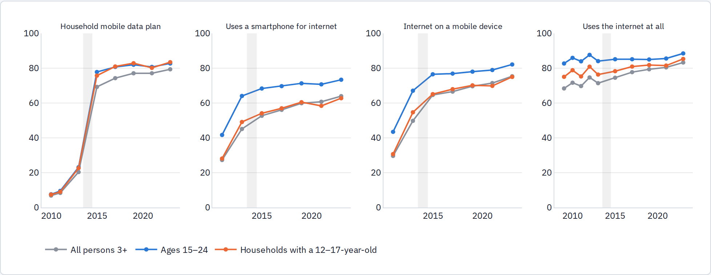

Weighted shares by wave. Smartphone-internet use reflects "use a cellular phone or smartphone to access the internet" in 2011 and 2013 (all persons) and NTIA's internet-enabled-phone definition from 2015 onward. In 2012 the phone items were asked only of the primary household respondent and are omitted here.

Smartphone internet use in households with a teenager rose from roughly 30% in 2011 to 45% in 2013 and 55% in 2015, before approaching saturation by 2017. Across states, teen-household smartphone use varied by 20 to 30 percentage points during the 2011–2015 transition window, providing the cross-state adoption variation used in our U.S. regression tests.

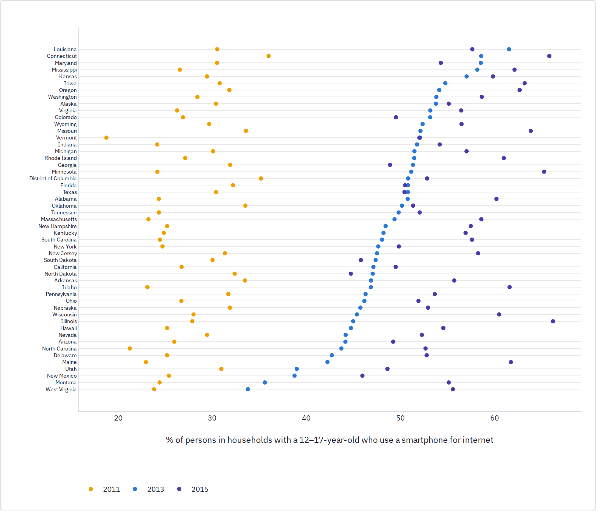

States ordered by their 2013 share. CBSA-level shares for 260–295 metropolitan areas per wave are also included in the compiled extract; county regressions restrict to CBSAs with at least 30 unweighted respondents.

### Phone-first countries: MICS Child Functioning Module (69 surveys, 2017–2025)

MICS6 and MICS7 surveys (2017 onward) administer the Washington Group / UNICEF Child Functioning Module for children aged 5–17, asking the mother or primary caregiver how often the child "seems very anxious, nervous or worried" and how often the child seems "very sad or depressed" (daily, weekly, monthly, a few times a year, or never), using identical wording across countries. In the same households, women aged 15–49 (and men in roughly half the surveys) report mobile-phone ownership and how often they used the internet and a mobile phone over the past three months, while the household questionnaire records home internet access. Reading all 69 MICS samples with the module on the IPUMS-MICS server (the 68 used in Phase 1 plus Bangladesh 2025, released in October 2026) yields 544,018 children with valid responses and weights across 68 surveys (54 of which also include the young-adult internet items).

##### Prevalence across surveys

One point per survey (ages 10–17, across the 54 surveys that also record young-adult internet use). Cross-survey variation in caregiver-reported anxiety is wide—ranging from under 1% in Laos, Tuvalu, Vietnam, and Turkmenistan to 40–50% in Tunisia, Afghanistan, the Central African Republic, and Chad—and largely reflects national reporting norms, which is why all tests below compare children within the same country and region.

##### Use and symptoms within countries

Cluster rows regress children's daily/weekly anxiety on the share of 15–24-year-olds in their sampling cluster who use the internet almost daily (or own a mobile phone, or the household internet share), with survey-by-region fixed effects, household wealth quintile, urban/rural status, and age controls, and standard errors clustered by sampling cluster. Own-use rows link 15–17-year-olds to their own individual record in the women's or men's questionnaire (85% of girls matched, 24% of boys) and compare users with non-users within the same sampling cluster.

Girls aged 10–17 living in sampling clusters where more young adults use the internet daily are reported as slightly more anxious (+0.24 pp per 10-percentage-point rise in the cluster share, SE 0.12). However, a similar positive association appears for 5–9-year-old girls (+0.14 pp, SE 0.11), who are too young to use phones themselves, indicating that this reflects characteristics of more connected communities rather than adolescent phone use. Cluster-level mobile-phone ownership is *negatively* associated with caregiver-reported anxiety across all age and sex groups; household internet access shows a small positive association for 10–17-year-old girls (+0.21 pp per 10 points, SE 0.12, and +0.01 pp at ages 5–9); and caregiver-reported depression shows no positive relationship with any connectivity measure. Comparing 15–17-year-olds who use the internet or a phone daily with non-users in the same sampling cluster—the closest MICS equivalent to individual-level screen exposure—yields point estimates for girls that are near zero or slightly negative: −0.1 pp on anxiety (SE 1.4) and −1.8 pp on depression (SE 1.3) for daily internet use, and −2.2 pp on anxiety (SE 1.2) for daily phone use. For boys, the within-cluster own-phone-use coefficients are positive (+4.4 pp on anxiety and +5.5 pp on depression, SE 2.3 and 1.9), though these rely on the roughly one-quarter of boys interviewed in the men's sub-sample. The learning and friendship functioning items show no meaningful association in either sex.

##### Two-round countries

| Country | Ages  | Sex   | Rounds      | Anxious daily/weekly % | Depressed daily/weekly % |
|---------|-------|-------|-------------|------------------------|--------------------------|
| BGD     | 10-14 | boys  | 2019 → 2025 | 6.8 → 4.1              | 9.3 → 5.5                |
| BGD     | 10-14 | girls | 2019 → 2025 | 6.9 → 3.9              | 8.5 → 5.7                |
| BGD     | 15-17 | boys  | 2019 → 2025 | 7.2 → 5.0              | 7.7 → 6.0                |
| BGD     | 15-17 | girls | 2019 → 2025 | 9.0 → 7.1              | 9.2 → 8.3                |
| KGZ     | 10-14 | boys  | 2018 → 2023 | 11.3 → 7.5             | 7.0 → 6.3                |
| KGZ     | 10-14 | girls | 2018 → 2023 | 13.1 → 8.2             | 7.5 → 7.4                |
| KGZ     | 15-17 | boys  | 2018 → 2023 | 10.7 → 9.3             | 5.5 → 4.3                |
| KGZ     | 15-17 | girls | 2018 → 2023 | 11.9 → 12.7            | 6.5 → 6.8                |
| MNG     | 10-14 | boys  | 2018 → 2023 | 7.5 → 11.2             | 4.4 → 7.6                |
| MNG     | 10-14 | girls | 2018 → 2023 | 9.9 → 13.3             | 6.3 → 9.0                |
| MNG     | 15-17 | boys  | 2018 → 2023 | 15.0 → 11.9            | 7.4 → 7.5                |
| MNG     | 15-17 | girls | 2018 → 2023 | 20.5 → 16.0            | 13.7 → 10.6              |
| TKM     | 10-14 | boys  | 2019 → 2024 | 0.8 → 4.7              | 0.7 → 2.8                |
| TKM     | 10-14 | girls | 2019 → 2024 | 0.8 → 2.1              | 0.9 → 1.7                |
| TKM     | 15-17 | boys  | 2019 → 2024 | 0.8 → 4.3              | 0.6 → 1.3                |
| TKM     | 15-17 | girls | 2019 → 2024 | 1.7 → 4.8              | 0.8 → 3.1                |
| TUN     | 10-14 | boys  | 2018 → 2023 | 42.7 → 30.1            | 15.8 → 13.8              |
| TUN     | 10-14 | girls | 2018 → 2023 | 37.5 → 28.0            | 12.9 → 14.5              |
| TUN     | 15-17 | boys  | 2018 → 2023 | 40.7 → 34.6            | 15.5 → 17.5              |
| TUN     | 15-17 | girls | 2018 → 2023 | 39.6 → 30.9            | 16.3 → 20.8              |

Countries with both a MICS6 and a MICS7 round on the server (Pakistan is excluded because its rounds sample different provinces). Turkmenistan rises from a very low baseline; Bangladesh (2019 → 2025, the newest MICS7 release, over a period of rapid smartphone diffusion), Kyrgyzstan and Tunisia decline; Mongolia is mixed.

**Assessment.** Across 68 MICS surveys, neither local young-adult connectivity nor a teenage girl's own daily internet or phone use predicts caregiver-reported anxiety or depression within sampling clusters, and the small positive cluster correlation for girls' anxiety is shared by 5–9-year-olds. Three qualifications apply: the outcome is reported by caregivers rather than adolescents themselves; the exposure measures current use rather than exogenous network rollout timing; and only five countries currently offer repeated MICS rounds with the module.

#### DHS-8 self-reports beyond Nepal

The Phase 1 report used one survey with adolescent self-reports of depression and anxiety outside the school-based GSHS: the Nepal 2022 DHS. The DHS Program's optional DHS-8 mental-health module administers the GAD-7 and PHQ-9 to women (and, in some surveys, men) aged 15–49 together with the standard internet-frequency and smartphone items, so every additional survey that fields it is a second self-report test of the MICS caregiver null. We read the final reports of all 31 DHS surveys with fieldwork from 2019 released by October 2026, checked the DHS-8 recode data dictionaries, and inventoried the IPUMS DHS integrated files. 4 surveys carry both scales (Nepal 2022, Mozambique 2022–23, Bangladesh 2022, Zambia 2024), 1 carries the PHQ-9 only (Lesotho 2023–24), 4 ask only whether a provider ever diagnosed depression or anxiety (Kenya 2022, Madagascar 2021, Mali 2023–24, DR Congo 2023–24), and the remaining 22, including the Jordan 2023 and Cambodia 2021–22 surveys named in the Phase 2 plan, have no mental-health chapter and no RECMTH file in their recode. The DHS Program API and STATcompiler publish no indicator from the module, so the published figures below were parsed from the final-report tables.

| Survey                            | Module         | Women asked                                                                | Men asked                                         | Internet frequency item                      | Smartphone item | IPUMS DHS file (October 2026)                                                                              |
|-----------------------------------|----------------|----------------------------------------------------------------------------|---------------------------------------------------|----------------------------------------------|-----------------|------------------------------------------------------------------------------------------------------------|
| Nepal 2022                        | PHQ-9 + GAD-7  | women 15-49 in the men's-survey household subsample (n = 7,442)            | yes, men 15-49 in the same households (n = 4,913) | yes                                          | yes             | np2022ir: DEPRESSIONSCORE, GADSCORE, ANXIETYDIAG, INTERNETMO, CELLPHONESMART; no men's file                |
| Bangladesh 2022                   | PHQ-9 + GAD-7  | ever-married women 15-49 in the long-questionnaire households (n = 20,029) | no (no men's survey)                              | yes                                          | yes             | bd2022ir: DEPRESSIONSCORE, GADSCORE, ANXIETYDIAG, INTERNETMO, CELLPHONESMART                               |
| Mozambique 2022-23                | PHQ-9 + GAD-7  | all women 15-49 (n = 13,183)                                               | yes, men 15-49 (n = 5,380)                        | yes (in the report; not yet in IPUMS DHS)    | yes             | mz2022ir: DEPRESSIONSCORE, GADSCORE, CELLPHONESMART; INTERNETMO/INTERNETEVYR not integrated; no men's file |
| Zambia 2024                       | PHQ-9 + GAD-7  | all women 15-49 (n = 13,951)                                               | yes, men 15-49 (n = 12,585)                       | yes                                          | yes             | not in IPUMS DHS (sample not yet released there)                                                           |
| Lesotho 2023-24                   | PHQ-9 only     | women 15-49 in a household subsample (n = 3,297)                           | yes, men 15-49 (n = 3,215)                        | yes                                          | yes             | ls2023ir integrated without the mental-health variables                                                    |
| Madagascar 2021                   | diagnosis only | women 15-49                                                                | yes, men 15-59                                    | ever-use only (women); frequency (men)       | no              | mg2021ir: DEPRESSIONDIAG, DEPRESSIONTR, INTERNETEVYR; mg2021mr: DEPRESSIONDIAGMN, INTERNETMOMN             |
| Kenya 2022                        | diagnosis only | women 15-49 in the men's-survey households                                 | yes, men 15-49                                    | no frequency item in IPUMS (v171a/b fielded) | yes             | ke2022ir: DEPRESSIONDIAG, ANXIETYDIAG, CELLPHONESMART                                                      |
| Mali 2023-24                      | diagnosis only | women 15-49                                                                | yes, men 15-49                                    | yes                                          | yes             | not in IPUMS DHS                                                                                           |
| Congo Democratic Republic 2023-24 | diagnosis only | women 15-49                                                                | yes, men 15-49                                    | yes                                          | yes             | not in IPUMS DHS                                                                                           |

DHS surveys with any mental-health content among the 31 final reports released for 2019+ fieldwork. Raw recode names: GAD-7 items mth1–mth7, PHQ-9 items mth8–mth16, provider diagnosis mth19/mth20, scores mth22/mth24 (men: mmth\*), internet v171a/v171b, smartphone v169c.

##### Published prevalence at ages 15–19

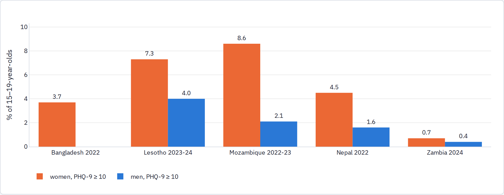

Percentage of 15–19-year-olds with a PHQ-9 score of 10 or more, from the final-report tables (weighted). Zambia's levels are an order of magnitude below the other surveys; the anxiety columns of the table use each report's own cutoff (GAD-7 ≥ 6 in Nepal, Mozambique and Bangladesh; ≥ 10 in Zambia).

| Survey             | Sex   | Ages  | n (weighted) | PHQ-9 ≥ 10 (%) | PHQ-9 ≥ 5 (%) | Anxiety, report definition (%) | GAD-7 ≥ 10 (%) | Ever told had depression (%) |
|--------------------|-------|-------|--------------|----------------|---------------|--------------------------------|----------------|------------------------------|
| Bangladesh 2022    | women | 15-19 | 1,729        | 3.7            | 23.8          | 12.9 (GAD-7 \>= 6)             |                | 2.6                          |
| Lesotho 2023-24    | men   | 15-19 | 616          | 4.0            | 19.2          | not asked                      |                | 4.1                          |
| Lesotho 2023-24    | women | 15-19 | 649          | 7.3            | 20.0          | not asked                      |                | 8.1                          |
| Mozambique 2022-23 | men   | 15-19 | 1,386        | 2.1            | 11.0          | 6.6 (GAD-7 \>= 6)              |                | 0.1                          |
| Mozambique 2022-23 | women | 15-19 | 3,050        | 8.6            | 23.9          | 21.6 (GAD-7 \>= 6)             |                | 0.8                          |
| Nepal 2022         | men   | 15-19 | 985          | 1.6            | 11.0          | 10.0 (GAD-7 \>= 6)             |                | 0.3                          |
| Nepal 2022         | women | 15-19 | 1,322        | 4.5            | 18.3          | 18.3 (GAD-7 \>= 6)             |                | 1.1                          |
| Zambia 2024        | men   | 15-19 | 3,002        | 0.4            | 5.1           | 0.2 (GAD-7 \>= 10)             | 0.2            | 0.9                          |
| Zambia 2024        | women | 15-19 | 3,292        | 0.7            | 6.3           | 0.5 (GAD-7 \>= 10)             | 0.5            | 0.7                          |

Severity tables of the DHS-8 mental-health chapters, ages 15–19 (the 20–24 and 25–49 rows, the residence splits and the source table and page numbers are in `results/tables/dhs8_prevalence_published.csv`). Bangladesh interviewed ever-married women only, so its 15–19 group is a selected (early-married) population. Lesotho did not field the GAD-7. For the diagnosis-only surveys the share of 15–19-year-olds ever told by a provider that they had depression or anxiety is Congo Democratic Republic 2023-24 men 0.5%; Congo Democratic Republic 2023-24 women 0.7%; Kenya 2022 men 1.6%; Kenya 2022 women 2.5%; Madagascar 2021 men 0.2%; Madagascar 2021 women 1.0%; Mali 2023-24 men 1.0%; Mali 2023-24 women 2.1%.

##### Microdata: pooled within-cluster estimates

IPUMS DHS has integrated the women's files of three of the four PHQ-9/GAD-7 surveys (Nepal, Mozambique, Bangladesh; Zambia 2024 and all men's files are not yet available there, and Mozambique's file does not yet carry the internet-frequency item). Weighted means from these files reproduce the final-report tables exactly (for example PHQ-9 ≥ 10 at 15–19: Nepal 4.5% vs 4.5% published; Mozambique 8.6% vs 8.6%; Bangladesh 3.7% vs 3.7%), and the Nepal rows reproduce the Phase 1 estimates to the third decimal. We then re-ran the Nepal specification on each survey and on the pooled file: women who use the internet almost daily (or weekly or more, or who own a smartphone or any phone) are compared with non-users in the same sampling cluster, with wealth quintile, education level and single-year age controls, survey weights, and standard errors clustered by sampling cluster; the pooled rows add survey-by-cluster fixed effects, let the control effects differ by survey, and normalise each survey's weights to its sample size. Among 15–19-year-old women, 42.1% in Nepal and 27.0% in Bangladesh use the internet almost daily, and 52.2%, 34.8% and 18.6% (Nepal, Bangladesh, Mozambique) own a smartphone.

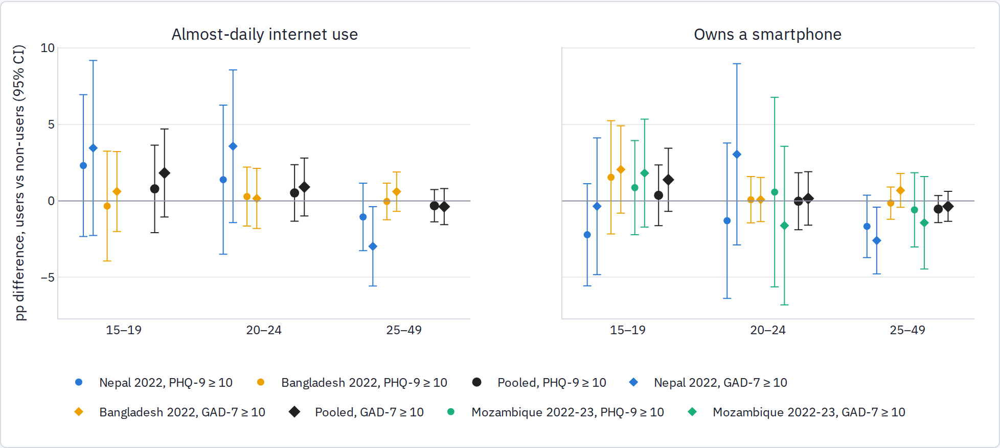

Percentage-point difference in screening positive between users and non-users in the same sampling cluster, by age group; circles PHQ-9 ≥ 10, diamonds GAD-7 ≥ 10; black markers are the pooled survey-by-cluster fixed-effects estimates. The 25–49 group is the falsification contrast.

| Exposure                  | Ages  | Nepal · PHQ-9 ≥ 10 | Bangladesh · PHQ-9 | Mozambique · PHQ-9 | Pooled · PHQ-9 | Nepal · GAD-7 ≥ 10 | Bangladesh · GAD-7 | Mozambique · GAD-7 | Pooled · GAD-7 | Pooled n |
|---------------------------|-------|--------------------|--------------------|--------------------|----------------|--------------------|--------------------|--------------------|----------------|----------|
| almost-daily internet use | 15-19 | +2.31 (2.37)       | -0.34 (1.83)       | —                  | +0.79 (1.46)   | +3.46 (2.92)       | +0.61 (1.34)       | —                  | +1.82 (1.47)   | 2,770    |
|                           | 20-24 | +1.39 (2.49)       | +0.28 (0.98)       | —                  | +0.52 (0.94)   | +3.57 (2.55)       | +0.16 (1.00)       | —                  | +0.90 (0.97)   | 4,411    |
|                           | 25-49 | -1.05 (1.13)       | -0.04 (0.61)       | —                  | -0.32 (0.54)   | -2.97 (1.32)       | +0.60 (0.66)       | —                  | -0.37 (0.60)   | 19,884   |
| weekly+ internet use      | 15-19 | +2.42 (2.28)       | -0.94 (1.70)       | —                  | +0.47 (1.38)   | +2.80 (2.42)       | +0.58 (1.25)       | —                  | +1.51 (1.25)   | 2,770    |
|                           | 20-24 | +3.01 (2.42)       | -0.99 (0.87)       | —                  | -0.20 (0.85)   | +3.71 (2.74)       | -0.49 (0.89)       | —                  | +0.34 (0.90)   | 4,411    |
|                           | 25-49 | -0.71 (1.13)       | -0.28 (0.56)       | —                  | -0.40 (0.51)   | -1.61 (1.29)       | +0.42 (0.60)       | —                  | -0.11 (0.56)   | 19,884   |
| owns a smartphone         | 15-19 | -2.22 (1.71)       | +1.54 (1.89)       | +0.87 (1.57)       | +0.36 (1.01)   | -0.36 (2.28)       | +2.05 (1.46)       | +1.82 (1.80)       | +1.38 (1.05)   | 5,841    |
|                           | 20-24 | -1.30 (2.59)       | +0.08 (0.77)       | +0.58 (3.16)       | -0.02 (0.95)   | +3.04 (3.02)       | +0.09 (0.74)       | -1.62 (2.64)       | +0.16 (0.89)   | 6,981    |
|                           | 25-49 | -1.67 (1.04)       | -0.15 (0.54)       | -0.59 (1.24)       | -0.54 (0.45)   | -2.59 (1.11)       | +0.68 (0.56)       | -1.43 (1.54)       | -0.36 (0.50)   | 27,332   |
| owns a phone              | 15-19 | -1.70 (1.84)       | +1.24 (1.59)       | +1.30 (1.50)       | +0.70 (0.96)   | -1.01 (2.34)       | +1.08 (1.18)       | +2.95 (1.95)       | +1.58 (1.12)   | 5,841    |
|                           | 20-24 | -3.96 (3.42)       | +0.87 (0.75)       | +1.83 (2.36)       | +0.76 (0.96)   | -3.61 (3.53)       | +1.10 (0.72)       | +2.57 (2.47)       | +1.17 (0.99)   | 6,981    |
|                           | 25-49 | -1.03 (1.21)       | +0.58 (0.50)       | -0.81 (1.48)       | +0.05 (0.50)   | -0.33 (1.44)       | +1.27 (0.52)       | -0.28 (1.61)       | +0.70 (0.54)   | 27,332   |

Coefficients in percentage points with cluster-robust standard errors in parentheses; women only. Full results, the continuous-score and GAD-7 ≥ 6 outcomes, the urban/rural splits and a precision-weighted average of the per-survey estimates are in `results/tables/dhs8_estimates.csv`.

Pooling Nepal and Bangladesh, 15–19-year-old women who use the internet almost daily are +0.79 (1.46) pp more likely to screen positive for depression and +1.82 (1.47) pp more likely to screen positive for anxiety than non-users in the same cluster (n = 2,770). The Nepal estimates (+2.31 (2.37) and +3.46 (2.92)) are not reproduced in Bangladesh (-0.34 (1.83) and +0.61 (1.34)), whose 15–19-year-olds are all ever-married. Smartphone ownership pooled across the three surveys gives +0.36 (1.01) pp on depression and +1.38 (1.05) pp on anxiety (n = 5,841); Mozambique's own estimates are +0.87 (1.57) and +1.82 (1.80). At ages 25–49 the pooled coefficients are -0.32 (0.54) and -0.37 (0.60) for daily internet use and -0.54 (0.45) and -0.36 (0.50) for smartphone ownership: the positive point estimates are confined to the youngest group, as in Nepal alone, but none is distinguishable from zero. Splitting the 15–19 pooled sample by residence gives +0.77 (2.14) (depression) and +1.58 (2.68) (anxiety) for daily internet use in urban clusters against +0.86 (1.92) and +1.87 (1.62) in rural clusters, and -0.15 (1.45) / +1.38 (1.57) against +1.38 (1.38) / +1.83 (1.37) for smartphone ownership. In the diagnosis-only surveys, owning a smartphone is unrelated to an ever-diagnosed depression among Kenyan women aged 15–19 (-0.09 (1.34) pp, n = 2,904, base rate 1.4%), and in Madagascar ever having used the internet (women, +0.73 (0.77)) or using it daily (men, -0.51 (0.47)) is likewise unrelated to a diagnosis that fewer than 1% of 15–19-year-olds report.

##### Published analyses of the module

| Survey                                      | Study                                                                                                                                                                                                                                                                                                                                                                                                                                | Instruments                                                    | Prevalence                                                                                                                                                                                                                                     | Screen / media exposure                                                                                                                                                                                                                                                                                                                                                    | Verification                                                                                                                                                                  |
|---------------------------------------------|--------------------------------------------------------------------------------------------------------------------------------------------------------------------------------------------------------------------------------------------------------------------------------------------------------------------------------------------------------------------------------------------------------------------------------------|----------------------------------------------------------------|------------------------------------------------------------------------------------------------------------------------------------------------------------------------------------------------------------------------------------------------|----------------------------------------------------------------------------------------------------------------------------------------------------------------------------------------------------------------------------------------------------------------------------------------------------------------------------------------------------------------------------|-------------------------------------------------------------------------------------------------------------------------------------------------------------------------------|
| Nepal 2022                                  | [Shawon MSR, Hossain FB, Hasan M, Rahman MR](https://doi.org/10.1017/gmh.2024.37) (2024)                                                                                                                                                                                                                                                                                                                                             | GAD-7 \>= 6 (anxiety), PHQ-9 \>= 10 (depression)               | anxiety: women 21.9% (95% CI 21.0-22.9), men 11.3% (10.4-12.2); depression: women 5.4% (4.9-6.0), men 1.7% (1.4-2.2); women vs men aOR 2.18 (anxiety) and 3.21 (depression); youngest group 15-29 only (women: anxiety 21.0%, depression 5.2%) | no internet, phone or media covariate                                                                                                                                                                                                                                                                                                                                      | numbers checked against the PMC full text (PMC11058515)                                                                                                                       |
| Mozambique 2022-23                          | [Noor STA, Siddique S, Das O, Yeasar S, Islam RB](https://doi.org/10.1016/j.gloepi.2025.100223) (2025)                                                                                                                                                                                                                                                                                                                               | PHQ-9 \>= 10, GAD-7 \>= 10                                     | depression 10.1% (9.5-10.7), anxiety 11.1% (10.5-11.7); ages 15-19: 8.6% depression, 8.4% anxiety; 20-24: 11.2% / 11.5%; richest vs poorest quintile aOR 0.61 (depression), 0.59 (anxiety)                                                     | mass-media exposure only: aOR 1.15 (0.98-1.33) depression, 1.14 (0.98-1.32) anxiety; no internet or phone variable                                                                                                                                                                                                                                                         | numbers checked against the PMC full text (PMC12539233)                                                                                                                       |
| Mozambique 2022-23                          | [Miah MS](https://doi.org/10.1371/journal.pone.0356265) (2026)                                                                                                                                                                                                                                                                                                                                                                       | PHQ-9 \>= 10, GAD-7 \>= 10                                     | anxiety 11.09% (9.8-12.4), depression 10.14% (8.9-11.5); the 15-19 prevalence is not stated in the text                                                                                                                                        | internet use in the past 12 months: aOR 1.46 (1.07-1.99) for anxiety overall and 2.06 (1.00-4.22) among rural women; no significant association with depression reported. The paper gives 80% of women as internet users, which does not match the DHS report (20% of women 15-19 used the internet in the last 12 months), so the exposure coding could not be reconciled | abstract and text checked on the PLOS site; the 80% internet figure is flagged as inconsistent with the survey report                                                         |
| Bangladesh 2022                             | [Haque MR, Rabbi AMF, Araf F, Rahman MM](https://doi.org/10.1371/journal.pmen.0000387) (2025)                                                                                                                                                                                                                                                                                                                                        | GAD-7 and PHQ-9: minimal 0-4, mild 5-9, moderate-to-severe 10+ | moderate-to-severe anxiety 15-19: 2.3%, 20-24: 2.7%; moderate-to-severe depression 15-19: 3.6%, 20-24: 3.2%; anxiety highest at 45-49 (6.5%)                                                                                                   | mass-media exposure, bivariate only (moderate-severe anxiety 4.6% unexposed vs 4.2% exposed; depression 4.9% vs 5.0%); no internet or phone variable                                                                                                                                                                                                                       | numbers checked against the PMC full text (PMC12798323)                                                                                                                       |
| Bangladesh 2022                             | [Rafi MA, Anika US, Hasan MT, Hossain MG](https://doi.org/10.1136/bmjopen-2025-099770) (2025)                                                                                                                                                                                                                                                                                                                                        | GAD-7 \>= 6, PHQ-9 \>= 10                                      | depressive symptoms 4.4%, anxiety symptoms 17.2%                                                                                                                                                                                               | none (the empowerment index includes a media-engagement component)                                                                                                                                                                                                                                                                                                         | numbers checked against the PMC full text (PMC12434786)                                                                                                                       |
| Bangladesh 2022                             | [Associations of internet use and pregnancy loss with depression and anxiety among women in Bangladesh: insights from the 2022 BDHS](https://communities.springernature.com/posts/associations-of-internet-use-and-pregnancy-loss-with-depression-and-anxiety-among-women-in-bangladesh-insights-from-the-2022-bdhs) (authors' summary on Springer Nature Research Communities)                                                      | PHQ-9, GAD-7                                                   | (not given in the summary)                                                                                                                                                                                                                     | internet use in the past 12 months associated with lower odds of depression (AOR 0.77) and anxiety (AOR 0.65)                                                                                                                                                                                                                                                              | NOT VERIFIED: the post is behind a login; the journal article was not located, so the odds ratios are quoted from the search snippet only                                     |
| Lesotho 2023-24                             | [Prevalence, determinants, and help-seeking behavior for major depressive disorder symptoms in the Lesotho population: a multilevel analysis of the 2023-24 LDHS. Social Psychiatry and Psychiatric Epidemiology](https://doi.org/10.1007/s00127-026-03057-9) (2026)                                                                                                                                                                 | PHQ-9 \>= 10 (no GAD-7 in the Lesotho module)                  | 6.3% with moderate-to-severe symptoms; about one in four with at least mild symptoms; 22.5% of symptomatic respondents had ever sought help and 6.5% used medication; help seeking lowest at ages 15-19                                        | none                                                                                                                                                                                                                                                                                                                                                                       | PARTLY VERIFIED: figures from the authors' public summary; the article itself was not accessible (publisher login) and sex- and age-specific prevalence is not in the summary |
| Kenya 2022                                  | [Melkam M, Fentahun S, Takelle GM, Rtbey G, Andualem F, Nakie G, Tadesse G, Wassie YA](https://doi.org/10.1371/journal.pone.0319571) (2025)                                                                                                                                                                                                                                                                                          | ever told by a doctor they have depression and/or anxiety      | 3.84% (3.56-4.14): depression only 2.85%, anxiety only 1.97%, both 0.98%; ages 15-19 about 1.8% (derived from the paper's Table 1 counts)                                                                                                      | community mass-media exposure, aOR 1.51 (0.88-2.01), not significant; no internet or phone variable                                                                                                                                                                                                                                                                        | numbers checked against the PMC full text (PMC11952211); the 15-19 figure is our calculation from Table 1                                                                     |
| Kenya 2022                                  | [Omondi E, Ng'ambi WF, Mugotitsa B, Ng'ambi C, Sitienei M, Cygu S, Odhiambo C, Iddi S, Kadengye DT, Kiragga A](https://doi.org/10.1186/s12889-025-24304-9) (2025)                                                                                                                                                                                                                                                                    | self-reported provider diagnosis of depression (or anxiety)    | 2.6% overall (women 2.85%, men 2.21%); ages 15-19: 0.9%, 20-24: 1.5%                                                                                                                                                                           | internet use at least one day a week: aOR 0.90 (0.84-0.96); television weekly aOR 0.68 (0.65-0.72); radio 0.79 (0.75-0.83); phone ownership not analysed                                                                                                                                                                                                                   | numbers checked against the PMC full text (PMC12395647)                                                                                                                       |
| Zambia 2024, Mozambique 2022-23, Nepal 2022 | [Fang J, Huang L, Fang N](https://doi.org/10.3389/fpubh.2026.1955678) (2026)                                                                                                                                                                                                                                                                                                                                                         | PHQ-9 \>= 10, GAD-7 \>= 10                                     | depressive symptoms 5.7%, anxiety symptoms 6.4%, both 3.9% (weighted, pooled)                                                                                                                                                                  | media exposure as a covariate only (60.9% exposed); no internet or phone variable; dietary diversity OR 0.69 (depression), 0.63 (anxiety)                                                                                                                                                                                                                                  | numbers checked against the Frontiers full text                                                                                                                               |
| Zambia 2024                                 | [Intimate partner violence and the dual burden of anxiety and depression among women in Zambia: spatial inequalities and implications for the SDGs](https://communities.springernature.com/posts/intimate-partner-violence-and-the-dual-burden-ofanxiety-and-depression-among-women-inzambia-spatial-inequalities-and-implications-for-the-sustainable-development-goals) (authors' summary on Springer Nature Research Communities) | PHQ-9 \>= 10, GAD-7 \>= 10                                     | (prevalence not in the summary); physical IPV aOR 3.89 (2.16-6.95) for depression; any IPV aOR 2.90 (depression) and 2.05 (anxiety)                                                                                                            | none                                                                                                                                                                                                                                                                                                                                                                       | NOT VERIFIED: summary behind a login; quoted from the search snippet; journal not confirmed                                                                                   |

Peer-reviewed analyses of the DHS-8 mental-health modules located by October 2026. None models adolescents separately or uses the internet-frequency or smartphone items as the exposure of interest; the two that include internet use as a covariate point in opposite directions (Mozambique: higher odds of anxiety; Bangladesh: lower odds of both, unverified).

**Assessment.** Adding Mozambique and Bangladesh to Nepal triples the self-report sample but does not strengthen the Phase 1 pattern: the pooled within-cluster association between daily internet use and screening positive at ages 15–19 is +0.79 (1.46) pp for depression and +1.82 (1.47) pp for anxiety, smaller than Nepal's own estimates and not significant, and smartphone ownership across three surveys gives +0.36 (1.01) and +1.38 (1.05) pp. The direction is consistent with H1 (positive at 15–19, zero or negative at 25–49, as in the GSHS self-reports and unlike the MICS caregiver reports), but the magnitudes are a third to a half of the GSHS phone-hours gradients and the intervals include zero, so these cross-sections neither confirm nor rule out a self-report-specific effect of the size seen in GSHS. They say nothing about H2 or H3 (no school items) and do not bear on H0. Three limits apply: the exposures are current use rather than exogenous rollout; Bangladesh's 15–19-year-olds are ever-married women, a group selected on early marriage; and the men's files, the Zambia 2024 survey (whose published 15–19 prevalence is an order of magnitude lower than the others), the Lesotho PHQ-9 module and Mozambique's internet items await IPUMS DHS integration or a DHS Program data request.

### Phone-first countries: GSHS school surveys (149 country-rounds, 2003–2023)

The WHO Global School-based Student Health Survey (GSHS) asks school-attending adolescents (primarily ages 13–17) in over 100 low- and middle-income countries identical questions on loneliness, anxiety-related sleep loss, and suicidality in waves starting in 2003. From the 165 public-use country-round files in the WHO microdata repository, 149 rounds contained usable mental-health items and survey weights after harmonization, including 91 rounds across 39 countries surveyed at least twice. We first test whether within-country changes in adolescent distress track national internet penetration from the World Bank (controlling for log GDP per capita), and then examine student-level phone hours and ITU mobile-network coverage below.

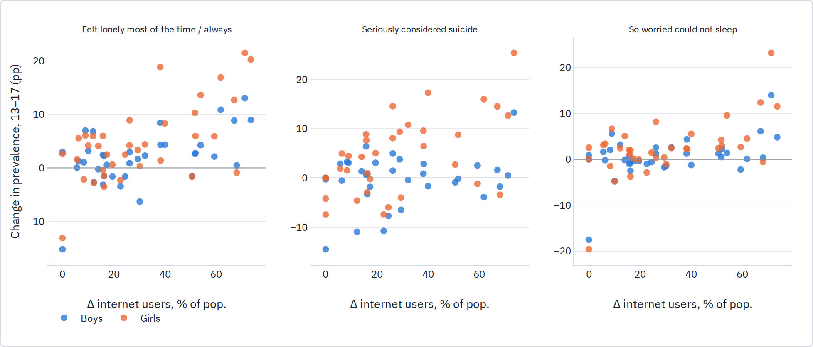

Each point plots a country's change from its first to its last GSHS wave (weighted prevalence) against the change in the national internet-user share over the same interval.

| Outcome          | Sex   | Sample                   | Effect of +10 pp internet users (SE) |
|------------------|-------|--------------------------|--------------------------------------|
| lonely           | girls | 79 rounds / 34 countries | +1.04 (0.83)                         |
| lonely           | boys  | 79 rounds / 34 countries | -0.18 (0.59)                         |
| worried sleep    | girls | 77 rounds / 33 countries | +0.14 (0.87)                         |
| worried sleep    | boys  | 77 rounds / 33 countries | -0.78 (0.54)                         |
| suicide consider | girls | 67 rounds / 30 countries | +0.02 (1.27)                         |
| suicide consider | boys  | 67 rounds / 30 countries | -0.42 (0.99)                         |
| suicide plan     | girls | 70 rounds / 31 countries | +0.86 (0.74)                         |
| suicide plan     | boys  | 70 rounds / 31 countries | -0.35 (0.69)                         |
| suicide attempt  | girls | 35 rounds / 19 countries | +0.30 (0.90)                         |
| suicide attempt  | boys  | 35 rounds / 19 countries | -0.50 (0.38)                         |
| no close friends | girls | 79 rounds / 34 countries | +0.48 (0.33)                         |
| no close friends | boys  | 79 rounds / 34 countries | -0.16 (0.36)                         |

Country and year fixed effects, log GDP per capita control, inverse-variance weights, and standard errors clustered by country.

**Assessment.** Across the full 34-country panel, within-country growth in national internet penetration shows no statistically significant relationship with adolescent distress: for girls, a 10-percentage-point increase in internet users is associated with +1.04 pp in loneliness (SE 0.83) and +0.02 pp in suicidal ideation (SE 1.27), while the point estimates for boys are slightly negative. (An earlier partial extract of 72 rounds had suggested a +2.5 pp effect for girls on both outcomes, which disappeared once the remaining 77 rounds were added—a useful illustration of how sensitive country-round panels are to sample coverage.) National internet penetration is also a coarse proxy that pools adult and youth access. The two subsections below turn to the 2022–23 GSHS waves that ask students directly about daily mobile-phone hours and to the ITU mobile-broadband coverage series.

##### Asking adolescents directly: mobile-phone hours in the 2022–23 rounds

Five recent GSHS rounds (Ghana 2022, India 2022, Jamaica 2023, Morocco 2023, and Wallis and Futuna 2023) added a question on "hours per day you used a mobile phone in the past 7 days," pairing each student's self-reported phone time with the same student's loneliness and suicidality responses.

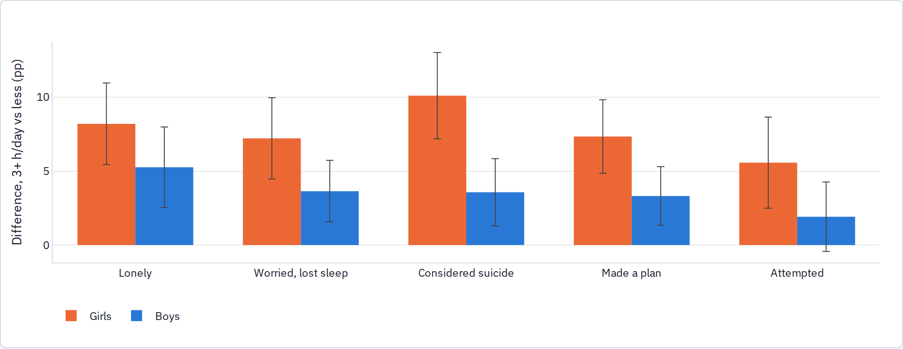

Regressions include country fixed effects and age controls, survey weights, and standard errors clustered by school across 7,708 girls and 7,102 boys (including students without a phone). Compared with students using a phone under three hours a day or not at all, girls at three or more hours report loneliness +8.2 pp (SE 1.4), suicidal ideation +10.1 pp (SE 1.5), and suicide attempts +5.6 pp (SE 1.6); the corresponding differences for boys are +5.3, +3.6, and +1.9 pp. Distress rises steadily across higher-use categories: relative to under one hour per day, girls reporting more than eight hours per day have +19.5 pp higher loneliness, +17.4 pp higher suicidal ideation, and +13.7 pp higher suicide attempts. Students without a mobile phone sit a few percentage points above the under-one-hour group rather than below it.

This individual-level dose-response gradient matches the pattern documented in Western surveys: substantial in magnitude, roughly twice as steep for girls as for boys, and increasing monotonically with daily hours above one hour. Because it is a cross-sectional self-report association, however, it cannot distinguish the effect of phone use on distress from reverse causation or shared underlying vulnerabilities. What it does show is that the 2022–23 GSHS rounds (alongside incoming MICS7 adolescent modules) are strong candidates for linking to subnational mobile-coverage rollout maps, since exposure is measured directly on the adolescent rather than inferred from national or adult averages.

##### Network coverage at country level (ITU)

Replacing World Bank internet penetration with the ITU mobile-network series allows us to test country-level 3G and 4G population coverage and active mobile-broadband subscriptions using the same two-way fixed-effects specification (country and year fixed effects, inverse-variance weights, and country-clustered standard errors across countries with two or more GSHS rounds).

| Exposure (per +10 points)           | Countries / rounds (loneliness) | Lonely, girls | Lonely, boys | Considered suicide, girls | …boys        | Attempted, girls | …boys        |
|-------------------------------------|---------------------------------|---------------|--------------|---------------------------|--------------|------------------|--------------|
| Mobile-broadband subs per 100 (ITU) | 22 / 47                         | +0.21 (0.54)  | +0.03 (0.42) | +0.28 (0.43)              | +0.35 (0.48) | +0.31 (0.44)     | +0.30 (0.50) |
| 3G population coverage (ITU)        | 17 / 36                         | -0.72 (0.28)  | +0.25 (0.26) | +0.10 (0.59)              | +0.28 (0.44) | -0.08 (0.32)     | +0.36 (0.36) |
| 4G population coverage (ITU)        | 15 / 32                         | -0.40 (0.41)  | -0.48 (0.38) | -0.51 (0.63)              | -0.20 (0.59) | -0.64 (0.43)     | -0.45 (0.69) |
| Internet users % (ITU)              | 33 / 78                         | +0.93 (0.86)  | -0.19 (0.60) | -0.04 (1.20)              | -0.54 (1.07) | +0.37 (1.02)     | -0.22 (0.86) |

Sample counts in the second column refer to the loneliness item; suicidal ideation and suicide attempts are available in 1 to 3 fewer countries per row.

None of the country-level ITU series supports H1. Across the 15 countries with repeated 4G data, a 10-percentage-point increase in 4G coverage has slightly negative point estimates across all outcomes (from −0.20 to −0.64 pp, with standard errors of 0.38–0.69). For 3G coverage (17 countries), the coefficient on girls' loneliness is negative (−0.72 pp, SE 0.28) and the suicidality estimates are near zero; for active mobile-broadband subscriptions (22 countries), estimates range from +0.03 to +0.35 pp with standard errors around 0.4–0.5 pp. Because national coverage series move with broader economic development and pool urban and rural areas together, local cluster-level coverage remains the necessary test.

### Phone-first countries: census microdata (IPUMS International)

We also examined the 2009/2019 Kenya and 2010/2020 Mexico census pairs in IPUMS International, the two best candidates carrying disability items alongside connectivity measures. Both 2020-round censuses include the Washington Group question on difficulty remembering or concentrating, and the 2019 Kenya census asks each person directly about mobile-phone ownership and internet use. However, the 2010-round censuses asked narrow yes/no questions about "mental disability," so changes between the 2010 and 2020 rounds are dominated by questionnaire wording. Within the 2019/2020 cross-sections, cognitive-difficulty prevalence at ages 12–17 is low (0.8–1.8% for any difficulty and 0.2–0.7% for "a lot of difficulty" or "cannot do at all"), boys exceed girls at every age, and subnational regressions of the 12–17 rate on adolescent phone ownership or internet use across 76 Kenyan district-sex cells or on household internet across 3,259 Mexican municipality-sex cells yield coefficients within ±0.01 pp per percentage point of phone ownership or internet access. In developing-country censuses, this item behaves like a measure of severe developmental disability and is insensitive to adolescent internalizing distress.

### Who reports the symptoms: U.S. caregivers and adolescents (NSCH 2016–2025, NHIS 2021–2024)

The MICS result above rests on caregivers describing their children, while the GSHS and DHS-8 gradients come from adolescents describing themselves. Two U.S. surveys separate the informant from the setting: the National Survey of Children's Health asks parents about diagnosed, current anxiety and depression alongside a graded screen-time item, and the National Health Interview Survey asks parents the MICS items while a subsample of the same 12–17-year-olds answers the PHQ-2 and GAD-2 in NHIS-Teen.

#### Parent-reported anxiety and depression in the United States: NSCH 2016–2025

The National Survey of Children's Health (HRSA/Census) asks a parent or caregiver each year whether a doctor or other health care provider has *ever* told them the child has anxiety problems or depression, whether the child *currently* has the condition, and how severe it is, alongside a single weekday screen-time item ("on most weekdays, about how much time did this child spend in front of a TV, computer, cellphone or other electronic device … do not include time spent doing schoolwork"), weeknight sleep, bullying victimization, school engagement, and the state of residence. It is the U.S. counterpart to the MICS caregiver reports above: the same informant, but asked about diagnosed conditions rather than how often the child seems anxious or sad. We use the public-use topical files for 2016–2025 (293,751 children aged 6–17, of whom 167,215 are 12–17; the 2025 file was released in October 2026), with survey weights, and treat 2016–17 separately because the screen-time item was split into TV and device questions in those two years.

##### Trends 2016–2025

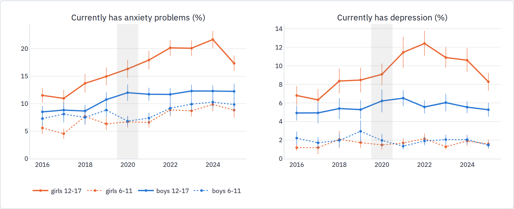

Weighted share of children whose parent reports a current condition, by survey year, with 95% intervals (one child per household; stratification ignored). Solid lines ages 12–17, dotted lines ages 6–11. Grey band = 2020; the NSCH is fielded from June into the following winter, so a survey year straddles two school years.

Parent-reported current anxiety among girls aged 12–17 rose from 11.5% in 2016 to a peak of 21.7% in 2024, and current depression from 6.8% to 12.4% in 2022; boys rose from 8.5% to 12.3% on anxiety with little change on depression. The 2025 survey is the first in the series to fall: girls' anxiety dropped by -4.33 (1.09) pp to 17.3% and depression by -2.32 (0.82) pp to 8.3%, while boys changed by -0.06 (0.87) pp and -0.28 (0.50) pp. Among 6–11-year-olds anxiety rose from 6.5% to 10.1% and was 9.4% in 2025. The parent series therefore matches the self-report surveys in the report on both ends: a female-led rise through the early 2020s and a downturn in the most recent wave, here between the 2024 and 2025 field periods. Two cautions apply to the last point: the 2025 response rate (34.7%) is the lowest in the series and the field period was extended to March 2026, and a single-year drop in a diagnosis-based item can reflect access to care as well as symptoms.

##### The caregiver screen-time gradient

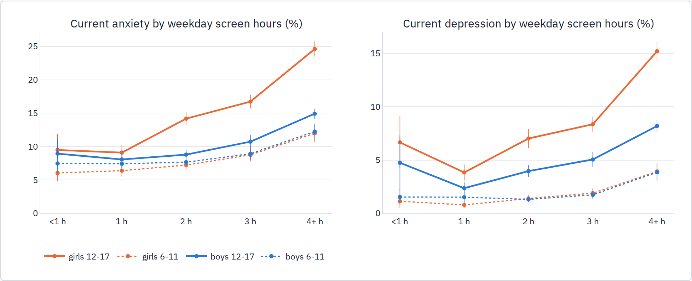

Pooled 2018–2025, weighted prevalence by the parent's answer to the weekday screen-time item, with 95% intervals. 37.7% of 12–17-year-olds and 18.4% of 6–11-year-olds are reported at four or more hours.

| Parent-reported outcome                            | Girls 12–17   | Boys 12–17   | Girls 6–11   | Boys 6–11    | Mean 12–17 | Mean 6–11 |
|----------------------------------------------------|---------------|--------------|--------------|--------------|------------|-----------|
| Currently has anxiety problems                     | +14.53 (0.79) | +7.02 (0.77) | +5.49 (0.80) | +4.81 (0.74) | 14.7%      | 8.4%      |
| … moderate or severe                               | +9.49 (0.61)  | +4.46 (0.49) | +3.09 (0.52) | +3.30 (0.57) | 7.9%       | 4.0%      |
| Currently has depression                           | +10.24 (0.61) | +5.51 (0.39) | +2.75 (0.42) | +2.05 (0.52) | 7.8%       | 1.9%      |
| … moderate or severe                               | +6.49 (0.41)  | +2.97 (0.29) | +1.44 (0.27) | +0.95 (0.24) | 4.2%       | 0.8%      |
| Currently has ADD/ADHD (contrast)                  | +3.07 (0.88)  | +7.18 (0.95) | +1.32 (0.84) | +5.58 (0.93) | 13.0%      | 10.8%     |
| Currently has behavior/conduct problems (contrast) | +3.74 (0.50)  | +5.23 (0.82) | +4.91 (0.81) | +8.31 (0.92) | 6.9%       | 9.1%      |

Percentage-point difference between children at 4+ hours and children at 1 hour on most weekdays (the reference category), from weighted linear probability models with single-year age, sex, race/ethnicity, income as a share of the poverty line, highest parental education, and state-by-year fixed effects; heteroskedasticity-robust standard errors in parentheses (one sampled child per household). 2018–2025 pooled.

Unlike the MICS caregivers, U.S. parents report a steep gradient. Girls aged 12–17 whose parents place them at four or more weekday hours are +14.53 (0.79) pp more likely to be reported with current anxiety and +10.24 (0.61) pp more likely with current depression than girls at one hour, against means of 14.7% and 7.8%; for boys the differences are +7.02 (0.77) and +5.51 (0.39) pp. The covariates and state-by-year effects remove little of the raw gap (+15.26 (0.80) pp for girls' anxiety with year effects only). The gradient is roughly linear from one hour upward and is absent or reversed below one hour, as in the published NSCH analyses. For scale, the self-reported GSHS gradient for girls using a mobile phone three or more hours a day was +8.19 (1.41) pp on loneliness and +10.09 (1.49) pp on suicidal ideation, while the MICS caregiver reports gave -0.12 (1.44) pp (daily internet use) and -2.24 (1.24) pp (daily phone use) on girls' anxiety within sampling clusters. U.S. caregivers, asked about diagnosed and current conditions rather than how often the child seems anxious, report a gradient at least as steep as the adolescents' own reports in GSHS. Three features argue against reading the U.S. gradient as a phone effect on its own. It is present at ages 6–11 (+5.49 (0.80) pp for girls' anxiety), where phone ownership is uncommon and the item mostly captures television and games. It is as large or larger for the contrast outcomes that no phone account predicts: current ADD/ADHD is +7.18 (0.95) pp higher for boys and behavior or conduct problems +8.31 (0.92) pp higher for 6–11-year-old boys at 4+ hours, a pattern consistent with children who already have a condition spending more time on screens, or with parents who worry about a child also counting their hours more. And it barely changed across the periods when adolescent screen time jumped and then receded:

| Outcome, ages 12–17 (girls / boys)      | 2018–19                     | 2022–25                     | 2018–25                     | 2016–17, two items summed   |
|-----------------------------------------|-----------------------------|-----------------------------|-----------------------------|-----------------------------|
| Current anxiety, pp per weekday hour    | +3.38 (0.44) / +1.85 (0.33) | +4.38 (0.28) / +2.19 (0.23) | +3.96 (0.21) / +2.09 (0.17) | +1.34 (0.25) / +0.72 (0.18) |
| Current depression, pp per weekday hour | +2.26 (0.38) / +1.78 (0.27) | +2.79 (0.25) / +1.20 (0.18) | +2.68 (0.18) / +1.43 (0.13) | +1.14 (0.17) / +0.56 (0.14) |
| Current ADD/ADHD, pp per weekday hour   | +0.95 (0.30) / +2.16 (0.42) | +1.38 (0.21) / +1.97 (0.29) | +1.20 (0.16) / +1.95 (0.21) | +0.81 (0.25) / +0.56 (0.24) |

Linear slope in percentage points per reported weekday hour (categories coded 0.5, 1, 2, 3 and 4.5 hours), same specification as above. The 2016–17 column sums the separate TV and device items of those years (0 to 9 hours), so its scale is not identical.

##### Sleep and bullying as pathways

| 4+ h vs 1 h, ages 12–17 | Girls: base   | Girls: + sleep, bullying | Girls: attenuation | Boys: base   | Boys: + sleep, bullying | Boys: attenuation |
|-------------------------|---------------|--------------------------|--------------------|--------------|-------------------------|-------------------|
| Current anxiety         | +14.61 (0.79) | +11.38 (0.76)            | 22%                | +7.06 (0.77) | +5.07 (0.76)            | 28%               |
| Current depression      | +10.05 (0.61) | +7.57 (0.59)             | 25%                | +5.30 (0.39) | +3.94 (0.40)            | 26%               |
| Current ADD/ADHD        | +3.29 (0.88)  | +1.60 (0.87)             | 51%                | +6.89 (0.97) | +4.88 (0.96)            | 29%               |

The 4+ hour coefficient on anxiety and depression (ages 12–17, 2018–2025) before and after adding weeknight sleep below 8 hours and bullying victimization (monthly or more, weekly or more) as controls; attenuation is the share of the base coefficient removed.

Parents who report heavy screen use also report less sleep and more bullying: four or more weekday hours is associated with +10.62 (1.24) pp more girls and +9.16 (1.17) pp more boys sleeping under eight hours, and with +8.60 (0.73) pp (girls) and +5.41 (0.72) pp (boys) more being bullied at least monthly. Both predict current anxiety strongly in the same models (short sleep +5.31 (0.71) pp, monthly bullying +25.18 (1.48) pp for girls), but adding them removes only 22% of the girls' 4+ hour anxiety gradient (+14.61 (0.79) to +11.38 (0.76)) and 25% of the depression gradient. Most of the cross-sectional association runs through neither sleep nor bullying as the NSCH measures them; the Leung and Torres (2021) finding below that sleep does not mediate the 2018 gradient holds in the pooled years.

##### State smartphone adoption

| Outcome            | Girls 12–17  | Boys 12–17   | Girls 6–11   | Boys 6–11    | State-years |
|--------------------|--------------|--------------|--------------|--------------|-------------|
| Current anxiety    | +0.34 (0.72) | -0.57 (0.72) | +0.18 (0.56) | -0.26 (0.51) | 357         |
| Current depression | -0.62 (0.53) | +0.06 (0.43) | -0.17 (0.27) | -0.16 (0.26) | 357         |
| Current ADD/ADHD   | +0.03 (0.64) | -0.16 (0.66) | -0.41 (0.51) | +0.20 (0.88) | 357         |

Percentage points of the parent-reported outcome per 10-point rise in the NTIA share of persons in teen households who use a smartphone for internet access (CPS supplements, November 2017, 2019, 2021 and 2023, interpolated between waves), on state-by-year cells 2017–2023 with state and year fixed effects, weighted by cell size, standard errors clustered by state (51 jurisdictions).

By the time the NSCH begins, teen-household smartphone use had already reached 57% nationally with a cross-state standard deviation of 5.9 points, and it moved to 63% (SD 5.6) by 2023. The within-state changes left are small and noisy, and the coefficients are correspondingly unstable: +0.34 (0.72) pp per 10 points for girls' anxiety and -0.62 (0.53) pp for depression at ages 12–17, with similar-sized estimates at ages 6–11. This is the saturation problem anticipated in the adoption section: after 2017 the NTIA series has no adoption transition left to exploit, so the NSCH cannot repeat the 2011–2019 YRBS test and these rows should be read as a null-variation result rather than a null effect.

##### The first statewide school phone bans: a first look

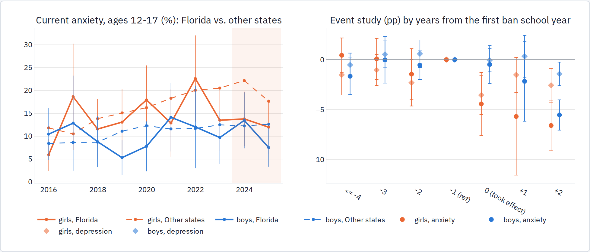

Left: weighted share of 12–17-year-olds with parent-reported current anxiety in Florida (HB 379, instructional-time ban from the 2023–24 school year; shaded) and in all other states, with 95% intervals for Florida. Right: event-study coefficients from the individual-level model (ages 12–17, covariates, state and year fixed effects, standard errors clustered by state), relative to the year before each mandate's first school year; treated states are Florida (2023–24), Indiana, Louisiana and South Carolina (2024–25) and the 19 states whose mandates took effect in 2025–26 and are observed only at event time 0.

| Outcome                     | Girls 12–17: in force, full year | Girls: took effect during field period | Girls: Florida only, full years (placebo SD) | Boys 12–17: in force, full year | Boys: took effect during field period | Boys: Florida only, full years (placebo SD) | Ages 6–11: in force, full year |
|-----------------------------|----------------------------------|----------------------------------------|----------------------------------------------|---------------------------------|---------------------------------------|---------------------------------------------|--------------------------------|
| Current anxiety             | -5.57 (2.29)                     | -4.11 (1.29)                           | -6.25 (2.79)                                 | -3.05 (1.04)                    | +0.12 (0.67)                          | -2.09 (1.84)                                | +2.40 (1.58)                   |
| Current depression          | -0.97 (0.66)                     | -2.48 (0.67)                           | -0.87 (3.01)                                 | -0.42 (0.62)                    | -0.10 (0.44)                          | -0.88 (2.18)                                | -0.09 (0.20)                   |
| Current ADD/ADHD (contrast) | -4.19 (1.19)                     | -2.24 (0.87)                           | -4.06 (1.93)                                 | +0.18 (1.88)                    | +2.01 (1.05)                          | +1.72 (3.62)                                | +2.38 (1.88)                   |

Difference-in-differences coefficients (pp) from weighted individual-level models with covariates, state and year fixed effects, and state-clustered standard errors. "In force, full year" = survey years after the mandate's first school year; "took effect during field period" = the survey year whose June–winter field period straddles the mandate's start. States that only require districts to adopt a policy (Minnesota 2024–25; Alaska, Arizona, Idaho and New Mexico 2025–26) carry a separate indicator. The Florida-only columns come from the state-year panel with the other mandate states dropped once treated; because one treated state leaves no valid cluster-robust standard error, the figure in parentheses is the standard deviation of the same coefficient across the 16 states without any mandate when each is treated alone from 2023–24. Ages 6–11 are also covered by the bans but rarely carry phones.

| Years relative to the mandate's first school year      | Girls 12–17, anxiety | Boys 12–17, anxiety | Girls 12–17, depression | Boys 12–17, depression |
|--------------------------------------------------------|----------------------|---------------------|-------------------------|------------------------|
| ≤ −4 (placebo)                                         | +0.44 (0.88)         | -1.66 (0.93)        | -1.53 (1.03)            | -0.53 (0.61)           |
| −3 (placebo)                                           | +0.08 (1.05)         | -0.01 (1.19)        | -1.03 (0.79)            | +0.53 (0.69)           |
| −2 (placebo)                                           | -1.45 (1.30)         | -0.55 (0.73)        | -2.30 (1.19)            | +0.59 (0.71)           |
| 0: first school year, field period straddles the start | -4.43 (1.61)         | -0.48 (0.97)        | -3.55 (0.99)            | -0.06 (0.59)           |
| +1: in force for a full school year                    | -5.69 (2.99)         | -2.17 (2.04)        | -1.52 (0.89)            | +0.33 (1.07)           |
| +2 (Florida only)                                      | -6.59 (1.30)         | -5.54 (0.77)        | -2.57 (0.86)            | -1.43 (0.60)           |

Event-study coefficients (pp) with the year before the first school year as the reference; "≤ −4" pools all earlier years. The "0" row is identified by 23 states, "+1" by Florida, Indiana, Louisiana and South Carolina, and "+2" by Florida alone.

Florida's parent-reported anxiety among 12–17-year-old girls was 22.6% in 2022 and 13.5% in 2023 against 20.0% and 20.5% elsewhere, then 13.8% and 12.0% in the two full post-ban years against 22.2% and 17.6% in other states. The Florida series rests on roughly 100–190 girls a year, so its year-to-year swings of five to ten points are mostly noise. In the pooled, population-weighted individual model a mandate in force for a full school year is associated with -5.57 (2.29) pp on girls' current anxiety and -0.97 (0.66) pp on depression, and with -3.05 (1.04) and -0.42 (0.62) pp for boys; with each treated state counted once (the state-year panel) the girls' anxiety estimate shrinks to -1.58 (2.12) pp while the boys' is -3.96 (1.28) pp, so the answer depends on whether Florida, Texas and New York are weighted by population. The placebo leads are small (-1.45 (1.30) and +0.08 (1.05) pp for girls at −2 and −3), and the 6–11 comparison group moves the other way (+2.40 (1.58) pp).

| Mandate in force, full year      | Equal state weights: coef (cluster SE) | Permutation SD | Permutation p | Population weights: coef (cluster SE) | Permutation SD | Permutation p |
|----------------------------------|----------------------------------------|----------------|---------------|---------------------------------------|----------------|---------------|
| Anxiety, girls 12–17             | -1.58 (2.12)                           | 2.07           | 0.45          | -5.18 (2.23)                          | 2.72           | 0.05          |
| Anxiety, boys 12–17              | -3.96 (1.28)                           | 1.44           | 0.00          | -2.73 (1.04)                          | 1.96           | 0.17          |
| Depression, girls 12–17          | +0.04 (0.87)                           | 1.82           | 0.98          | -0.91 (0.70)                          | 1.81           | 0.60          |
| Depression, boys 12–17           | -1.40 (1.01)                           | 1.33           | 0.31          | -0.58 (0.60)                          | 1.20           | 0.57          |
| ADD/ADHD (contrast), girls 12–17 | -3.83 (2.47)                           | 1.75           | 0.03          | -4.03 (1.20)                          | 1.86           | 0.04          |
| ADD/ADHD (contrast), boys 12–17  | -2.75 (2.26)                           | 2.02           | 0.17          | +0.28 (1.80)                          | 2.43           | 0.92          |
| Anxiety, ages 6–11 (comparison)  | +0.49 (1.54)                           | 1.19           | 0.72          | +2.35 (1.52)                          | 1.76           | 0.20          |

State-year difference-in-differences (ages 12–17 unless noted; state and year fixed effects) with two weightings, and permutation inference: the observed mandate schedule (one state from 2023–24, three from 2024–25, the rest from 2025–26) is reassigned to random states 400 times; "permutation SD" is the standard deviation of the placebo coefficients and "permutation p" the share of placebo draws at least as large in absolute value as the observed one.

Two checks argue against reading these declines as a ban effect. First, the ADD/ADHD contrast moves as much as anxiety: -3.83 (2.47) pp for girls with equal state weights (permutation p 0.03) and -4.03 (1.20) pp with population weights, whereas depression, the other internalizing outcome, is +0.04 (0.87) and -0.91 (0.70) pp. Whatever lowered parent-reported anxiety diagnoses in the early-ban states in 2024–25 lowered reported ADHD diagnoses by about as much, which a phone ban does not predict. Second, the only state observed two years after its mandate is Florida, whose full-year coefficient of -6.25 pp for girls' anxiety is lower than the placebo coefficient of every one of the 16 states without any mandate when each is treated alone from 2023–24 (placebo SD 2.79, two-sided p 0.06); for boys the Florida coefficient is -2.09 (p 0.38), and for girls' ADHD it is -4.06 (p 0.00), again lower than every placebo state. Florida's post-2023 decline is therefore unusual, but it is a decline in reported diagnoses of every kind. With one state identifying the second post-ban year, four the first, and 2025 the year the national series turned down everywhere, this is a first look rather than an evaluation: it finds no ban-specific signal, and the design will sharpen as the 2026 and 2027 files add full post-ban years for the 19 states that started in 2025–26.

##### Published NSCH analyses

| Study                                                                                                                                                                                                                               | NSCH data                                                                 | Finding                                                                                                                                                                                                                     |
|-------------------------------------------------------------------------------------------------------------------------------------------------------------------------------------------------------------------------------------|---------------------------------------------------------------------------|-----------------------------------------------------------------------------------------------------------------------------------------------------------------------------------------------------------------------------|
| [Twenge & Campbell (2018)](https://doi.org/10.1016/j.pmedr.2018.10.003)                                                                                                                                                             | NSCH 2016, ages 2-17, n = 40,337 (unweighted)                             | Adolescents 14-17 at 7+ h/day vs 1 h/day: anxiety diagnosis RR 2.26 (95% CI 1.59-3.22), depression RR 2.39 (1.54-3.70); inflection after about 1 h/day; stronger for adolescents than younger children                      |
| [Leung & Torres (2021)](https://doi.org/10.1016/j.sleep.2021.02.031)                                                                                                                                                                | NSCH 2018, ages 13-17, n = 10,907                                         | 4+ h vs \<1 h weekday screen time: depression OR 2.23 (1.27-3.91), anxiety OR 1.85 (1.26-2.72) fully adjusted; no association at 1-3 h; sleep duration did not mediate                                                      |
| [Lebrun-Harris, Ghandour, Kogan & Warren (2022)](https://doi.org/10.1001/jamapediatrics.2022.0056)                                                                                                                                  | NSCH 2016-2020, ages 0-17, n = 174,551                                    | Anxiety 7.1% to 9.2% (+29%), depression 3.1% to 4.0% (+27%), 2016 to 2020; mental-health care use flat                                                                                                                      |
| [Wu, Li & Tsurumi (2024)](https://doi.org/10.1186/s13034-023-00688-7)                                                                                                                                                               | NSCH 2018-2021, ages 6-17, n = 88,823                                     | Share with 4+ h weekday screen time 22.7% (2018) to 32.8% (2020) and 29.4% (2021); each screen hour associated with +0.32 points on a 0-6 problem index; 2016-17 excluded because TV and device hours were asked separately |
| [HRSA MCHB data brief, Adolescent mental and behavioral health (2024)](https://mchb.hrsa.gov/sites/default/files/mchb/data-research/nsch-data-brief-adolescent-mental-behavioral-health-2023.pdf) (not verified against the source) | NSCH 2016-2023, ages 12-17                                                | Diagnosed anxiety 10.0% (2016) to 16.1% (2023), depression 5.8% to 8.4%; 61% of adolescents with a current condition who needed treatment had difficulty obtaining it in 2023                                               |
| [Forrest, Koenigsberg, Harvey, Maltenfort & Halfon (2025)](https://doi.org/10.1001/jama.2025.9855) (not verified against the source)                                                                                                | NSCH and four other national surveys, mortality files, PEDSnet, 2007-2023 | Chronic-condition prevalence among 3-17-year-olds rose from 25.8% to 31.0% in the general population; anxiety and depression among the fastest-rising diagnoses                                                             |

**Assessment.** The NSCH shows that U.S. caregivers do report a steep screen-time gradient in diagnosed, current anxiety and depression, larger for girls and at least as large as the adolescents' own GSHS gradient, so the MICS null is not a general property of caregiver reports; it is specific to asking caregivers how often a child *seems* anxious in settings where phone use is measured for the household rather than the child. But the U.S. gradient is equally present at ages 6–11, for ADHD and conduct problems, and before and after the pandemic screen-time surge, which points to selection and reverse causation as much as to H1. The parent series reproduces the female-led 2016–2024 rise and, in 2025, the first decline, placing a national parent-report marker beside the post-2021 state-survey downturn documented in the state youth surveys. The adoption test has no variation left to use (H1 untestable here). The phone-ban difference-in-differences (H1/H3) shows lower parent-reported anxiety in the early-ban states after their mandates, but the decline is matched by ADD/ADHD, absent for depression, sensitive to weighting, and identified two years out by Florida alone; it is not evidence of a ban effect and should be re-run when the 2026 NSCH file is released.

#### United States: parents and teenagers describing the same population (NHIS 2021–2024 and NHIS-Teen)

The National Health Interview Survey's Sample Child interview asks a parent the Washington Group / UNICEF child-functioning items used in MICS, with identical wording: how often the child "seems very anxious, nervous, or worried" and how often the child "seems very sad or depressed" (daily, weekly, monthly, a few times a year, never). From July 2021 NCHS invited the 12–17-year-old sample children themselves to complete NHIS-Teen, a self-administered web questionnaire with the PHQ-2 and GAD-2 screeners, weekday non-school screen hours, sleep, bullying and support items. It is the one national U.S. survey in which the MICS caregiver items and an adolescent self-report screener describe the same children in the same months. The public-use Sample Child files for 2021–2024 give 12,058 adolescents aged 12–17 (12,020 with a valid anxiety item; the screen-time item was asked in 2022 and 2024, n = 5,834, and the bullying item in 2021–2022, n = 5,779). The NHIS-Teen microdata, however, are released only through the NCHS Research Data Center ("there is no public-use NHIS-Teen file"), so the person-level link cannot be made from public data. Of 7,323 eligible sample children, 60.4% of parents gave permission and 46.2% of permitted teenagers responded (overall 27.9%, n = 1,958); NCHS publishes weighted estimates from this sample by parent-reported subgroup in its Interactive Summary Health Statistics for Teens and in a series of data briefs. This section therefore compares the two informants at the population level (the same months, the same subgroups) and compares each informant's own screen-time gradient, rather than agreement on linked individuals.

##### Prevalence under the two informants

Children aged 12–17, July 2021–December 2023. Parent report: NHIS Sample Child public-use files (2021 Q3–Q4, 2022, 2023; weighted with WTFA_C, 2021 weights doubled for the half year; 95% CIs from SEs clustered on pseudo-stratum × PSU). Teen report: NCHS Interactive Summary Health Statistics for Teens (NHIS-Teen weight, Korn–Graubard CIs). Subgroups follow the parent-reported classification used in both sources.

For anxiety the two informants land in the same place overall: 19.7% of parents say their 12–17-year-old seems very anxious daily or weekly, and 19.7% of teenagers score 3 or more on the GAD-2. The composition differs. Parents report boys at 15.3% against 10.7% by the boys themselves (ratio 1.43), and girls at 24.3% against 29.1% (ratio 0.84); the girl-to-boy ratio is 1.6 in parent reports and 2.7 in self-reports. Parents also flatten the age gradient (18.2% at 12–14 and 21.2% at 15–17, against 15.6% and 23.8% by the teenagers). For depression the gap is large and uniform: 7.9% of parents report daily or weekly sadness while 17.8% of teenagers screen positive on the PHQ-2 (ratio 0.44; 0.50 for boys, 0.42 for girls). The same direction appears for more observable items: parents report that 23.3% of 12–17-year-olds were bullied in the past year against 34.0% by the teenagers, and that 81.0% spend more than two hours a weekday on screens against 90.9% who say so themselves. Part of the depression gap is the instrument rather than the informant: when adults answered both sets of items about themselves in the 2019 NHIS, the PHQ classified more people as depressed than the Washington Group item and the Washington Group item classified more as anxious than the GAD-7, with about 90% agreement for each pair after collapsing the lowest categories (NHSR 172).

| Item pair (parent ↔ teen)                  | Group      | Parent % (SE) | Teen % (95% CI)  | Parent ÷ teen | Parent n |
|--------------------------------------------|------------|---------------|------------------|---------------|----------|
| Anxious daily/weekly ↔ GAD-2 ≥ 3           | All        | 19.7 (0.6)    | 19.7 (17.6–22.0) | 1.00          | 7,300    |
|                                            | Boys       | 15.3 (0.7)    | 10.7 (8.5–13.2)  | 1.43          | 3,809    |
|                                            | Girls      | 24.3 (0.9)    | 29.1 (25.5–32.9) | 0.84          | 3,487    |
|                                            | Ages 12–14 | 18.2 (0.8)    | 15.6 (12.7–18.8) | 1.17          | 3,397    |
|                                            | Ages 15–17 | 21.2 (0.8)    | 23.8 (20.9–26.9) | 0.89          | 3,903    |
| Anxious daily ↔ GAD-2 ≥ 3                  | All        | 7.0 (0.3)     | 19.7 (17.6–22.0) | 0.36          | 7,300    |
|                                            | Boys       | 5.1 (0.4)     | 10.7 (8.5–13.2)  | 0.48          | 3,809    |
|                                            | Girls      | 9.0 (0.5)     | 29.1 (25.5–32.9) | 0.31          | 3,487    |
|                                            | Ages 12–14 | 6.5 (0.5)     | 15.6 (12.7–18.8) | 0.42          | 3,397    |
|                                            | Ages 15–17 | 7.5 (0.5)     | 23.8 (20.9–26.9) | 0.32          | 3,903    |
| Sad/depressed daily/weekly ↔ PHQ-2 ≥ 3     | All        | 7.9 (0.4)     | 17.8 (15.6–20.1) | 0.44          | 7,293    |
|                                            | Boys       | 5.5 (0.5)     | 10.9 (8.5–13.6)  | 0.50          | 3,800    |
|                                            | Girls      | 10.4 (0.6)    | 24.9 (21.3–28.8) | 0.42          | 3,489    |
|                                            | Ages 12–14 | 7.0 (0.6)     | 13.4 (10.6–16.6) | 0.52          | 3,391    |
|                                            | Ages 15–17 | 8.8 (0.5)     | 22.0 (19.0–25.3) | 0.40          | 3,902    |
| Sad/depressed daily ↔ PHQ-2 ≥ 3            | All        | 1.9 (0.2)     | 17.8 (15.6–20.1) | 0.11          | 7,293    |
|                                            | Boys       | 1.5 (0.3)     | 10.9 (8.5–13.6)  | 0.14          | 3,800    |
|                                            | Girls      | 2.3 (0.3)     | 24.9 (21.3–28.8) | 0.09          | 3,489    |
|                                            | Ages 12–14 | 1.7 (0.3)     | 13.4 (10.6–16.6) | 0.12          | 3,391    |
|                                            | Ages 15–17 | 2.1 (0.3)     | 22.0 (19.0–25.3) | 0.10          | 3,902    |
| Bullied in past 12 months (parent 2021–22) | All        | 23.3 (0.8)    | 34.0 (31.4–36.7) | 0.69          | 4,281    |
|                                            | Boys       | 21.8 (1.1)    | 29.9 (26.4–33.6) | 0.73          | 2,194    |
|                                            | Girls      | 25.0 (1.2)    | 38.3 (34.4–42.3) | 0.65          | 2,086    |
|                                            | Ages 12–14 | 28.1 (1.2)    | 38.4 (34.4–42.5) | 0.73          | 2,013    |
|                                            | Ages 15–17 | 18.6 (1.0)    | 29.7 (26.3–33.4) | 0.62          | 2,268    |
| 2+ h weekday screen time (parent 2022)     | All        | 81.0 (0.9)    | 90.9 (89.0–92.6) | 0.89          | 2,675    |
|                                            | Boys       | 81.1 (1.3)    | 90.3 (87.5–92.6) | 0.90          | 1,353    |
|                                            | Girls      | 80.9 (1.3)    | 91.6 (88.9–93.8) | 0.88          | 1,321    |
|                                            | Ages 12–14 | 77.1 (1.4)    | 89.9 (87.0–92.3) | 0.86          | 1,234    |
|                                            | Ages 15–17 | 84.8 (1.2)    | 92.0 (89.4–94.1) | 0.92          | 1,441    |

Parent and teen prevalence for the same population, July 2021–December 2023, with the parent ÷ teen ratio. Parent n is the unweighted number of 12–17-year-olds with a valid parent item in the period (the bullying item was asked in 2021–2022 and the screen item in 2022 only, so those rows use the parent data available within the period). Teen estimates and CIs are NCHS's published values; GAD-2 and PHQ-2 are scored 0–6 with 3+ as symptomatic. The "daily" rows show that the overall anxiety match depends on counting weekly as well as daily reports: only 7.0% of 12–17-year-olds are described as anxious daily.

##### The screen-time gradient under parent and teen report

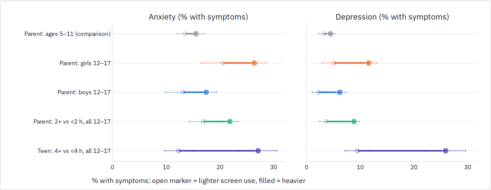

Each row joins the share with symptoms among lighter users (open marker) and heavier users (filled marker), with 95% CIs. Teen row: NHIS-Teen, July 2021–December 2023, 4+ versus fewer than 4 weekday non-school screen hours and GAD-2 / PHQ-2 ≥ 3 (NCHS Data Brief 513, n = 1,952). Parent rows: NHIS Sample Child 2022 and 2024, parent-reported "more than 2 hours a weekday" versus not and parent-reported daily/weekly anxiety or sadness. NCHS has not published the teen gradient by sex.

NCHS reports that teenagers with four or more hours of daily screen time were more than twice as likely to screen positive for anxiety (12.3% → 27.1%, prevalence ratio 2.21; 2.12 after adjustment for age, sex, race and Hispanic origin, urbanization, parental education and income) and for depression (9.5% → 25.9%, ratio 2.74; adjusted 2.51, 95% CI 1.89–3.35). In the parent interview, where the same adult reports both the child's screen time and the child's mood, the gradient is present but, for anxiety, far shallower: 12–17-year-olds whose parents say they exceed two hours a weekday are +5.1 (1.5) pp more likely to be described as anxious daily or weekly (16.9% → 21.8%, ratio 1.29, with age, sex, race/ethnicity, income, parental education, region, urbanicity and year controls) and +4.7 (0.8) pp more likely to be described as sad or depressed (3.7% → 8.9%, ratio 2.40). The parent-reported gradient is similar for boys (+4.8 (2.0) anxiety, +4.0 (0.8) depression) and girls (+4.8 (2.3) and +4.8 (1.3)), survives a control for parent-reported bullying in 2022 (+4.6 (2.3) and +5.2 (1.2), against +5.9 (2.3) and +5.8 (1.2) without it in the same year), and is weaker among 5–11-year-olds (+2.8 (1.1) and +1.0 (0.7)), the group for which the MICS analysis found a comparable cluster-level association. The exposure thresholds differ (2+ hours, which 81.0% of parents affirm, against 4+ hours, which about half of teenagers report), so the pp differences are not directly comparable; the prevalence ratios are the better comparison, and they put the parent-reported depression gradient (2.40) close to the teen-reported one (2.74) but the parent-reported anxiety gradient (1.29) well below it (2.21).

| Informant and sample           | Outcome                    | % lighter → heavier screen use | Unadjusted (SE), pp | Adjusted (SE), pp | Prevalence ratio            | n     |
|--------------------------------|----------------------------|--------------------------------|---------------------|-------------------|-----------------------------|-------|
| Parent: All 12–17              | anxious daily/weekly       | 16.9 → 21.8                    | +4.7 (1.5)          | +5.1 (1.5)        | 1.29                        | 5,823 |
|                                | sad/depressed daily/weekly | 3.7 → 8.9                      | +5.0 (0.8)          | +4.7 (0.8)        | 2.40                        | 5,819 |
| Parent: Boys 12–17             | anxious daily/weekly       | 13.1 → 17.4                    | +4.2 (1.9)          | +4.8 (2.0)        | 1.33                        | 3,005 |
|                                | sad/depressed daily/weekly | 2.2 → 6.2                      | +4.0 (0.9)          | +4.0 (0.8)        | 2.77                        | 3,003 |
| Parent: Girls 12–17            | anxious daily/weekly       | 20.5 → 26.4                    | +5.4 (2.3)          | +4.8 (2.3)        | 1.28                        | 2,815 |
|                                | sad/depressed daily/weekly | 5.1 → 11.6                     | +6.1 (1.4)          | +4.8 (1.3)        | 2.27                        | 2,813 |
| Parent: Ages 12–14             | anxious daily/weekly       | 15.9 → 21.5                    | +5.5 (2.0)          | +5.9 (2.1)        | 1.36                        | 2,678 |
|                                | sad/depressed daily/weekly | 3.0 → 7.8                      | +4.7 (1.1)          | +4.4 (1.1)        | 2.62                        | 2,675 |
| Parent: Ages 15–17             | anxious daily/weekly       | 18.3 → 22.1                    | +3.4 (2.4)          | +3.9 (2.4)        | 1.20                        | 3,145 |
|                                | sad/depressed daily/weekly | 4.8 → 9.8                      | +4.9 (1.3)          | +5.2 (1.3)        | 2.06                        | 3,144 |
| Parent: Ages 5–11 (comparison) | anxious daily/weekly       | 13.5 → 15.6                    | +2.0 (1.1)          | +2.8 (1.1)        | 1.15                        | 5,673 |
|                                | sad/depressed daily/weekly | 3.2 → 4.5                      | +1.2 (0.7)          | +1.0 (0.7)        | 1.40                        | 5,674 |
| Teen: all 12–17, 4+ h vs \<4 h | GAD-2 ≥ 3                  | 12.3 → 27.1                    | +14.8 (2.2)         | —                 | 2.21 (adj. 2.12, 1.67–2.71) | 1,952 |
|                                | PHQ-2 ≥ 3                  | 9.5 → 25.9                     | +16.4 (2.2)         | —                 | 2.74 (adj. 2.51, 1.89–3.35) | 1,952 |

Linear probability models, weighted, SEs clustered on pseudo-stratum × PSU. Parent rows pool NHIS 2022 and 2024 (the years with the screen-time item); adjusted models add single-year age, sex, race/ethnicity, income-to-poverty category, parental education, region, urbanicity and year. Teen rows are NCHS's published estimates (Data Brief 513 for the percentages; Zablotsky et al. 2025 for the Poisson prevalence ratios, with the adjusted ratio and its 95% CI in parentheses).

Bullying provides a benchmark for how well a parent-reported exposure tracks a parent-reported symptom when the exposure is salient to the parent. Among 12–17-year-olds in 2021–2022, those whose parents report that they were bullied in the past year are +21.1 (1.7) pp more often described as anxious daily or weekly (14.6% → 37.2%, ratio 2.54) and +12.3 (1.2) pp more often as sad or depressed (ratio 3.43); in the teenagers' own reports the corresponding differences are 15.3 pp (ratio 2.06) and 16.4 pp (ratio 2.36) (Data Brief 514). The parent items also behave as expected against treatment: 63.2% of 12–17-year-olds described as anxious daily received mental-health therapy or medication in the past year, against 48.5% of those anxious weekly and 7.9% of those never anxious.

##### Level and trend, 2021–2024

| NHIS year | Boys anxious d/w | Girls anxious d/w | Boys depressed d/w | Girls depressed d/w |
|-----------|------------------|-------------------|--------------------|---------------------|
| 2021      | 13.1%            | 20.9%             | 4.8%               | 9.6%                |
| 2022      | 17.5%            | 28.4%             | 5.6%               | 12.7%               |
| 2023      | 15.8%            | 23.0%             | 5.9%               | 9.3%                |
| 2024      | 15.4%            | 21.7%             | 5.1%               | 7.5%                |

Parent-reported daily/weekly anxiety and sadness among 12–17-year-olds by NHIS year (weighted; d/w = daily or weekly). Full table with SEs and single-year ages in `results/tables/nhis_prevalence.csv` and `nhis_prevalence_age.csv`.

Parent-reported anxiety among 12–17-year-olds moved from 16.9% in 2021 to 22.8% in 2022 and back to 18.5% in 2024, with the swing concentrated among girls (20.9% → 28.4% → 21.7%); parent-reported sadness followed the same path (7.1% → 9.1% → 6.3%). The post-2022 decline matches the downturn in self-reported sadness in the state youth surveys and the 2023 YRBS described above. On the MICS scale the U.S. parent reports sit in the upper middle of the international range: 25.5% of U.S. girls aged 15–17 are described as anxious daily or weekly and 11.8% as sad or depressed, against medians of 15.5% and 9.9% across the 68 MICS samples in the prevalence table.

Published work with the linked NHIS-Teen file, all from NCHS, points the same way as the population comparison. Parents report more health-care use than their teenagers do, with weighted Cohen's kappa between 0.08 and 0.42 across items ([Ng et al. 2025, NHSR 219](https://dx.doi.org/10.15620/cdc/174622)); parents report fewer adverse experiences than their teenagers, for instance 6.5% against 15.5% for witnessing neighborhood violence, with kappas of 0.27–0.53 ([Ng et al. 2025](https://doi.org/10.1016/j.chiabu.2025.107339)); teenagers who rarely receive social and emotional support report anxiety symptoms at 33.1% against 12.9% ([Zablotsky et al. 2024, NHSR 206](https://dx.doi.org/10.15620/cdc/156514)); and the screen-time gradient above is from [Data Brief 513](https://www.cdc.gov/nchs/products/databriefs/db513.htm) and [Zablotsky et al. 2025](https://doi.org/10.5888/pcd22.240537). The broader literature puts parent–youth agreement on internalizing symptoms at a mean correlation of 0.25 across 341 studies ([De Los Reyes et al. 2015](https://doi.org/10.1037/a0038498)). No NCHS publication has yet reported parent–teen agreement on the anxiety and depression items themselves; that is the first table an RDC proposal should produce.

**Assessment.** The NHIS pair does not resolve the caregiver–adolescent divergence, but it narrows it. Both informants show a screen-time gradient in their own reports, so the MICS null is not explained simply by parents being unable to see a link between heavy use and distress; the parent-reported gradient for anxiety is, however, much shallower than the teenagers' (1.29 against 2.21), and parents compress exactly the contrasts that dominate the self-report literature on H1: the girl–boy gap (1.6× against 2.7×) and the age gradient, while reporting less than half the depression the teenagers report. A caregiver-reported outcome therefore has limited power to detect a girl-specific, adolescence-specific association even when one exists, which is consistent with the MICS own-use estimates being near zero for girls while GSHS self-reports show a steep gradient. Because parent exposure and parent outcome come from one respondent here, as teen exposure and teen outcome do in GSHS, neither gradient separates a real association from shared-informant reporting; the cross-informant test on linked individuals requires the NHIS-Teen restricted file (RDC). The 2022 peak and subsequent decline in parent-reported anxiety and sadness independently corroborate the post-2021 downturn seen in self-report surveys (H0: not a self-report artifact).

## Part 3 · School pressure (H2)

The school-pressure hypothesis predicts that adolescent distress rose when and where academic demands intensified: during the high-stakes high-school years, in states that introduced test-based accountability reforms, and in countries where students report rising schoolwork pressure. We test this channel using U.S. adolescent time-use diaries, Monitoring the Future's published homework and socializing series, the cross-national HBSC schoolwork-pressure series, the school-calendar seasonality of suicide in the national vital statistics, and state accountability policy timelines.

### Did school demands rise? Time use of 15–17-year-olds (ATUS, 2003–2025)

The American Time Use Survey (ATUS) measures how U.S. 15–17-year-olds allocate their time on school-year weekdays. Between 2003–08 and 2015–19, average weekday homework time rose from roughly 50 minutes to 71 minutes per day (+40%) and stood at roughly 75 minutes in 2023–25 (the 2025 wave is the first ATUS year released since the Phase 1 report). Over the same period, sleep duration did not decline (averaging 8.7–9.2 hours), in-person socializing fell from about 40 minutes a day in 2003–08 to 24 minutes in 2020–22 and 16 minutes in 2023–25, television viewing fell by roughly 40%, and time spent playing computer or video games more than doubled. Sample sizes are modest (roughly 160 to 820 teens per pooled period), and because ATUS records only primary activities, background smartphone checking during homework or socializing is not captured.

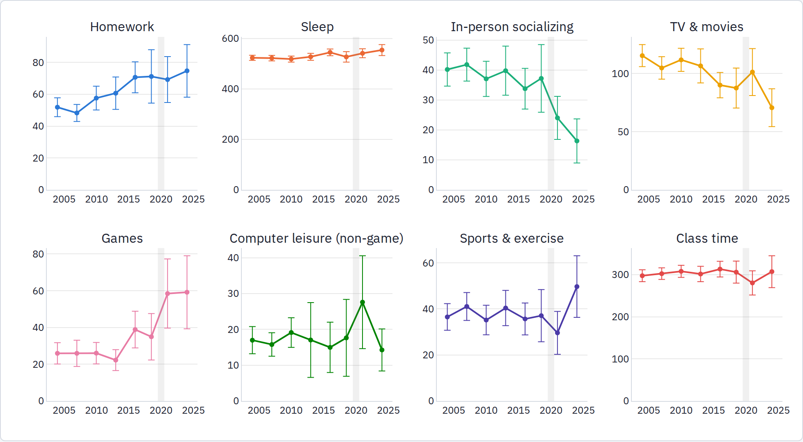

Weighted minutes per day on non-holiday weekdays during the school year (September–May), pooled periods; vertical bars show 95% confidence intervals.

### Monitoring the Future: homework, socializing, screens and distress among 12th graders, 1996–2012, and the student-level test that still needs the microdata

Monitoring the Future (MTF) is the one U.S. survey that has asked the same adolescents about homework hours, evenings out, time with friends, screen use and a stable set of distress items every year since 1991, and it is the source behind most of the Twenge-side correlational evidence. Its public-use microdata (ICPSR/NAHDAP series 35, grades 8, 10 and 12) could not be obtained from this machine: icpsr.umich.edu answers a Cloudflare bot challenge (HTTP 403) to every non-interactive client tried, and downloads in any case require an ICPSR login with terms acceptance. We therefore use what MTF itself published: the annual *Questionnaire Responses from the Nation's High School Seniors* volumes, which print every item's weighted percentage distribution by sex, race, region and college plans. The volumes for the 1996–2012 surveys are the only ones ever posted as PDFs (the series ended with the 2012 volume) and were recovered from Internet Archive captures; each item is answered by one random sixth of the national sample (about 2,261 weighted cases for a single-form item, 12,130 for items on every form). The 17 volumes were parsed into 26 item series and pooled across forms weighting by the N answering. Standard errors use a design effect of 2, the midpoint of the volumes' own guidance.

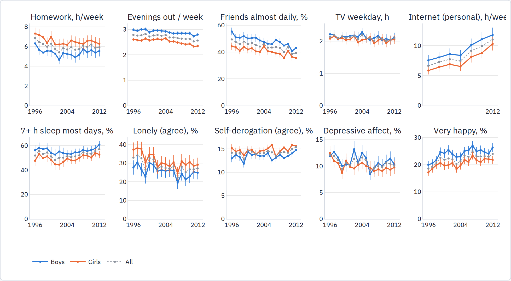

MTF 12th graders, 1996–2012, by sex (boys blue, girls orange, all dotted), with approximate 95% intervals. Homework and TV are means of category midpoints; the self-derogation and depressive-affect panels average the share endorsing the negative pole over four items each ("I feel I do not have much to be proud of", "Sometimes I think that I am no good at all", "I feel that I can't do anything right", "I feel that my life is not very useful"; "Life often seems meaningless", "The future often seems hopeless", disagree "I enjoy life as much as anyone", disagree "It feels good to be alive").

#### What moved before 2012, and what did not

Over 1996–2012, 12th graders' self-reported homework fell by roughly an hour a week (boys -0.78 (0.42) hours, girls -1.04 (0.42), from 6.9 to 5.9 hours for all students), so the MTF record does not show the rise in homework load that ATUS shows for school weekdays after 2003; MTF's weekly self-report is a different quantity from a diary, but Twenge and Park (2019) and Twenge, Spitzberg and Campbell (2019) read the same series as flat or declining back to 1976. In-person socializing, by contrast, fell steadily and well before smartphones: evenings out per week -0.19 (0.04) for boys and -0.25 (0.04) for girls, and the share getting together with friends informally almost every day -12.36 (2.09) and -8.82 (2.02) percentage points. Weekday television was flat (-0.05 (0.07) hours, all students), and the share getting seven or more hours of sleep most days rose by +4.71 (2.75) points for boys and +4.96 (2.68) for girls. Screen time did rise before the distress turn: personal internet use went from 6.6 to 11.0 hours a week between 2006 and 2012, daily social-networking from 49% to 71% (2008–2012; girls 78%), and electronic games from 6.6 to 9.9 hours a week. The distress items were, over the same sixteen years, essentially stable or improving: loneliness -2.80 (2.69) points for boys and -8.10 (2.76) for girls, self-derogation +1.79 (0.61) and +0.42 (0.62), depressive affect -1.55 (0.96) and -2.73 (0.93). The last two volumes catch at most the start of the post-2011 turn: between 2010 and 2012 girls' self-derogation rose +1.10 (0.62) points while their loneliness did not move (-1.40 (2.76)), and homework hours moved -0.33 (0.40) (girls) and -0.08 (0.41) (boys).

| Indicator (12th graders)                 | Boys 1996  | Boys 2012 | Δ 1996→2010            | Δ 2010→2012  | Girls 1996 | Girls 2012 | Δ 1996→2010            | Δ 2010→2012  |
|------------------------------------------|------------|-----------|------------------------|--------------|------------|------------|------------------------|--------------|
| Homework, hours/week (mean)              | 6.3        | 5.5       | -0.7 (0.4)             | -0.1 (0.4)   | 7.3        | 6.3        | -0.7 (0.4)             | -0.3 (0.4)   |
| Homework 10+ h/week, %                   | 22.3       | 17.0      | -3.8 (2.6)             | -1.5 (2.4)   | 27.6       | 20.8       | -5.8 (2.6)             | -1.0 (2.5)   |
| Evenings out per week (mean)             | 2.98       | 2.80      | -0.13 (0.04)           | -0.05 (0.04) | 2.60       | 2.35       | -0.17 (0.04)           | -0.08 (0.04) |
| Friends informally almost daily, %       | 55.4       | 43.0      | -9.2 (2.1)             | -3.1 (2.1)   | 44.3       | 35.5       | -3.3 (2.0)             | -5.5 (2.0)   |
| Dates weekly or more, %                  | 44.6       | 31.6      | -9.3 (1.2)             | -3.7 (1.2)   | 46.8       | 30.2       | -11.2 (1.2)            | -5.4 (1.2)   |
| TV on a weekday, hours (mean)            | 2.21       | 2.12      | -0.13 (0.10)           | +0.04 (0.10) | 2.08       | 2.05       | -0.14 (0.10)           | +0.11 (0.10) |
| Internet for personal use, h/week (mean) | 7.6 (2006) | 11.8      | +4.2 (0.8) (2006–2012) | +1.7 (0.8)   | 5.8 (2006) | 10.3       | +4.4 (0.7) (2006–2012) | +2.2 (0.7)   |
| Works during the school year, %          | 74.0       | 57.8      | -15.8 (1.2)            | -0.4 (1.2)   | 77.7       | 60.9       | -18.0 (1.1)            | +1.2 (1.2)   |
| 7+ hours of sleep most days, %           | 56.1       | 60.8      | +0.3 (2.8)             | +4.4 (2.1)   | 47.6       | 52.6       | +2.5 (2.7)             | +2.4 (2.1)   |
| Lonely: agree, %                         | 27.7       | 24.9      | -4.8 (2.7)             | +2.0 (2.6)   | 37.3       | 29.2       | -6.7 (2.8)             | -1.4 (2.8)   |
| Often feels left out, %                  | 23.4       | 27.1      | +1.5 (2.6)             | +2.2 (2.7)   | 34.8       | 33.4       | -4.9 (2.8)             | +3.5 (2.8)   |
| Self-derogation, mean % agree (4 items)  | 13.0       | 14.8      | +0.5 (0.6)             | +1.3 (0.6)   | 15.2       | 15.6       | -0.7 (0.6)             | +1.1 (0.6)   |
| Depressive affect, mean % (4 items)      | 11.9       | 10.3      | -1.1 (1.0)             | -0.5 (1.0)   | 12.5       | 9.8        | -2.8 (0.9)             | +0.1 (0.9)   |
| Very happy, %                            | 19.9       | 26.3      | +4.7 (1.1)             | +1.7 (1.2)   | 17.2       | 21.7       | +5.1 (1.0)             | -0.5 (1.1)   |
| Not too happy, %                         | 14.9       | 12.6      | -2.9 (0.9)             | +0.6 (0.9)   | 15.0       | 12.9       | -2.2 (0.9)             | +0.1 (0.9)   |
| Life satisfaction, mean (1-7)            | 5.01       | 5.14      | +0.08 (0.06)           | +0.06 (0.07) | 4.98       | 5.12       | +0.19 (0.05)           | -0.05 (0.06) |

Levels in 1996 and 2012 and changes with approximate SEs (design effect 2). Pooled across questionnaire forms; loneliness and the left-out item are on one form (n ≈ 2,270), happiness on all six.

At the year level the series that declined together over 1996–2012 (friends, evenings out, homework, loneliness, depressive affect) are positively correlated in levels, which is shared trend rather than evidence of anything; in first differences the correlations of the exposures with loneliness, self-derogation and depressive affect run from -0.67 (evenings out with self-derogation) to +0.50 (homework hours with loneliness) over seventeen points, with nothing in between that survives the number of pairs tried. Table: Pearson r in levels / in first differences (years).

| Year-level exposure  | Lonely             | Self-derogation    | Depressive affect  |
|----------------------|--------------------|--------------------|--------------------|
| Homework hours       | +0.63 / +0.50 (17) | +0.05 / +0.45 (17) | +0.45 / +0.22 (17) |
| Evenings out         | +0.46 / -0.43 (17) | -0.62 / -0.67 (17) | +0.42 / -0.14 (17) |
| Friends almost daily | +0.58 / -0.13 (17) | -0.58 / -0.47 (17) | +0.46 / +0.03 (17) |
| TV hours (weekday)   | +0.51 / +0.05 (17) | -0.20 / -0.06 (17) | +0.51 / +0.14 (17) |
| 7+ h sleep most days | -0.10 / -0.11 (17) | +0.20 / -0.25 (17) | -0.09 / +0.00 (17) |
| Works                | +0.54 / +0.09 (17) | -0.50 / +0.15 (17) | +0.27 / -0.18 (17) |

Year-level co-movement of 12th-grade means, all students. Seventeen annual points; these are descriptive, not estimates of an effect.

#### 8th and 10th graders, 1991–2014, from a published table

The one tabular annual series that reaches past 2012 is Johnson, Staff, Patrick and Schulenberg's (2017) Table 1, which regresses each MTF 8th/10th-grade indicator on survey-year dummies with 2008 as reference. Homework hours fall monotonically from +0.55 scale points above 2008 in 1991 to +0.05 in 2014 (the authors put the 2014 level under five hours a week); the odds of going out at least one evening a week fall from 1.29 times the 2008 level in 1991 to 0.67 in 2014; depressed mood is +0.07 points above 2008 in 1991, indistinguishable from 2008 through 2012, and +0.13 in 2014.

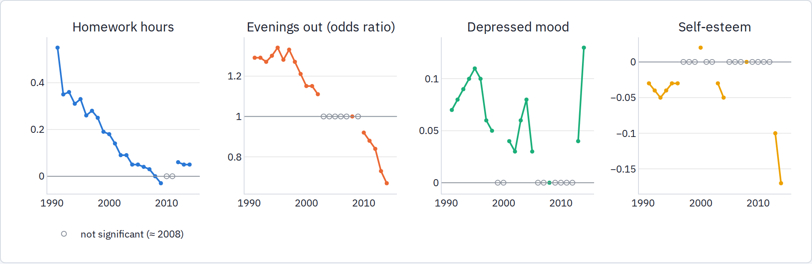

Johnson et al. (2017), Int J Psychol, Table 1: year coefficients (OLS) or odds ratios (logit) relative to 2008, MTF 8th and 10th graders pooled; open markers are years the authors report as not significantly different from 2008 (no point estimate given). Compiled in `data/compiled/mtf/mtf_johnson2017_year_effects.csv`.

#### What the student-level MTF literature already answers

Published analyses of the microdata cover the main effects but not the H3 interaction. On the phone side, Twenge, Joiner, Rogers & Martin (2018) report that high-school students using electronic devices five or more hours a day (YRBS) were 66% more likely to report a suicide-related outcome than one-hour users and, in MTF, that time on homework was *negatively* correlated with depressive symptoms, i.e. homework enters their models as a protective "nonscreen activity", not as pressure. Kreski, Platt, Rutherford, Olfson, Odgers, Schulenberg & Keyes (2021), using the same 8th/10th-grade files for 2009–2017, find that the daily-use margin of social networking carries no association with depressive symptoms for girls (overall OR 1.03, 95% CI 0.97–1.09 at the broadest cut) and a slightly protective one for boys, with any harm confined to 2009–2010. Keyes, Gary, O'Malley, Hamilton & Schulenberg (2019) establish that the post-2012 rise is a period effect (about 0.50 SD for girls and 0.33 SD for boys between 2012 and 2018), and Kaur et al. (2022) that adjusting for the falling share with seven hours' sleep reduces the period-effect median odds ratio for loneliness from 1.16 to 1.07. No published MTF paper interacts homework hours with social-media hours, and none reports the homework gradient of the social-media association by sex and grade; the time-use profile papers (Kreski et al. 2022, 2024) treat homework as one of 17 profile items and conclude that changing time-use composition explains little of the rise.

| Study                                                                                                                     | Data                                                                                    | Exposure → outcome                                                                                                                                                                                                            | Estimate (as published)                                                                                                                                                                                                                                                                                                                                             | Bears on                                          |
|---------------------------------------------------------------------------------------------------------------------------|-----------------------------------------------------------------------------------------|-------------------------------------------------------------------------------------------------------------------------------------------------------------------------------------------------------------------------------|---------------------------------------------------------------------------------------------------------------------------------------------------------------------------------------------------------------------------------------------------------------------------------------------------------------------------------------------------------------------|---------------------------------------------------|
| [Keyes, Maslowsky, Hamilton & Schulenberg (2015)](https://doi.org/10.1542/peds.2014-2707)                                 | MTF 8th/10th/12th 1991-2012 (N = 272,077)                                               | Period and cohort → Gets 7+ hours of sleep; gets less sleep than should                                                                                                                                                       | Sleep declined over 20 years; largest change between 1991-1995 and 1996-2000; girls, minorities, urban and low-SES students less likely to report 7+ h                                                                                                                                                                                                              | H2/H0 (pre-smartphone decline)                    |
| [Johnson, Staff, Patrick & Schulenberg (2017)](https://doi.org/10.1002/ijop.12389)                                        | MTF 8th/10th 1991-2014                                                                  | Survey year (Great Recession) → Self-esteem, depressed mood, GPA, homework hours, evenings out, work, sports, volunteering                                                                                                    | Homework hours declined steadily 1991-2014 (coefficient +0.55 in 1991 vs 2008; under 5 h/week by 2014); evenings out OR 1.29 (1991) to 0.67 (2014); depressed mood +0.13 in 2014                                                                                                                                                                                    | against H2 premise (homework fell for 8th/10th)   |
| [Twenge, Krizan & Hisler (2017)](https://doi.org/10.1016/j.sleep.2017.08.013)                                             | MTF + YRBS (N = 369,595)                                                                | New-media screen time (devices, social media, online news); homework, work, TV → Short sleep (\<7 h most nights)                                                                                                              | 16-17% more likely to report short sleep in 2015 vs 2009 (35% to 41% and 37% to 43%); exposure-response after 2+ h/day of device use; homework, paid work and TV stable or falling over the period                                                                                                                                                                  | H1 (sleep channel); against H2 via homework time  |
| [Twenge, Joiner, Rogers & Martin (2018)](https://doi.org/10.1177/2167702617723376)                                        | MTF 8th/10th/12th 1991-2015 + YRBS (N = 506,820)                                        | Hours/day on electronic devices; social media use; nonscreen activities (in-person interaction, sports, homework, print, religious services) → Depressive-symptom item mean \> 3; at least one suicide-related outcome (YRBS) | High depressive symptoms 16.13% (2010) to 21.48% (2015), +33%; 5+ h/day devices: 48% had a suicide-related outcome vs 29% at 1 h (66% more likely); 3+ h vs \<=2 h: +34%; homework time negatively correlated with depressive symptoms (Table 2)                                                                                                                    | H1 (dose); H2 (homework protective)               |
| [Twenge, Martin & Campbell (2018)](https://doi.org/10.1037/emo0000403)                                                    | MTF 8th/10th/12th 1991-2016 (N = 1.1 million)                                           | Screen activities (social media, internet, texting, gaming) vs nonscreen (in-person interaction, sports, homework, religious services) → Psychological well-being: self-esteem, life satisfaction, happiness                  | Well-being fell suddenly after 2012; lower among heavier screen users and higher among nonscreen users; light electronic-communication users happiest (abstract). Press release: happiest at \<1 h/day, unhappiness rises steadily beyond                                                                                                                           | H1                                                |
| [Keyes, Gary, O'Malley, Hamilton & Schulenberg (2019)](https://doi.org/10.1007/s00127-019-01697-8)                        | MTF 8th/10th/12th 1991-2018 (N = 1,260,159; 446,244 with the 4 depressive-affect items) | Period and cohort (age-period-cohort models) → 4-item depressive affect scale (life meaningless, future hopeless, enjoy life, good to be alive)                                                                               | Girls: decline 1991-2011 then rise, peak 2018; period effect 2018 = 1.15 (p\<.01); increase 2012-2018 about 0.50 SD for girls (mean 7.26 to 8.39) and 0.33 SD for boys; cohort effects minimal                                                                                                                                                                      | H0/H1 timing (period effect from 2012)            |
| [Orben & Przybylski (2019)](https://doi.org/10.1038/s41562-018-0506-1)                                                    | MTF + YRBS + UK Millennium Cohort (n = 355,358); MTF 8th/10th 2008-2016                 | Digital technology use (TV, internet, social media, gaming, texting; 11 MTF items) → Well-being (happiness, depressive affect, self-esteem; 12 MTF items)                                                                     | Association negative but small, explaining at most 0.4% of well-being variance; per-dataset median betas are in figures (not verifiable here)                                                                                                                                                                                                                       | against H1 magnitude                              |
| [Twenge & Campbell (2019)](https://doi.org/10.1007/s11126-019-09630-7)                                                    | MTF + YRBS + UK Millennium Cohort (n = 221,096)                                         | Digital media hours/day (\<1 h light vs 5+ h heavy) → Unhappiness, low well-being, depression, suicidal ideation, attempts                                                                                                    | Heavy vs light users 48% to 171% more likely to be unhappy/low well-being/have suicide risk factors; twice as likely to report a suicide attempt; light (not non-) users highest in well-being; largest drop between moderate and heavy use                                                                                                                         | H1 (dose)                                         |
| [Twenge & Park (2019)](https://doi.org/10.1111/cdev.12930)                                                                | Seven surveys incl. MTF 1976-2016 (N = 8.44 million)                                    | Adult activities (dating, sex, alcohol, paid work, going out without parents, driving) → Developmental timing (slow life strategy)                                                                                            | Fewer adolescents engage in adult activities; trends unlikely due to homework and extracurricular time, which stayed steady or declined                                                                                                                                                                                                                             | against H2 premise for 12th graders               |
| [Twenge, Spitzberg & Campbell (2019)](https://doi.org/10.1177/0265407519836170)                                           | MTF 8th/10th/12th + American Freshman 1976-2017 (N = 8.2 million)                       | In-person peer interaction (friends, parties, going out, dating, movies, riding in cars); social media use → Loneliness                                                                                                       | 2010s teens spent less time in in-person interaction; college-bound seniors in 2016 an hour less per day than late 1980s despite little change in homework or extracurricular time; loneliness rose sharply after 2011; lowest in-person + highest social media = most lonely; in-person interaction and social media positively correlated at the individual level | H1 (displacement) and H3 (combination)            |
| [Twenge, Haidt, Joiner & Campbell (2020)](https://doi.org/10.1038/s41562-020-0839-4)                                      | Re-analysis of MTF, YRBS, MCS                                                           | Social media vs TV vs gaming, by sex → Depressive symptoms, well-being                                                                                                                                                        | Figure 2 gives average linear r for boys and girls by medium; values behind paywall                                                                                                                                                                                                                                                                                 | H1 (sex x medium)                                 |
| [Kreski, Platt, Rutherford, Olfson, Odgers, Schulenberg & Keyes (2021)](https://doi.org/10.1016/j.jadohealth.2020.07.006) | MTF 8th/10th 2009-2017 (N = 74,472)                                                     | Daily social media use (visit social networking sites almost every day) vs less → Depressive symptoms (4-item scale) above cut-scores 9, 10, 12, 15                                                                           | Girls overall OR 1.03 (0.97-1.09) for score\>9, 1.01 (0.95-1.08) for \>10, 1.02 for \>12, 1.07 (0.96-1.21) for \>15; boys OR 0.97 (0.92-1.02) ... 0.86 (0.76-0.98) for \>15; possible harm confined to 2009-2010; daily use rose 61% to 89% (girls) and 46% to 75% (boys)                                                                                           | against H1 (daily-use margin)                     |
| [Twenge & Farley (2021)](https://doi.org/10.1007/s00127-020-01906-9)                                                      | UK Millennium Cohort age 14 (n = 11,427), not MTF                                       | Hours/day on social media, internet, gaming, TV → Self-harm, depressive symptoms, life satisfaction, self-esteem                                                                                                              | Heavy internet users 166% more likely to have clinically relevant depressive symptoms (girls) vs 75% (boys); social media/internet stronger than gaming/TV                                                                                                                                                                                                          | H1 (sex x activity)                               |
| [Askari, Rutherford, Mauro, Kreski & Keyes (2022)](https://doi.org/10.1007/s00127-021-02189-4)                            | MTF 8th/10th/12th 1991-2018 (N = 304,542)                                               | Period (time-varying effect modification) → Internalizing factor (8 items incl. self-derogation) and externalizing factor                                                                                                     | Internalizing factor mean -0.03 (2012) to 0.06 (2013); externalizing -0.06 (2011) to -0.13 (2012); internalizing-externalizing coupling fell 22.3% 2010-2018; decoupling started ~1995 for boys, ~2010 for girls                                                                                                                                                    | H0/H1 timing                                      |
| [Kaur, Hamilton, Chen, Hasin, Cerda, Martins & Keyes (2022)](https://doi.org/10.1093/aje/kwac010)                         | MTF 8th/10th/12th 1991-2019 (n ~ 390,000)                                               | Yearly prevalence of getting 7+ hours of sleep most nights → Loneliness (A lot of times I feel lonely); self-esteem, self-derogation, depressive affect                                                                       | Loneliness +0.83% per year; 2019 log-odds 0.68 (0.49-0.87) above the period mean; girls steeper than boys (p\<.0001); period-effect median OR 1.16 before vs 1.07 after adjusting for 7+ h sleep                                                                                                                                                                    | H1/H2 mechanism (sleep)                           |
| [Kreski, Chen, Olfson, Cerda, Martins, Mauro, Branas, Rajan & Keyes (2022)](https://doi.org/10.1016/j.ssmph.2022.101181)  | MTF 8th/10th 1991-2019 (N = 465,839)                                                    | Six latent time-use groups from 17 items (dates, parties, evenings out, friends, social media, sports, homework, work ...) → Highest-decile depressive symptoms; self-derogation; self-esteem                                 | Internalizing symptoms higher with low socializing, low engagement (sports, academics, community service) and paid work; social engagement declined over time, but shifts in time-use groups did not account for much of the increase in depressive symptoms (abstract)                                                                                             | against H1/H2 via time-use composition            |
| [Keyes & Platt (2024)](https://doi.org/10.1111/jcpp.13864)                                                                | Review (MTF among sources)                                                              | Established and novel risk factors incl. digital technology and social media → Internalizing conditions by sex                                                                                                                | Concludes many potential causes; digital technology evidence does not yet meet all conditions for explaining the increase (Table 2)                                                                                                                                                                                                                                 | H1/H2 synthesis                                   |
| [Kreski, Askari, Cerda, Chen, Hasin, Martins, Mauro, Olfson & Keyes (2024)](https://doi.org/10.1017/S0033291723001150)    | MTF 8th/10th/12th 1991-2020 (N = 338,896)                                               | Six time-use profiles from 17 behaviour items → Poor self-esteem; externalizing symptoms                                                                                                                                      | Poor self-esteem rose across nearly all activity groups; increases most pronounced for girls with low peer socializing                                                                                                                                                                                                                                              | H1/H2: rise is not confined to any time-use group |

Student-level MTF estimates as published (verified against the abstract, PMC full text or the paper where accessible; two entries flagged in the methods note could not be verified beyond the abstract). Full citations in `data/compiled/mtf/mtf_literature.csv`.

#### The prepared microdata test

`scripts/analysis/31_mtf.py` is written to run on the ICPSR files once they are placed in `data/external/mtf/icpsr/<study>/` (0 files found at this run). It locates variables through the MTF variable labels (the OSIRIS abbreviations printed in the volumes' cross-time index), with the 8th/10th-grade V-codes from Orben and Przybylski's public replication code as confirmed anchors, and estimates, by sex and grade with year fixed effects, race/ethnicity, parent education, region and the design weight, depressive affect, loneliness and happiness on homework hours, social-media hours and their product, followed by a year-effects decomposition of the change since 2012. The study numbers to request are listed in the script header; the 12th-grade files for 2013–2024 are the binding gap, since they carry the hours-per-day social-media item that the published volumes never reached.

**Assessment.** Nothing in the published MTF record supports the H2 premise for 12th graders: self-reported homework fell by about an hour a week from 1996 to 2012 (boys -0.78 (0.42), girls -1.04 (0.42)) and fell for 8th/10th graders from 1991 to 2014, while in-person socializing declined steadily through the whole period and TV time was flat; loneliness and depressive affect were lower in 2012 than in 1996 and self-derogation only slightly higher, with girls' self-derogation (+1.10 (0.62) points, 2010–2012) the one sign of the turn that Keyes et al. date to 2012. That ordering fits Haidt's and Gray's shared claim that face-to-face time was eroding before smartphones, and it leaves the H1 question to the 2013–2024 microdata. The literature answers the H1 main effect (a dose gradient in hours, a null at the daily-use margin) and shows homework as protective at the individual level, but the H3 interaction of homework with social-media hours has not been estimated by anyone; the pipeline here will estimate it as soon as the ICPSR files can be downloaded by an account holder.

### Schoolwork pressure across countries (HBSC)

The WHO Health Behaviour in School-aged Children (HBSC) surveys ask 11-, 13-, and 15-year-olds across roughly 45 European and North American countries the same question on schoolwork pressure and the same psychosomatic-complaints checklist every four years. Published country tables from 1997/98 through 2021/22 (supplemented by the HBSC data browser for 2014–2022) allow a direct cross-national test of Gray's school-pressure mechanism. Because the United States participated only through the 2009/10 wave, post-2010 U.S. trends cannot be tracked in HBSC.

Unweighted means across participating countries (thick lines), with the United States, Canada, and England shown as thin dashed lines. Age 15.

Both series were flat or declining through 2009/10 and then rose in tandem: among 15-year-old girls, the cross-country mean of perceived schoolwork pressure increased from 46% in 2010 to 50% in 2014, 51% in 2018, and 62% in 2022, while the share reporting two or more weekly psychosomatic complaints rose from 44% to 50%, 52%, and 66%. In the 2000s, American 15-year-olds reported above-average schoolwork pressure, though U.S. pressure fell between 2006 and 2010, the final U.S. wave.

##### Did complaints rise where pressure rose?

Each point is a country-sex cell at age 15; the dashed line is the pooled OLS fit (slope 0.24, SE 0.07, r = 0.59). Over the pre-pandemic 2010 → 2018 window alone, the slope is 0.16 (SE 0.07, r = 0.31).

| Specification (ages 11–15 pooled unless noted)                                                                         | Estimate                                                 | Interpretation                                                           |
|------------------------------------------------------------------------------------------------------------------------|----------------------------------------------------------|--------------------------------------------------------------------------|
| Within-country panel regression of complaints on pressure, with country×age×sex and wave×age×sex FE (1,440 cells)      | 0.14 (SE 0.04); girls 0.16, boys 0.12                    | A 10-pp rise in pressure corresponds to a 1.4-pp rise in complaints      |
| Long difference 2010 → 2018, age 15 (72 country-sex pairs)                                                             | mean Δpressure +5.5 pp, Δcomplaints +6.6 pp; slope 0.16  | Cross-country pressure differences account for ~1 pp of the 6.6-pp rise  |
| Long difference 2010 → 2022, age 15 (70 pairs)                                                                         | Δpressure +12.7, Δcomplaints +17.7; slope 0.24, r = 0.59 | Stronger relationship, though 2022 includes pandemic disruptions         |
| Pre-smartphone baseline period 2002 → 2010                                                                             | Δpressure −2.9, Δcomplaints −0.1; slope 0.14             | Same within-country slope during a period when neither series was rising |
| 2018 & 2022 cross-country: complaints on problematic social media use (PSMU) and pressure, wave×age×sex FE (496 cells) | PSMU 0.53 (SE 0.15); pressure 0.13 (SE 0.06)             | Both predictors are independently associated with complaints             |
| Within-country change 2018 → 2022 on PSMU and pressure                                                                 | PSMU 0.25 (SE 0.18); pressure 0.12 (SE 0.10)             | Imprecisely estimated with a single four-year change per country         |

**Assessment.** Perceived schoolwork pressure rose after 2010 across most HBSC countries, and psychosomatic complaints rose more in countries where pressure increased more. However, the within-country slope is modest (0.14) and identical to the slope during the 2002–2010 baseline period when neither measure was rising. Perceived pressure thus behaves like a steady correlate of complaints rather than the sole driver of the post-2010 inflection, most of which is absorbed by common wave effects across countries. Testing whether complaints became more concentrated among high-pressure students within countries requires the student-level HBSC microdata.

### School-calendar seasonality of adolescent suicide and the summer-vs-school decomposition of the rise (NVSS, 1999–2024)

Suicide deaths are the one adolescent-distress series that is counted, not asked, in every month of every year since 1999. The school-pressure (H2) and interaction (H3) hypotheses predict that whatever drove the post-2010 rise operated through the school year, so the increase should be concentrated in September–May; a phone or social-media mechanism that operates year-round (H1) predicts a proportional rise in summer and school months alike. [Hansen and Lang (2011)](https://doi.org/10.1016/j.econedurev.2011.04.012) and [Hansen, Sabia and Schaller (2024)](https://doi.org/10.3368/jhr.1222-12710R2) established the seasonal pattern itself: suicides at ages 12–18 fall every summer while young-adult suicides do not. Whether the *rise* of the 2010s followed the same calendar has not, as far as we can find, been tested; we do so here with the public CDC WONDER monthly tabulations of the National Vital Statistics System (ICD-10 X60–X84, Y87.0, \*U03), ages 12–17 against 18–24 and 25–34, by sex, with July 1 single-year-age populations as denominators and exposure adjusted for the length of each month (31,967 suicides at 12–17, 106,331 at 18–24 and 167,764 at 25–34 over 1999–2024). Data for 1999–2020 come from the 1999–2020 database (bridged-race populations) and 2021–2024 from the 2018–2024 single-race database; the two agree exactly on deaths in the overlap years.

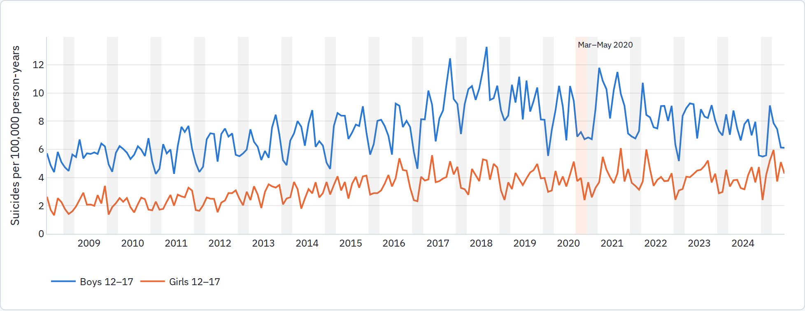

Monthly suicide rate per 100,000 person-years at ages 12–17 by sex, 2008–2024; shaded bands are June–August; the orange band marks the March–May 2020 school closures. Monthly counts are ~39 for girls and ~92 for boys in 2015–19, so single months are noisy.

#### The summer drop exists at 12–17 and not at 18–24 or 25–34

Pooling 1999–2019, the 12–17 suicide rate in June–August is 0.81 times the September–May rate (95% CI 0.78–0.83), a 19% summer deficit; it is 0.80 for girls and 0.81 for boys. At 18–24 the ratio is 1.01 (0.99–1.03) and at 25–34 1.07 (1.06–1.09): the young-adult and adult summer rates are, if anything, slightly higher than their school-month rates, as in Hansen and Lang. December, when students are out of school for its last ten days, is lower than the other school months at every age (the familiar holiday dip), but by more at 12–17 (0.80, 0.76–0.84) than at 18–24 (0.92) or 25–34 (0.94). A Poisson regression of monthly counts on summer and December indicators with year fixed effects gives the same picture (table), and the magnitudes match Hansen, Sabia and Schaller's 15.6–22.0% summer deficit from restricted county data. The depth of the trough has not changed: the summer ÷ school ratio at 12–17 was 0.83 in 2008–2010, 0.80 in 2015–2019 and 0.84 in 2021–2024.

| Ages  | Sex   | Deaths 1999–2019 | Rate | Sep–May | Jun–Aug | Summer ÷ school ratio (95% CI) | Dec ÷ other school months | Poisson log-ratio, summer (SE) |
|-------|-------|------------------|------|---------|---------|--------------------------------|---------------------------|--------------------------------|
| 12-17 | Girls | 6,491            | 2.5  | 2.6     | 2.1     | 0.80 (0.75–0.85)               | 0.79 (0.72–0.87)          | **-0.25 (0.03)**               |
| 12-17 | Boys  | 17,623           | 6.5  | 6.8     | 5.5     | 0.81 (0.78–0.84)               | 0.81 (0.76–0.85)          | **-0.24 (0.02)**               |
| 12-17 | Both  | 24,114           | 4.6  | 4.8     | 3.9     | 0.81 (0.78–0.83)               | 0.80 (0.76–0.84)          | **-0.24 (0.02)**               |
| 18-24 | Girls | 13,177           | 4.3  | 4.3     | 4.4     | 1.03 (0.99–1.07)               | 0.88 (0.82–0.94)          | +0.02 (0.02)                   |
| 18-24 | Boys  | 68,147           | 21.2 | 21.2    | 21.3    | 1.01 (0.99–1.02)               | 0.93 (0.90–0.95)          | -0.00 (0.01)                   |
| 18-24 | Both  | 81,324           | 13.0 | 12.9    | 13.1    | 1.01 (0.99–1.03)               | 0.92 (0.89–0.94)          | +0.00 (0.01)                   |
| 25-34 | Girls | 24,209           | 5.6  | 5.5     | 5.9     | 1.09 (1.06–1.12)               | 0.94 (0.89–0.98)          | **+0.08 (0.01)**               |
| 25-34 | Boys  | 101,130          | 22.9 | 22.5    | 24.1    | 1.07 (1.06–1.09)               | 0.93 (0.91–0.96)          | **+0.06 (0.01)**               |
| 25-34 | Both  | 125,339          | 14.3 | 14.1    | 15.1    | 1.07 (1.06–1.09)               | 0.94 (0.92–0.95)          | **+0.06 (0.01)**               |

Pooled 1999–2019 rates per 100,000 person-years. The summer ÷ school ratio is the June–August rate divided by the September–May rate with a Poisson 95% CI; the Poisson column is the log rate ratio of summer months relative to the other school months (September–May excluding December) from a model with year fixed effects and robust (HC1) standard errors.

#### Did the rise follow the school calendar?

We compare 2008–2010, the trough before the increase, with 2015–2019, the plateau at the top of the pre-pandemic rise (the 2005–2009 and 1999–2003 baselines in `nvss_decomposition.csv` give the same answer). For girls aged 12–17 the September–May rate rose from 2.2 to 4.1 per 100,000 (+82%), and the June–August rate from 1.8 to 3.2 (+80%); for boys the changes are +59% in school months and +51% in summer. The test statistic is the ratio of the two period ratios, school-month post ÷ pre over summer post ÷ pre: for girls, boys and both sexes together the school-month and summer increases are statistically indistinguishable (ratios of ratios 1.01, 95% CI 0.83–1.23; 1.05, 95% CI 0.93–1.19; 1.04, 95% CI 0.94–1.16). A rise confined to the school year, with summer flat at its 2008–2010 level, would give a ratio of ratios equal to the school-month ratio itself, 1.65; the upper confidence limit of 1.16 excludes it and allows at most 16% more growth in school months than in summer. Because school months carry 75% of the year's person-time, 80% of the absolute increase in annual deaths per 100,000 at 12–17 accrued in September–May, against the 75% expected if the rise were seasonally neutral. The Poisson model on monthly counts (month fixed effects, period indicator and a period × summer interaction, exposure offset) gives a post × summer log-ratio of -0.01 (0.09) for girls, -0.05 (0.06) for boys and -0.04 (0.05) pooled; a negative-binomial fit returns the same coefficients. The young-adult comparison behaves as a placebo should: at 18–24 the ratio of ratios is 1.02 (0.97–1.08), and the triple-difference coefficient (12–17 vs 18–24, post × summer × teen) is -0.02 (0.06) pooled, +0.05 (0.11) for girls. Other baselines agree: the ratio of ratios is 0.98 (0.90–1.07) from 1999–2003, 1.05 (0.97–1.15) from 2005–2009, and 1.00 (0.90–1.11) for 2008–2010 against 2021–2024.

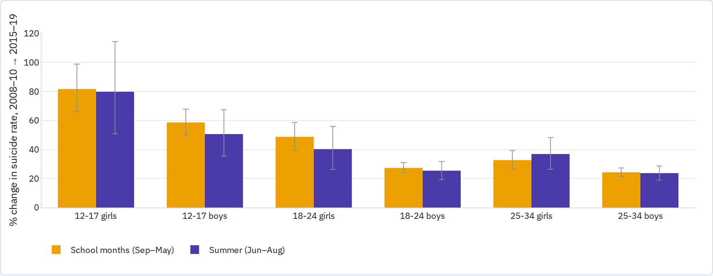

Percent change in the suicide rate from 2008–2010 to 2015–2019 in school months (September–May) and summer (June–August), by age group and sex, with Poisson 95% confidence intervals.

| Periods               | Ages  | Sex   | School-month rate | Change | Summer rate | Change | School ÷ summer ratio of ratios (95% CI) | Poisson post × summer (SE) | Share of increase in Sep–May |
|-----------------------|-------|-------|-------------------|--------|-------------|--------|------------------------------------------|----------------------------|------------------------------|
| 2008-2010 → 2015-2019 | 12-17 | Girls | 2.2 → 4.1         | +82%   | 1.8 → 3.2   | +80%   | 1.01 (0.83–1.23)                         | -0.01 (0.09)               | 79%                          |
| 2008-2010 → 2015-2019 | 12-17 | Boys  | 5.7 → 9.1         | +59%   | 4.9 → 7.4   | +51%   | 1.05 (0.93–1.19)                         | -0.05 (0.06)               | 80%                          |
| 2008-2010 → 2015-2019 | 12-17 | Both  | 4.0 → 6.6         | +65%   | 3.4 → 5.3   | +58%   | 1.04 (0.94–1.16)                         | -0.04 (0.05)               | 80%                          |
| 2008-2010 → 2015-2019 | 18-24 | Girls | 3.8 → 5.7         | +49%   | 4.3 → 6.1   | +40%   | 1.06 (0.94–1.20)                         | -0.06 (0.07)               | 76%                          |
| 2008-2010 → 2015-2019 | 18-24 | Boys  | 19.7 → 25.0       | +27%   | 19.8 → 24.8 | +25%   | 1.01 (0.96–1.07)                         | -0.01 (0.04)               | 76%                          |
| 2008-2010 → 2015-2019 | 18-24 | Both  | 11.9 → 15.6       | +31%   | 12.2 → 15.7 | +28%   | 1.02 (0.97–1.08)                         | -0.02 (0.03)               | 76%                          |
| 2008-2010 → 2015-2019 | 25-34 | Girls | 5.1 → 6.8         | +33%   | 5.5 → 7.5   | +37%   | 0.97 (0.88–1.06)                         | +0.03 (0.05)               | 71%                          |
| 2008-2010 → 2015-2019 | 25-34 | Boys  | 21.1 → 26.2       | +24%   | 23.0 → 28.5 | +24%   | 1.00 (0.96–1.05)                         | -0.00 (0.03)               | 74%                          |
| 2008-2010 → 2015-2019 | 25-34 | Both  | 13.1 → 16.6       | +27%   | 14.3 → 18.1 | +27%   | 1.00 (0.96–1.04)                         | +0.00 (0.03)               | 73%                          |
| 2015-2019 → 2021-2024 | 12-17 | Girls | 4.1 → 4.2         | +4%    | 3.2 → 3.4   | +8%    | 0.96 (0.83–1.11)                         | +0.04 (0.09)               | 65%                          |
| 2015-2019 → 2021-2024 | 12-17 | Boys  | 9.1 → 8.2         | -10%   | 7.4 → 7.0   | -5%    | 0.95 (0.86–1.05)                         | +0.05 (0.06)               | 88%                          |
| 2015-2019 → 2021-2024 | 12-17 | Both  | 6.6 → 6.3         | -5%    | 5.3 → 5.3   | -1%    | 0.96 (0.88–1.04)                         | +0.04 (0.06)               | 95%                          |
| 2015-2019 → 2021-2024 | 18-24 | Girls | 5.7 → 6.3         | +11%   | 6.1 → 5.9   | -2%    | 1.14 (1.03–1.26)                         | **-0.13 (0.06)**           | 109%                         |
| 2015-2019 → 2021-2024 | 18-24 | Boys  | 25.0 → 25.8       | +3%    | 24.8 → 25.7 | +4%    | 1.00 (0.95–1.05)                         | +0.00 (0.04)               | 74%                          |
| 2015-2019 → 2021-2024 | 18-24 | Both  | 15.6 → 16.3       | +4%    | 15.7 → 16.0 | +2%    | 1.02 (0.98–1.07)                         | -0.02 (0.03)               | 86%                          |
| 2015-2019 → 2021-2024 | 25-34 | Girls | 6.8 → 7.1         | +6%    | 7.5 → 7.7   | +3%    | 1.03 (0.95–1.11)                         | -0.03 (0.05)               | 84%                          |
| 2015-2019 → 2021-2024 | 25-34 | Boys  | 26.2 → 29.2       | +12%   | 28.5 → 30.5 | +7%    | 1.04 (1.00–1.08)                         | -0.04 (0.03)               | 82%                          |
| 2015-2019 → 2021-2024 | 25-34 | Both  | 16.6 → 18.3       | +10%   | 18.1 → 19.3 | +6%    | 1.04 (1.01–1.07)                         | -0.04 (0.03)               | 82%                          |

Rates per 100,000 person-years. The ratio of ratios divides the post ÷ pre rate ratio in school months by the same ratio in summer (above 1 = the rise was concentrated in school months). The Poisson column is the post × summer interaction from a monthly-count model with month fixed effects and an exposure offset (robust SE); the last column is the share of the absolute increase in annual deaths per 100,000 that accrued in September–May (seasonally neutral = 75%).

Extending the comparison past the pandemic, 2021–2024 against 2015–2019: the 12–17 school-month rate changed by -5% and the summer rate by -1% (ratio of ratios 0.96, 0.88–1.04); girls +4% vs +8%, boys -10% vs -5%. Annual 12–17 rates: girls 2.0 (2008), 3.9 (2019), 4.3 (2024); boys 5.3, 8.6, 7.0.

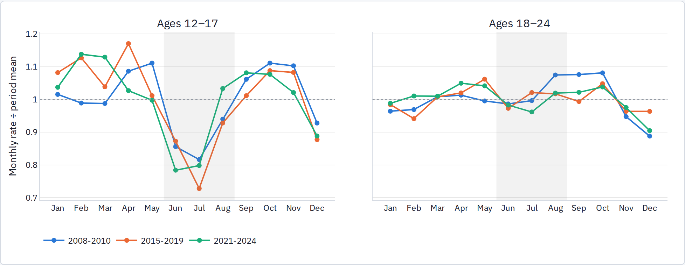

Seasonal profile (monthly rate divided by the period mean, both sexes) in 2008–2010, 2015–2019 and 2021–2024 at ages 12–17 and 18–24; shaded = June–August. The 12–17 trough keeps its depth across the rise.

#### 2020: closures and reopening

Expected counts for 2020 and 2021 come from a Poisson model fit to 2015–2019 monthly counts with month fixed effects and a linear year trend, extrapolated with each later month's exposure; a second variant applies the 2015–19 seasonal index to the 2019 rate (the "2019 level"). The two differ for 2021 because the extrapolated trend outruns the plateau that boys' rates had reached by 2018–19, so both are shown. In March–May 2020, 12–17 suicides were 33% below the trend expectation (ratio 0.67, 95% CI 0.60–0.76; girls 27% below, boys 35% below) and 23% below the 2019 level, against 9% below trend at 18–24 and 4% below at 25–34. Hansen, Sabia and Schaller report March–May 2020 teen suicides 25–38% below January 2020 (their abstract: −25% in March); the national figures here are of the same order, and January–February 2020 (7% below trend, 6% above the 2019 level) shows that 2020 did not start low. June–August 2020 was 12% below trend (1% above the 2019 level), and September–December 2020, when most districts were in hybrid or remote instruction, was 1% above trend but 16% above the 2019 level. January–May 2021, when most districts had returned to in-person instruction, was 14% below the trend expectation (ratio 0.86, 0.79–0.94) and 3% above the 2019 level; relative to the closure months themselves, March–May 2021 ran 31% higher (6.8 against 5.2 per 100,000 person-years), the direction of Hansen, Sabia and Schaller's reopening estimate, but whether 2021 was above or below where the pre-pandemic series would have been depends on the counterfactual.

| Ages  | Sex   | Jan–Feb 2020            | Mar–May 2020 (closures) | Jun–Aug 2020            | Sep–Dec 2020           | Jan–May 2021            |
|-------|-------|-------------------------|-------------------------|-------------------------|------------------------|-------------------------|
| 12-17 | Girls | 94 / 94 (+0%; +6%)      | 104 / 142 (-27%; -23%)  | 98 / 106 (-7%; -2%)     | 182 / 169 (+8%; +14%)  | 236 / 250 (-6%; +2%)    |
| 12-17 | Boys  | 210 / 234 (-10%; +6%)   | 224 / 347 (-35%; -24%)  | 241 / 279 (-14%; +2%)   | 439 / 445 (-1%; +16%)  | 528 / 638 (-17%; +3%)   |
| 12-17 | Both  | 304 / 328 (-7%; +6%)    | 328 / 489 (-33%; -23%)  | 339 / 384 (-12%; +1%)   | 621 / 613 (+1%; +16%)  | 764 / 886 (-14%; +3%)   |
| 18-24 | Girls | 156 / 138 (+13%; +19%)  | 223 / 235 (-5%; +0%)    | 216 / 237 (-9%; -4%)    | 315 / 288 (+9%; +15%)  | 417 / 380 (+10%; +17%)  |
| 18-24 | Boys  | 625 / 671 (-7%; -1%)    | 985 / 1091 (-10%; -4%)  | 1089 / 1056 (+3%; +10%) | 1375 / 1408 (-2%; +4%) | 1768 / 1817 (-3%; +7%)  |
| 18-24 | Both  | 781 / 810 (-4%; +3%)    | 1208 / 1327 (-9%; -3%)  | 1305 / 1294 (+1%; +7%)  | 1690 / 1696 (+0%; +6%) | 2185 / 2198 (-1%; +9%)  |
| 25-34 | Girls | 254 / 248 (+3%; +10%)   | 366 / 409 (-10%; -4%)   | 397 / 443 (-10%; -4%)   | 555 / 537 (+3%; +11%)  | 678 / 658 (+3%; +12%)   |
| 25-34 | Boys  | 1141 / 1051 (+9%; +13%) | 1659 / 1702 (-3%; +2%)  | 1814 / 1831 (-1%; +3%)  | 2268 / 2254 (+1%; +5%) | 2881 / 2777 (+4%; +11%) |
| 25-34 | Both  | 1395 / 1299 (+7%; +13%) | 2025 / 2112 (-4%; +1%)  | 2211 / 2275 (-3%; +2%)  | 2823 / 2793 (+1%; +6%) | 3559 / 3449 (+3%; +11%) |

Observed / expected suicides from the trend model; in parentheses the percent difference from the trend model and, after the semicolon, from the 2019-level model (2019 annual rate × 2015–19 seasonal index × the window's exposure). Population change is in the exposure.

#### Day of week

WONDER also tabulates deaths by day of week, and its year/month filter lets the weekday table be pooled over school months and summer months separately. Pooling 1999–2019, 12–17 suicides per calendar day are 1.19 times higher on Monday–Friday than on Saturday–Sunday during school months (95% CI 1.15–1.23), with Monday the peak (3.70 deaths per Monday against 2.81 per Saturday), and 1.11 times higher in summer (1.04–1.18); the school ÷ summer ratio of those ratios is 1.07 (1.00–1.15). At 18–24 there is no weekday excess in either season (0.98 in school months, 0.98 in summer). Part of the adolescent weekday excess therefore survives the summer, but it is larger in term time and absent at the ages that have left school, which makes it a second, within-week trace of school exposure to set beside the summer trough.

| Period    | Ages  | Sex   | Deaths  | Weekday ÷ weekend per-day ratio, Sep–May (95% CI) | Same, Jun–Aug    | School ÷ summer  |
|-----------|-------|-------|---------|---------------------------------------------------|------------------|------------------|
| 1999-2019 | 12-17 | Both  | 24,109  | 1.19 (1.15–1.23)                                  | 1.11 (1.04–1.18) | 1.07 (1.00–1.15) |
| 1999-2019 | 12-17 | Girls | 6,491   | 1.15 (1.08–1.23)                                  | 1.06 (0.94–1.19) | 1.09 (0.96–1.25) |
| 1999-2019 | 12-17 | Boys  | 17,618  | 1.20 (1.15–1.25)                                  | 1.13 (1.05–1.22) | 1.06 (0.98–1.15) |
| 1999-2019 | 18-24 | Both  | 81,306  | 0.98 (0.97–1.00)                                  | 0.98 (0.96–1.01) | 1.00 (0.96–1.03) |
| 1999-2019 | 18-24 | Girls | 13,175  | 1.01 (0.97–1.05)                                  | 1.01 (0.94–1.09) | 1.00 (0.92–1.09) |
| 1999-2019 | 18-24 | Boys  | 68,131  | 0.98 (0.96–1.00)                                  | 0.98 (0.95–1.01) | 1.00 (0.96–1.04) |
| 1999-2019 | 25-34 | Both  | 125,295 | 1.01 (0.99–1.02)                                  | 1.00 (0.98–1.03) | 1.01 (0.98–1.03) |
| 1999-2019 | 25-34 | Girls | 24,200  | 1.02 (0.99–1.06)                                  | 1.03 (0.98–1.09) | 0.99 (0.93–1.05) |
| 1999-2019 | 25-34 | Boys  | 101,095 | 1.00 (0.99–1.02)                                  | 0.99 (0.97–1.02) | 1.01 (0.98–1.04) |
| 2021-2024 | 12-17 | Both  | 6,261   | 1.15 (1.08–1.23)                                  | 1.11 (0.98–1.25) | 1.04 (0.91–1.19) |
| 2021-2024 | 12-17 | Girls | 2,049   | 1.21 (1.08–1.36)                                  | 1.25 (1.00–1.56) | 0.97 (0.76–1.24) |
| 2021-2024 | 12-17 | Boys  | 4,212   | 1.12 (1.04–1.22)                                  | 1.05 (0.91–1.21) | 1.07 (0.91–1.26) |
| 2021-2024 | 18-24 | Both  | 20,016  | 0.99 (0.95–1.02)                                  | 1.02 (0.95–1.08) | 0.97 (0.90–1.04) |
| 2021-2024 | 18-24 | Girls | 3,761   | 1.03 (0.95–1.12)                                  | 1.11 (0.96–1.29) | 0.93 (0.79–1.10) |
| 2021-2024 | 18-24 | Boys  | 16,255  | 0.98 (0.94–1.01)                                  | 1.00 (0.93–1.07) | 0.98 (0.91–1.06) |
| 2021-2024 | 25-34 | Both  | 33,961  | 0.98 (0.95–1.01)                                  | 0.99 (0.95–1.04) | 0.99 (0.94–1.04) |
| 2021-2024 | 25-34 | Girls | 6,564   | 0.98 (0.92–1.05)                                  | 1.02 (0.92–1.13) | 0.97 (0.86–1.09) |
| 2021-2024 | 25-34 | Boys  | 27,397  | 0.98 (0.95–1.01)                                  | 0.98 (0.93–1.04) | 0.99 (0.94–1.06) |

Deaths per calendar day on Monday–Friday divided by deaths per calendar day on Saturday–Sunday, pooled over the period's school months (September–May) or summer months (June–August), with Poisson 95% CIs; the last column divides the school-month ratio by the summer ratio.

#### What the literature already shows

| Study                                                                                                           | Data                                                                                              | Finding on the school calendar                                                                                                                                                                                                                                                      |
|-----------------------------------------------------------------------------------------------------------------|---------------------------------------------------------------------------------------------------|-------------------------------------------------------------------------------------------------------------------------------------------------------------------------------------------------------------------------------------------------------------------------------------|
| [Hansen & Lang 2011](https://doi.org/10.1016/j.econedurev.2011.04.012), *Econ. Educ. Rev.*                      | State-month suicide rates 1980–2004, NVSS multiple-cause files                                    | Summer lowers the 14–17 suicide rate by 1.38 per 100,000 (youth overall −0.83); the drop is absent at 19–25, whose summer rate is higher; not explained by weather, economic conditions or seasonal affective disorder                                                              |
| [Hansen, Sabia & Schaller 2024](https://doi.org/10.3368/jhr.1222-12710R2), *J. Human Resources* (NBER WP 30795) | Restricted county-month NVSS counts 1990–2020, ages 12–18 vs 19–25; SafeGraph school foot traffic | 12–18 suicides 15.6–22.0% below January in June–August and ~19% lower in December; August-start counties rise in August, September-start counties in September; March–May 2020 25–38% below January 2020 (abstract: −25% in March); reopening +12–18%; young adults +1–3% in summer |
| [Lueck et al. 2015](https://doi.org/10.1016/j.ajem.2015.02.055), *Am. J. Emerg. Med.*                           | 3,223 pediatric psychiatric ED visits for danger to self/others, one academic ED, 2009–2012       | 82.7% of visits in school weeks vs 68.6% of time in school: IRR 2.18 (urinary-tract-infection control 1.25)                                                                                                                                                                         |
| [Plemmons et al. 2018](https://doi.org/10.1542/peds.2017-2426), *Pediatrics*                                    | 115,856 suicide-ideation/attempt encounters, 31 children's hospitals, ages 5–17, 2008–2015        | Share of encounters rose from 0.66% to 1.82%; lowest in summer, highest in spring and fall every year, with the seasonal pattern persisting over the rise                                                                                                                           |
| [Carbone, Holzer & Vaughn 2019](https://doi.org/10.1016/j.jpeds.2018.10.017), *J. Pediatrics*                   | HCUP ED billing data 2010–2014, 874,872 child/adolescent visits                                   | Largest increase at 12–14 (+82%); higher rates in the school year for children and adolescents, no seasonality for adults                                                                                                                                                           |
| [Kim, Krause & Lane 2023](https://doi.org/10.1001/jamanetworkopen.2023.24183), *JAMA Netw. Open*                | Commercial-claims ED visits and hospitalizations for suicidality, ages 10–19, 2016–2021           | Peak in April (IRR 1.15) and nadir in July (IRR 0.63) in pre-COVID years and 2021; April–May 2020 were the lowest months of that year                                                                                                                                               |
| [Radhakrishnan et al. 2023](https://doi.org/10.15585/mmwr.mm7238a3), *MMWR*                                     | NSSP ED visits, ages 5–17, Jan 2018–Jun 2023                                                      | Suicidal-ideation/self-harm visit ratios for fall and spring semesters vs the preceding summer 1.13–2.00 (10–14) and 1.15–1.74 (15–17) in every school year including 2021–22 and 2022–23                                                                                           |
| [To et al. 2024](https://doi.org/10.1186/s12888-024-06309-7), *BMC Psychiatry*                                  | CDC WONDER monthly suicides 2015–2020 by age group                                                | Ages 15–24 are the only group peaking in September–October with a June trough; summer incidence lower than at 25+ in every year                                                                                                                                                     |

**Assessment.** Two things are established with precision and one is ruled out. First, school exposure raises the *level* of adolescent suicide: at 12–17 the rate is 19% lower in June–August than in September–May (95% CI 17–22%), 19% higher on school days than at weekends, and 33% below expectation when schools closed in March–May 2020, with none of these patterns at 18–24 or 25–34. That is the premise of H2 and H3, it replicates Hansen, Sabia and Schaller nationally, and it holds in every period from 1999 to 2024. Second, the 2008–10 → 2015–19 rise did not follow the school calendar: school-month and summer rates rose +65% and +58% (ratio of ratios 1.04, 95% CI 0.94–1.16), the triple difference against 18–24 is -0.02 (0.06), the seasonal profile kept its depth, and the same holds for girls and boys separately and for every alternative baseline. A driver that acted only through the school day, whether academic pressure, school climate or what phones do at school, would have raised September–May faster than June–August; the data exclude a school-only rise and allow at most 16% faster growth in term time. Third, the pattern that fits is a year-round driver scaling a fixed seasonal profile, which is what H1 (continuous exposure to phones and social media) predicts and a pure H2 account does not; H3 survives only in a form where the interaction operates as much in summer as in term. Caveats: suicide is a rare extreme outcome whose drivers (means, intoxication, contagion) need not match those of the survey-measured distress the rest of the report tracks; summer is not school-free (August starts, summer school, school-based peer networks and anticipatory anxiety carry over); and the 2021 reopening comparison is unresolved between the two counterfactuals (14% below trend, 3% above the 2019 level). The school effect on the level is real and large; the rise ran through summer as much as through the school year.

### U.S. school accountability policy

In the United States, states adopted test-based accountability reforms on staggered schedules between 2009 and 2017; if those policy shifts drove adolescent distress, states implementing them should show corresponding increases in youth depression and sadness.

We compiled implementation dates across all 51 jurisdictions for five major state accountability policies, documenting a primary source for each cell: Race to the Top awards (2010–11), ESEA/NCLB flexibility waivers (2012–16), the first operational Common Core–aligned state assessment (2012–2019, concentrated in spring 2015), statewide test-based teacher evaluation (2009–2017), and mandatory high-school exit exams (which declined from 25 states to 13 over the decade). Years refer to the school year ending that spring.

Share of states (including DC) with each policy in force. Most states adopted ESEA waivers, teacher-evaluation rules, and Common Core–aligned tests within a narrow 2012–2015 window, leaving limited timing variation across states.

#### State-year regressions

| Policy (each estimated alone)            | ACS girls    | ACS boys     | YRBS sad girls   | YRBS sad boys    | NSDUH youth MDE |
|------------------------------------------|--------------|--------------|------------------|------------------|-----------------|
| Race to the Top winner (award year–2015) | -0.06 (0.07) | -0.00 (0.10) | **+1.06 (0.40)** | **+0.68 (0.34)** | +0.16 (0.14)    |
| ESEA waiver in force                     | -0.01 (0.08) | +0.13 (0.07) | -1.08 (0.56)     | -0.20 (0.48)     | -0.18 (0.25)    |
| Common Core aligned test in force        | -0.00 (0.08) | +0.01 (0.12) | -0.88 (0.75)     | -0.95 (0.71)     | -0.35 (0.30)    |
| Test-based teacher evaluation in force   | -0.03 (0.06) | -0.13 (0.09) | -0.48 (0.62)     | -0.28 (0.36)     | -0.03 (0.17)    |
| High-school exit exam in force           | -0.04 (0.07) | -0.03 (0.12) | -0.49 (0.81)     | -0.07 (0.86)     | +0.34 (0.27)    |
| Pressure index (sum of the five)         | -0.03 (0.03) | -0.01 (0.04) | -0.17 (0.25)     | -0.06 (0.20)     | +0.02 (0.09)    |

Coefficients in percentage points from regressions with state and year fixed effects, inverse-variance weights, and standard errors clustered by state, 2008–2019 (YRBS biennial across 43 states). NSDUH estimates are reported in two-year waves and matched to the average policy indicator across the two survey years; state clustering accounts for the half-sample overlap between consecutive waves (restricting to non-overlapping waves changes every NSDUH coefficient by less than 0.15 pp). Bold = \|t\| \> 1.96.

Common Core–aligned testing, ESEA waivers, test-based teacher evaluations, high-school exit exams, and the five-policy sum show no positive relationship with any of the three distress measures; several point estimates are slightly negative. The only statistically significant positive coefficient in the table is for Race to the Top on YRBS sadness (+1.06 pp for girls, SE 0.40; +0.68 pp for boys, SE 0.34; the YRBS panel now includes the five states added by the 2025 combined release), while the corresponding NSDUH estimate is +0.16 pp (SE 0.14) and the ACS coefficients are near zero. However, the 19 Race to the Top winners were a selected group of states (including DC, New York, Massachusetts, and Florida), and the static indicator was coded as 1 only during the 2010–2015 grant window—treating the winners' higher post-2015 sadness levels as part of the control baseline. When we trace the winning states year by year around the award date in the event study below, the apparent effect disappears.

#### Race to the Top, traced year by year

State and year fixed effects, plotting coefficients relative to the year before the award (the school year ending spring 2010 for Phase 1 and 2 winners, and spring 2012 for the December 2011 Phase 3 winners), 2005–2019. Both award cohorts are observed in the YRBS wave prior to their award (2009 and 2011); event years 6 or more before and 8 or more after are pooled into endpoint bins.

Tracing Race to the Top winners year by year around the grant award shows why the static regression coefficient in the previous section was misleading: after winning an award, states' YRBS sadness and NSDUH youth depression rates actually trended flat to downward relative to non-winning states. The positive static coefficient was an artifact of coding the grant indicator as 1 only during 2010–2015, which placed the winning states' post-2015 observations into the reference group. The event study provides no evidence that Race to the Top increased adolescent distress. Within the U.S. public data, state accountability policy shocks do not explain the post-2010 rise.

## Part 4 · The interaction (H3): phones in the same hours as high-pressure school

In its sharpest form, the interaction hypothesis (H3) proposes that smartphones harm adolescents primarily when they pervade the school day alongside high-stakes academic pressure—layering constant social comparison and notifications onto the same hours that carry grades and testing. That mechanism implies three testable predictions: academic demands and smartphone use should both have risen after 2010 (as seen in HBSC schoolwork pressure and U.S. weekday homework time); removing phones from the school day should improve well-being, particularly for students experiencing high academic pressure; and screen use outside high-pressure school environments should be less strongly tied to distress. Phase 2 adds the direct test that Phase 1 lacked: PISA 2015 measures schoolwork anxiety itself, alongside internet hours at school and outside school.

### What the phone-ban evidence says about this

PISA 2022 allows an initial test of whether school phone bans matter more for academically anxious students. Because PISA 2022 did not include general schoolwork-anxiety items, we use the PISA mathematics-anxiety index (asked of all students) as a proxy for academic pressure, splitting students at their country's median. We estimate the same within-country regression as above, interacting the school ban indicator with high mathematics anxiety separately by sex.

| Outcome                 | Sex   | Ban, low-anxiety students (SE) | Ban, high-anxiety students | Difference (SE) | High vs low anxiety, no ban |
|-------------------------|-------|--------------------------------|----------------------------|-----------------|-----------------------------|
| Lonely at school        | girls | -0.27 (0.68)                   | -1.15                      | -0.88 (0.93)    | +8.2                        |
| Lonely at school        | boys  | +1.12 (0.53)                   | -0.81                      | -1.94 (0.98)    | +7.4                        |
| Nervous without device  | girls | -0.75 (0.60)                   | -0.49                      | +0.26 (0.78)    | +9.3                        |
| Nervous without device  | boys  | +0.13 (0.53)                   | +0.19                      | +0.06 (0.81)    | +5.8                        |
| Belonging index         | girls | +2.34 (1.60)                   | +2.46                      | +0.11 (1.90)    | -22.7                       |
| Belonging index         | boys  | +0.32 (1.43)                   | +1.91                      | +1.59 (2.11)    | -19.2                       |
| Life satisfaction index | girls | +3.09 (3.41)                   | +2.23                      | -0.86 (4.53)    | -25.3                       |
| Life satisfaction index | boys  | +2.54 (3.26)                   | +0.71                      | -1.82 (4.93)    | -25.2                       |

Binary items in percentage points and scale indices in hundredths of an SD; regressions include country fixed effects, socio-economic status, private/public school type, and grade controls, student weights, and school-clustered standard errors across 441,992 students with non-missing mathematics anxiety.

Students with above-median mathematics anxiety are substantially lonelier at school (+8.2 pp among girls and +7.4 pp among boys in non-ban schools), and the association between attending a ban school and lower loneliness is larger for them: −1.15 pp for high-anxiety girls versus −0.27 pp for low-anxiety girls (interaction −0.88 pp, SE 0.93), and −0.81 pp versus +1.12 pp for boys (interaction −1.94 pp, SE 0.98). These interaction estimates point in the direction H3 predicts, though they are noisy and rely on mathematics anxiety as a proxy for broader academic pressure. Notably, school bans reduce daily in-school phone use by virtually the same amount (~13 percentage points) in both anxiety groups, so any difference in well-being would reflect differential sensitivity to removing phones rather than differential compliance. A more direct test of H3 requires pairing school phone policies with a direct measure of schoolwork pressure, which the 2021/22 HBSC microdata can support.

### PISA 2012–2022: school loneliness, life satisfaction and digital use across waves

PISA has asked 15-year-olds the same six sense-of-belonging statements since 2000 ("I feel lonely at school", "I feel like I belong at school", ...), a 0–10 life-satisfaction question since 2015, and, in the systems that chose the ICT familiarity module, how long they spend on the Internet on a typical weekday at school and outside school (2012, 2015 and 2018; identical seven categories from "no time" to "more than 6 hours"). PISA 2022 replaced the Internet items with hours per day on digital resources for learning and for leisure, at school and before/after school, which we sum to total device hours and flag wherever 2022 enters a digital-use comparison. Stacking the four public-use files gives 2,225,175 students: 480,174 in 65 systems in 2012 (43 with the ICT module), 519,334 in 73 in 2015 (46), 612,002 in 80 in 2018 (53) and 613,665 in 80 in 2022. Life satisfaction is available for 50, 72 and 73 systems in 2015, 2018 and 2022. In 2012 the belonging block sat in two of the three rotated questionnaire forms, so about a third of students have no belonging items by design; all estimates use the final student weights. The 2015 wave also carries the five-item test-anxiety scale (ANXTEST: "I often worry that it will be difficult for me to take a test", "I worry that I will get poor grades at school", "Even if I am well prepared for a test I feel very anxious", "I get very tense when I study", "I get nervous when I don't know how to solve a task at school"), which is the direct schoolwork-anxiety measure that the Phase 1 H3 test had to proxy with mathematics anxiety in 2022.

#### Trends

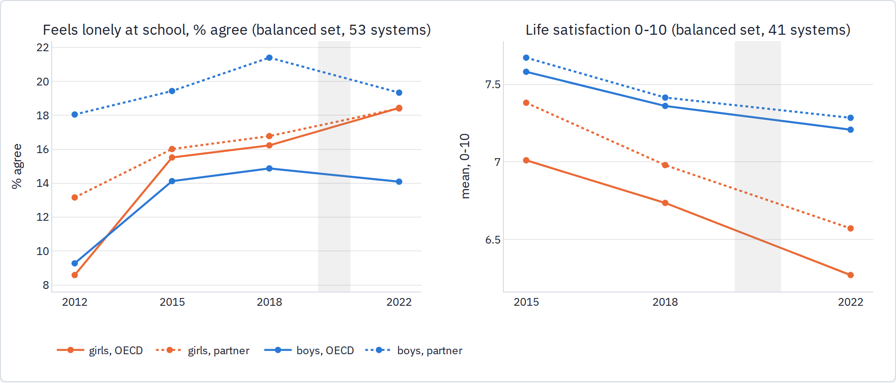

Unweighted means of weighted country means, restricted to systems that asked the item in every wave shown (balanced sets). Solid lines are OECD members, dotted lines partner systems. Life satisfaction was first asked in 2015. The grey band marks 2020.

Among OECD systems, the share of girls who agree they feel lonely at school moved from 8.6% in 2012 to 15.5% in 2015, 16.2% in 2018 and 18.4% in 2022; for boys the path is 9.3% → 14.1% → 14.9% → 14.1%. Partner systems started higher (13.2% of girls, 18.0% of boys in 2012) and reached 18.4% and 19.3% in 2022. Agreement with "I feel like I belong at school" fell from 82.7% to 73.8% among girls and from 81.0% to 76.5% among boys across all systems in the balanced set. Mean life satisfaction among OECD girls went from 7.01 in 2015 to 6.74 in 2018 and 6.27 in 2022, against 7.58, 7.36 and 7.21 for boys, so the sex gap in life satisfaction widened from 0.57 to 0.94 points. Over the same years weekday Internet time in the ICT-module systems rose from 2.37 hours outside school and 0.65 hours at school in 2012 to 3.62 and 1.59 hours in 2018; the share above 4 hours outside school went from 19% to 40% and the share above 1 hour at school from 17% to 40%. The largest single step in loneliness is 2012 → 2015, the wave in which most systems moved from paper to computer-delivered questionnaires and the belonging block left the rotated design; the 2015 → 2022 changes are smaller and, for OECD boys, flat.

#### Within-country panel: did well-being fall more where digital hours rose more?

The country-sex-wave means are regressed on the mean in-school and out-of-school weekday hours with country and wave fixed effects, so that the estimates use only within-country changes net of the common wave trend; the mean ESCS of the cell is controlled and standard errors are clustered by country. The 2012–2018 rows use the identical Internet-hours item; the 2012–2022 rows add the 2022 total device hours.

| Outcome (country means)    | Waves     | Girls: in-school h | Girls: out-of-school h | Boys: in-school h | Boys: out-of-school h | Cells / systems |
|----------------------------|-----------|--------------------|------------------------|-------------------|-----------------------|-----------------|
| Lonely at school (pp)      | 2012-2018 | +1.40 (1.02)       | -0.81 (1.16)           | +0.95 (1.37)      | -0.08 (1.55)          | 118 / 43        |
| Lonely at school (pp)      | 2012-2022 | +0.33 (0.63)       | -0.22 (0.58)           | -0.18 (0.72)      | -0.52 (0.51)          | 184 / 56        |
| Belongs at school (pp)     | 2012-2018 | -2.03 (1.30)       | **-2.33 (0.92)**       | -0.70 (1.81)      | **-2.62 (1.23)**      | 118 / 43        |
| Belongs at school (pp)     | 2012-2022 | -0.71 (1.39)       | -1.38 (0.84)           | -0.17 (1.29)      | -1.00 (0.89)          | 184 / 56        |
| Life satisfaction (points) | 2012-2018 | +0.008 (0.169)     | +0.097 (0.149)         | -0.044 (0.214)    | +0.052 (0.212)        | 66 / 33         |
| Life satisfaction (points) | 2012-2022 | +0.113 (0.097)     | +0.053 (0.068)         | +0.158 (0.100)    | -0.032 (0.087)        | 126 / 48        |
| Life satisfaction 0-4 (pp) | 2012-2018 | -1.40 (1.78)       | -0.35 (1.53)           | -0.78 (2.08)      | -2.74 (1.95)          | 66 / 33         |
| Life satisfaction 0-4 (pp) | 2012-2022 | -1.24 (1.04)       | -0.15 (0.68)           | **-1.99 (0.90)**  | +0.87 (0.78)          | 126 / 48        |

Coefficient per additional hour per weekday (SE); bold when \|t\| \> 1.96. Cells are country × sex × wave means for ICT-module systems observed in at least two waves. Life satisfaction rows start in 2015.

With country and wave effects removed, changes in out-of-school hours do not track changes in loneliness (-0.81 (1.16) pp per hour for girls and -0.08 (1.55) for boys over 2012–2018) or in life satisfaction (+0.097 (0.149) and +0.052 (0.212) points per hour), but they do track the fall in school belonging: agreement that one belongs at school moves by -2.33 (0.92) pp per additional out-of-school hour among girls and -2.62 (1.23) among boys, an association that weakens to -1.38 (0.84) and -1.00 (0.89) once the 2022 total-device item is added. In-school hours add nothing beyond that. The long differences show the same pattern. Between 2012 and 2018 the loneliness share rose by +6.9 pp among girls and +5.6 pp among boys in the 34 systems with the ICT module in both waves, while out-of-school hours rose by +1.41 hours; the cross-country slope of the loneliness change on the hours change is -1.00 (1.49) pp per hour for girls (r = -0.14) and -0.78 (1.66) for boys (r = -0.09), whereas belonging changed by -10.2 pp among girls and -9.7 pp among boys with slopes of -2.07 (1.09) (r = -0.27) and -2.86 (0.98) (r = -0.32) pp per hour. The 2015 → 2018 fall in life satisfaction (-0.33 points for girls, -0.21 for boys) is unrelated to the hours change (+0.09 (0.11) and +0.09 (0.21) points per hour).

| Change                                                | Period      | Sex   | Mean Δ outcome | Mean Δ out-of-school h | Slope on Δ in-school h (SE) | Slope on Δ out-of-school h (SE) | Systems |
|-------------------------------------------------------|-------------|-------|----------------|------------------------|-----------------------------|---------------------------------|---------|
| Δ lonely at school (pp)                               | 2012 → 2018 | girls | +6.91          | +1.41 h                | +1.73 (1.10) (r = 0.27)     | -1.00 (1.49) (r = -0.14)        | 34      |
| Δ lonely at school (pp)                               | 2012 → 2018 | boys  | +5.58          | +1.15 h                | +0.99 (1.45) (r = 0.12)     | -0.78 (1.66) (r = -0.09)        | 34      |
| Δ belongs at school (pp)                              | 2012 → 2018 | girls | -10.17         | +1.41 h                | -2.64 (1.60) (r = -0.38)    | -2.07 (1.09) (r = -0.27)        | 34      |
| Δ belongs at school (pp)                              | 2012 → 2018 | boys  | -9.74          | +1.15 h                | -0.98 (2.16) (r = -0.12)    | -2.86 (0.98) (r = -0.32)        | 34      |
| Δ life satisfaction (points)                          | 2015 → 2018 | girls | -0.33          | +0.51 h                | +0.06 (0.15) (r = 0.07)     | +0.09 (0.11) (r = 0.12)         | 33      |
| Δ life satisfaction (points)                          | 2015 → 2018 | boys  | -0.21          | +0.48 h                | +0.01 (0.19) (r = 0.01)     | +0.09 (0.21) (r = 0.07)         | 33      |
| Δ life satisfaction (points), 2022 total device hours | 2018 → 2022 | girls | -0.45          | +0.52 h                | +0.19 (0.10) (r = 0.29)     | +0.05 (0.06) (r = 0.11)         | 42      |
| Δ life satisfaction (points), 2022 total device hours | 2018 → 2022 | boys  | -0.13          | +0.46 h                | +0.11 (0.08) (r = 0.20)     | -0.01 (0.07) (r = -0.02)        | 42      |

Long differences in weighted country means; slopes from OLS across systems with heteroskedasticity-robust SEs.

#### PISA 2015: test anxiety × in-school versus out-of-school Internet use (H3)

H3 predicts that the harmful association of digital use is concentrated among students under academic pressure and for use inside the school day. PISA 2015 is the one wave with a direct schoolwork-anxiety scale and the weekday hours split by location, in 45 ICT-module systems (302,326 students with anxiety, hours, ESCS and grade). Students above their country's median test anxiety are not heavier in-school users: 24.0% of them exceed 1 hour at school against 23.7% of lower-anxiety students, and 30.0% versus 28.9% exceed 4 hours outside school. The regressions below interact standardised ANXTEST with both use indicators, with country fixed effects, ESCS and grade, student weights and school-clustered SEs.

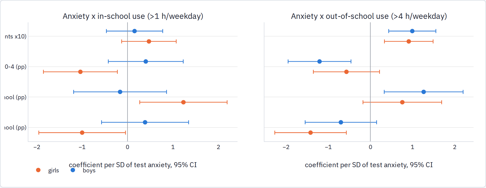

Interaction coefficients (per SD of test anxiety) with 95% confidence intervals; the life-satisfaction coefficient is multiplied by 10 for display. A positive value for loneliness or low life satisfaction, or a negative value for belonging or life satisfaction, means the use indicator is more harmful for anxious students.

| Outcome                    | Sex   | Mean | Test anxiety (per SD) | In-school \>1 h    | Out-of-school \>4 h | Anxiety × in-school | Anxiety × out-of-school | n       |
|----------------------------|-------|------|-----------------------|--------------------|---------------------|---------------------|-------------------------|---------|
| Lonely at school (pp)      | girls | 15.6 | **+4.05 (0.27)**      | **+1.29 (0.45)**   | **+1.57 (0.42)**    | **-1.00 (0.49)**    | **-1.42 (0.43)**        | 153,205 |
| Lonely at school (pp)      | boys  | 16.8 | **+1.84 (0.26)**      | **+2.15 (0.46)**   | +0.29 (0.45)        | +0.39 (0.49)        | -0.70 (0.43)            | 149,121 |
| Belongs at school (pp)     | girls | 75.3 | **-2.98 (0.29)**      | **-1.77 (0.52)**   | **-2.58 (0.47)**    | **+1.23 (0.49)**    | +0.76 (0.48)            | 152,842 |
| Belongs at school (pp)     | boys  | 72.5 | **-1.40 (0.30)**      | **-1.23 (0.52)**   | **-1.93 (0.49)**    | -0.16 (0.52)        | **+1.26 (0.48)**        | 148,821 |
| Life satisfaction (points) | girls | 7.3  | **-0.351 (0.017)**    | +0.030 (0.028)     | **-0.340 (0.027)**  | +0.047 (0.031)      | **+0.091 (0.029)**      | 134,352 |
| Life satisfaction (points) | boys  | 7.5  | **-0.243 (0.017)**    | **+0.082 (0.028)** | **-0.123 (0.025)**  | +0.016 (0.032)      | **+0.099 (0.029)**      | 130,607 |
| Life satisfaction 0-4 (pp) | girls | 12.5 | **+3.75 (0.24)**      | +0.24 (0.38)       | **+3.71 (0.37)**    | **-1.04 (0.42)**    | -0.57 (0.40)            | 134,352 |
| Life satisfaction 0-4 (pp) | boys  | 10.3 | **+1.81 (0.25)**      | +0.29 (0.37)       | **+1.67 (0.34)**    | +0.40 (0.42)        | **-1.20 (0.38)**        | 130,607 |

Main effects are evaluated at mean anxiety; the interaction is the change in the use coefficient per SD of ANXTEST. Binary outcomes in percentage points, life satisfaction in points on the 0–10 scale.

Test anxiety itself is strongly associated with worse outcomes: one SD raises girls' loneliness by 4.0 pp (boys 1.8) and lowers life satisfaction by 0.35 points (boys 0.24). In-school Internet use above 1 hour is itself linked to more loneliness (+1.29 (0.45) pp for girls, +2.15 (0.46) for boys) whereas heavy out-of-school use mainly lowers life satisfaction (-0.34 (0.03) points for girls, -0.12 (0.03) for boys). The interactions are the H3 test proper: for loneliness the anxiety × in-school term is -1.00 (0.49) pp for girls and +0.39 (0.49) for boys, against anxiety × out-of-school terms of -1.42 (0.43) and -0.70 (0.43); for life satisfaction the in-school interactions are +0.047 (0.031) and +0.016 (0.032) points, the out-of-school interactions +0.091 (0.029) and +0.099 (0.029). Every interaction that is distinguishable from zero has the sign opposite to H3's prediction: among more anxious students heavy use is less, not more, strongly associated with loneliness and low life satisfaction, and in-school use is not singled out. The above-median anxiety split and the continuous-hours version (results/tables/pisa_panel_h3_2015.csv) give the same picture.

#### Dose–response by wave

| Outcome                             | Wave   | Sex   | None             | ≤1 h             | 1-2 h | 2-4 h            | 4-6 h            | \>6 h            | % of students by band       | n / systems  |
|-------------------------------------|--------|-------|------------------|------------------|-------|------------------|------------------|------------------|-----------------------------|--------------|
| Life satisfaction (points vs 1-2 h) | 2015   | girls | **-0.22 (0.05)** | **+0.08 (0.03)** | ref.  | **-0.16 (0.03)** | **-0.30 (0.04)** | **-0.42 (0.04)** | 10 / 21 / 17 / 20 / 13 / 17 | 135,463 / 40 |
| Life satisfaction (points vs 1-2 h) | 2015   | boys  | **-0.14 (0.05)** | -0.03 (0.03)     | ref.  | **-0.16 (0.03)** | **-0.18 (0.04)** | **-0.19 (0.04)** | 12 / 22 / 19 / 20 / 11 / 16 | 132,176 / 40 |
| Life satisfaction (points vs 1-2 h) | 2018   | girls | **-0.35 (0.10)** | +0.07 (0.05)     | ref.  | **-0.24 (0.05)** | **-0.44 (0.06)** | **-0.60 (0.06)** | 4 / 13 / 16 / 25 / 19 / 23  | 147,789 / 47 |
| Life satisfaction (points vs 1-2 h) | 2018   | boys  | **-0.25 (0.08)** | -0.09 (0.06)     | ref.  | **-0.18 (0.04)** | **-0.38 (0.06)** | **-0.36 (0.05)** | 5 / 14 / 17 / 24 / 17 / 24  | 143,512 / 47 |
| Life satisfaction (points vs 1-2 h) | 2022 † | girls | **-0.45 (0.06)** | -0.03 (0.04)     | ref.  | **-0.08 (0.04)** | **-0.24 (0.05)** | **-0.42 (0.05)** | 8 / 20 / 15 / 23 / 16 / 17  | 220,325 / 65 |
| Life satisfaction (points vs 1-2 h) | 2022 † | boys  | **-0.21 (0.06)** | +0.04 (0.05)     | ref.  | -0.01 (0.04)     | -0.07 (0.05)     | **-0.14 (0.05)** | 10 / 20 / 14 / 23 / 15 / 18 | 211,556 / 65 |
| Lonely at school (pp vs 1-2 h)      | 2012   | girls | **+5.3 (0.8)**   | **+1.4 (0.4)**   | ref.  | **+2.1 (0.5)**   | **+3.1 (0.7)**   | **+4.9 (0.9)**   | 11 / 29 / 25 / 21 / 9 / 6   | 97,618 / 43  |
| Lonely at school (pp vs 1-2 h)      | 2012   | boys  | **+5.0 (0.8)**   | **+1.8 (0.5)**   | ref.  | +0.4 (0.5)       | **+2.3 (0.7)**   | **+5.9 (0.9)**   | 10 / 27 / 25 / 21 / 9 / 8   | 95,374 / 43  |
| Lonely at school (pp vs 1-2 h)      | 2015   | girls | **+3.5 (0.9)**   | +0.6 (0.5)       | ref.  | -0.2 (0.5)       | +1.0 (0.6)       | **+2.7 (0.6)**   | 10 / 21 / 17 / 21 / 14 / 17 | 154,136 / 45 |
| Lonely at school (pp vs 1-2 h)      | 2015   | boys  | **+3.9 (0.8)**   | **+1.8 (0.6)**   | ref.  | -0.1 (0.5)       | -0.5 (0.6)       | **+3.2 (0.6)**   | 12 / 21 / 19 / 20 / 12 / 16 | 150,425 / 45 |
| Lonely at school (pp vs 1-2 h)      | 2018   | girls | **+6.7 (1.5)**   | **+1.9 (0.9)**   | ref.  | +0.1 (0.9)       | **+2.0 (0.9)**   | **+3.8 (0.8)**   | 4 / 13 / 16 / 25 / 19 / 23  | 161,310 / 52 |
| Lonely at school (pp vs 1-2 h)      | 2018   | boys  | **+6.9 (1.3)**   | **+3.1 (0.9)**   | ref.  | **-1.5 (0.8)**   | +1.5 (0.9)       | **+2.4 (0.9)**   | 5 / 14 / 17 / 24 / 17 / 24  | 155,453 / 52 |
| Lonely at school (pp vs 1-2 h)      | 2022 † | girls | **+4.3 (0.9)**   | **+1.9 (0.7)**   | ref.  | **+1.5 (0.6)**   | **+1.8 (0.7)**   | **+4.1 (0.7)**   | 8 / 20 / 15 / 24 / 16 / 17  | 202,813 / 69 |
| Lonely at school (pp vs 1-2 h)      | 2022 † | boys  | **+4.8 (0.9)**   | +1.3 (0.7)       | ref.  | -0.1 (0.7)       | +0.8 (0.7)       | **+2.7 (0.7)**   | 10 / 20 / 14 / 23 / 15 / 18 | 194,483 / 69 |

Country-fixed-effect contrasts against students at 1–2 hours per weekday outside school (SE), controlling ESCS and grade, student weights, school-clustered SEs; ICT-module systems only. † 2022 bands are total weekday hours on digital resources before and after school (learning plus leisure), not Internet hours, so 2022 levels are not comparable with earlier waves.

Within every wave the relationship is J-shaped rather than linear. Students who report no Internet use outside school are lonelier and less satisfied than those at 1–2 hours (girls' life satisfaction -0.22 (0.05) points in 2015 and -0.35 (0.10) in 2018), the 1–2 hour band is the best-off group, and above 2 hours the gradient is monotone and steeper for girls: at more than 6 hours girls' life satisfaction is -0.42 (0.04) points below the 1–2 hour band in 2015, -0.60 (0.06) in 2018 and -0.42 (0.05) in 2022 (boys -0.19 (0.04), -0.36 (0.05) and -0.14 (0.05)), and the share of girls at 0–4 is +5.51 (0.52), +8.33 (0.83) and +5.26 (0.68) pp higher. Meanwhile the share of girls above 4 hours went from 31% in 2015 to 42% in 2018. Pooling 2015 and 2018 for the 40 systems with the ICT module in both waves, the linear slope of life satisfaction on out-of-school hours was -0.063 (0.006) points per hour for girls in 2015 and changed by -0.022 (0.010) in 2018 (boys -0.027 (0.006) and -0.026 (0.009)); for loneliness the 2015 slopes are +0.09 (0.10) and -0.22 (0.10) pp per hour with 2018 changes of +0.08 (0.14) and -0.14 (0.15). The in-school slope on loneliness is +0.52 (0.14) pp per hour for girls and +0.98 (0.14) for boys in 2015, several times the out-of-school slope per hour, with 2018 changes of -0.02 (0.19) and -0.12 (0.19). The per-hour life-satisfaction gradient therefore steepened by roughly a third between 2015 and 2018 for both sexes, while the loneliness gradients did not move; the flatter 2022 gradient is measured on a different item and is not comparable.

#### 2018: schools with a written policy on digital-device use

No PISA wave before 2022 asked principals about phone bans, so the 2022 within-country ban comparison cannot be replicated backwards. The closest earlier item is PISA 2018 SC156Q01HA, whether the school has "its own written statement about the use of digital devices": 64% of students in 77 systems (19,924 schools) attended such a school. A written statement is a much weaker treatment than a ban and is as likely to accompany device-rich teaching as device restriction.

| Outcome                                                | All              | Girls            | Boys             | Mean                | n / systems  |
|--------------------------------------------------------|------------------|------------------|------------------|---------------------|--------------|
| Chats online at school (almost) every day (ICT module) | +0.17 (0.63)     | +0.38 (0.79)     | -0.04 (0.73)     | 28.9 pp             | 298,431 / 52 |
| Internet \>1 h/weekday at school (ICT module)          | **+2.79 (0.79)** | **+2.86 (1.02)** | **+2.63 (0.82)** | 38.0 pp             | 335,238 / 53 |
| Internet hours/weekday at school (ICT module)          | **+0.10 (0.03)** | **+0.12 (0.04)** | **+0.07 (0.03)** | 1.5 hours           | 335,238 / 53 |
| Internet \>4 h/weekday outside school (placebo)        | +1.08 (0.63)     | +1.14 (0.79)     | +0.96 (0.78)     | 40.6 pp             | 334,122 / 53 |
| Lonely at school (agree)                               | -0.67 (0.35)     | -0.02 (0.47)     | **-1.29 (0.49)** | 18.9 pp             | 505,479 / 77 |
| Belongs at school (agree)                              | +0.67 (0.42)     | +0.98 (0.51)     | +0.42 (0.54)     | 73.5 pp             | 504,959 / 77 |
| Life satisfaction (0-10)                               | +0.017 (0.028)   | -0.005 (0.036)   | +0.038 (0.035)   | 7.1 points          | 469,411 / 72 |
| Life satisfaction 0-4                                  | +0.11 (0.33)     | +0.52 (0.44)     | -0.29 (0.42)     | 16.1 pp             | 469,411 / 72 |
| Belonging index (hundredths of SD)                     | **+2.71 (0.85)** | **+2.10 (1.06)** | **+3.30 (1.13)** | -13.8 hundredths SD | 508,873 / 77 |

Within-country comparison of students in schools with and without a written digital-device policy in 2018 (same specification as the 2022 phone-ban table: ESCS, private/public, grade, sex; country FE; student weights; school-clustered SEs). The ICT-module outcomes cover fewer systems.

#### Related literature

| Study                                                                                                                                                                                                | Data                                         | Finding                                                                                                                                                                                                                                             |
|------------------------------------------------------------------------------------------------------------------------------------------------------------------------------------------------------|----------------------------------------------|-----------------------------------------------------------------------------------------------------------------------------------------------------------------------------------------------------------------------------------------------------|
| [Twenge, Haidt, Blake et al. 2021](https://doi.org/10.1016/j.adolescence.2021.06.006), *J. Adolescence*                                                                                              | PISA 2000-2018, 37 countries, n = 1,049,784  | School loneliness (6 ST034 items) rose 2012-2018 in 36 of 37 countries, more for girls; higher where smartphone access and internet use were higher; GDP, inequality and fertility unrelated (abstract)                                             |
| [Haidt and Rausch 2026](https://www.worldhappiness.report/ed/2026/social-media-is-harming-adolescents-at-a-scale-large-enough-to-cause-changes-at-the-population-level/), World Happiness Report ch. | PISA 2015-2018 life satisfaction, 47 systems | 40 of 47 systems showed significant declines 2015-2018, strong for both sexes; school loneliness up 2012-2018 in 34 of 35 countries                                                                                                                 |
| [OECD 2017](https://doi.org/10.1787/9789264273856-en), PISA 2015 Results Vol. III                                                                                                                    | PISA 2015 well-being module                  | OECD average life satisfaction 7.31; 11.8% at 0-4 (14% of girls, 9% of boys); 15% agree they feel lonely at school; 'extreme' internet users (\>6 h/weekday outside school) 0.4 points lower life satisfaction and 17% lonely vs 12% of 1-2 h users |
| [OECD 2019](https://doi.org/10.1787/acd78851-en), PISA 2018 Results Vol. III                                                                                                                         | PISA 2015 and 2018                           | 67% satisfied (7-10) in 2018, down 5 pp from 2015; agreement with 'I belong at school' and 'I make friends easily' down about 2 pp (OECD summary)                                                                                                   |
| [Mao and See 2025](https://econpapers.repec.org/RePEc:cca:wchild:121), CHILD WP 121                                                                                                                  | PISA 2015 and 2018 ICT module                | Early device exposure (age ≤6), instrumented by parental-occupation ICT intensity, raises school belonging at 15 with no clear effect on life satisfaction (abstract)                                                                               |
| [Fang and Mo 2026](https://doi.org/10.3389/fpsyg.2026.1740535), *Front. Psychol.*                                                                                                                    | PISA 2022, n = 41,490                        | School digitalisation (IC172) and life satisfaction: direct β = 0.032 in a PLS-SEM; cross-sectional, small effects                                                                                                                                  |

**Assessment.** The four-wave panel confirms the descriptive premise shared by H1 and H2: between 2012 and 2022 school loneliness rose, belonging fell and life satisfaction fell in most systems, more for girls, while weekday Internet time outside school in the ICT-module systems went from 2.4 to 3.6 hours. Three findings qualify the timing-based reading. First, the largest loneliness step is 2012 → 2015, which coincides with the move to computer-delivered questionnaires, so part of the published 2012–2018 trend (Twenge et al. 2021) may be a mode effect (H0). Second, within countries, systems where out-of-school hours rose more did not see loneliness rise more or life satisfaction fall more (two-way fixed-effects coefficients near zero), although school belonging did fall more there (-2.33 (0.92) pp per hour for girls, -2.62 (1.23) for boys, 2012–2018); as in the HBSC pressure panel, most of the change is a common wave shift. Third, at the student level the association is J-shaped and present in every wave, steeper for girls, and the per-hour life-satisfaction gradient steepened significantly between 2015 and 2018 (-0.022 (0.010) points per hour for girls, -0.026 (0.009) for boys), consistent with H1's claim that heavy use became more harmful as it became heavier, though the 2022 item gives a flatter gradient. For H3 the 2015 test is informative in a way the 2022 mathematics-anxiety proxy was not: in-school Internet use is tied to school loneliness (+0.52 (0.14) and +0.98 (0.14) pp per hour, several times the out-of-school slope) but not to lower life satisfaction, whereas out-of-school use is tied to lower life satisfaction and barely to loneliness; and test anxiety, the strongest correlate of every outcome, does not amplify either association, the anxiety × use interactions being small and of the opposite sign. The sharp form of H3 (digital harm concentrated among anxious students during the school day) is therefore not supported in 2015, while the location-specific form (in-school use relates to school loneliness) is. The 2018 written-policy item is not a ban: schools with a policy have slightly more in-school use (+2.79 (0.79) pp above 1 hour) yet slightly less loneliness (-0.67 (0.35) pp) and higher belonging, which points to school-quality selection rather than restriction. All within-wave estimates are cross-sectional; the panel component rests on 43 systems observed two to three times (2012–2018).

### Did 4G timing matter more in high-pressure states?

| Outcome (ACS 12–17, market panel) | LTE × policy             | Interaction (SE) |
|-----------------------------------|--------------------------|------------------|
| girls                             | pressure_index           | -0.34 (0.25)     |
| girls                             | cc_aligned_test_in_force | not identified   |
| girls                             | waiver_in_force          | +0.12 (1.02)     |
| girls                             | rttt_winner              | -0.94 (0.49)     |
| boys                              | pressure_index           | +0.36 (0.34)     |
| boys                              | cc_aligned_test_in_force | not identified   |
| boys                              | waiver_in_force          | -0.04 (1.63)     |
| boys                              | rttt_winner              | +0.61 (0.75)     |

State-by-year fixed effects absorb the direct effect of state policies; the interaction tests whether early-LTE metros rose more than late-LTE metros within states that had each policy in force. "Not identified" indicates that the policy turned on in the same year as LTE for nearly all dated metros in the state.

Where the interaction is identified, the point estimates for girls are negative (LTE × pressure index −0.34 pp, SE 0.25; LTE × Race to the Top −0.94 pp, SE 0.49). Early-LTE markets inside high-accountability states did not experience a larger rise in the ACS cognitive-difficulty item, though this test carries the same metro-level limitations as the main LTE event study.

### School phone bans

School phone restrictions are the one policy intervention that both the phone-centered and interaction hypotheses predict should matter, and they have shifted markedly over the past fifteen years. Below we combine national school-policy surveys, our 51-state legislative tracker, existing quasi-experimental evaluations, and PISA 2022 microdata to assess what school phone bans do.

#### Bans and sadness on one time axis

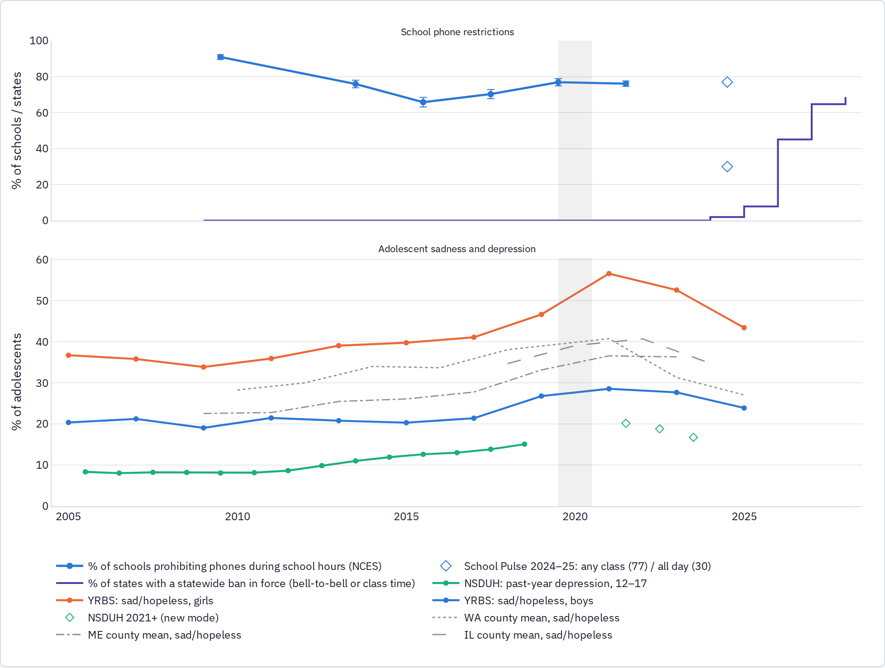

Top: principal-reported share of U.S. public schools prohibiting non-academic phone use during school hours (NCES SSOCS; 2013–14 is from a smaller Fast Response Survey; question wording changed in 2017–18), the 2024–25 School Pulse Panel estimates (77% prohibiting use during any class, 30% all day), and the cumulative share of states with a statewide bell-to-bell or instructional-time mandate in force. Bottom: NSDUH past-year major depressive episode (ages 12–17), YRBS persistent sadness by sex, and county-mean sadness from the Washington, Maine, and Illinois youth surveys. Grey band = 2020.

Plotted on a common timeline, U.S. school phone restrictions and adolescent distress moved in opposite directions over two successive cycles. Between 2009–10 and 2015–16—the years when smartphones replaced feature phones—the share of public schools prohibiting cell-phone use fell from 91% to 66%, while youth depression and sadness rose from their 2011–13 lows. School prohibitions then rebounded to 77% by 2019–20, and a wave of state legislation between 2023 and 2026 has pushed mandatory class-time or bell-to-bell bans into a majority of states; over the same post-2021 window, adolescent sadness fell across every state survey with recent data. Because these are aggregate national series, however, the timing alignment is only suggestive: sadness continued to rise through 2019–2021 even after school prohibitions began recovering, and the post-2021 downturn started before most state laws took effect. Two non-exclusive mechanisms could account for the recent decline:

- **Gradual school re-restriction and broader norm shifts.** The recovery in school restrictions after 2016, combined with growing concern among parents, educators, and teenagers themselves, may have curbed the most disruptive in-school phone use even before statutory state mandates arrived. That interpretation is consistent with the PISA 2022 cross-section and Norway's middle-school ban study, though the aggregate U.S. timing is loose.
- **Shifts in platform content.** If the 2012–2019 rise was driven primarily by peer social comparison on photo-sharing networks (Instagram, Snapchat), the subsequent shift of teen screen time toward algorithmic short-form video feeds (TikTok, YouTube) could keep total screen hours high while generating less acute social-comparison distress. Because public surveys do not track platform mix over time, our data cannot test this channel directly.

#### Lags and enforcement

Two practical features of school phone bans also affect how the aggregate timeline and upcoming state evaluations should be interpreted:

- **Effects take a year or two to materialize.** Quasi-experimental studies consistently find adjustment lags after a ban is introduced. In the 2026 U.S. Yondr-pouch study (Allcott et al.), student subjective well-being *dipped* by 0.20 SD in the adoption year before turning positive (+0.16 SD) in year two; in Norway (Abrahamsson 2024), reductions in bullying and mental-health visits grew over three years; and in Florida (Figlio and Özek 2025), student suspensions rose 12% in year one before fading in year two as test-score gains emerged. If school bans require a year of administrative adjustment before improving school climate, the 2015–16 trough in U.S. restrictions would register around 2017–18 and the 2024–25 state mandates around 2026–27. Evaluations of the new U.S. laws will therefore need at least two post-ban waves rather than a single immediate post-year.
- **Stated policy differs from actual enforcement.** PISA 2022 measures both principal-reported school bans and student-reported daily smartphone use at school. Across 52 education systems with both items, a median 46% of students in ban schools still reported using a smartphone at school daily (versus 62% in non-ban schools), and in 24 systems a majority of students in ban schools did so. Enforcement in the United States in 2022 was particularly weak: 70.1% of students in U.S. ban schools used a smartphone daily at school compared with 81.7% in non-ban schools (an 11.6-point gap, versus gaps of 30–46 points in Japan, Taiwan, Switzerland, and Brunei). Stated school policies in the pre-2024 U.S. data were thus loosely enforced, and any effects estimated from early state mandates will represent a lower bound on strict bell-to-bell enforcement.

Country-by-country daily in-school smartphone rates in ban and non-ban schools are reported in `results/tables/pisa_ban_enforcement_by_country.csv`.

##### The national school-policy series

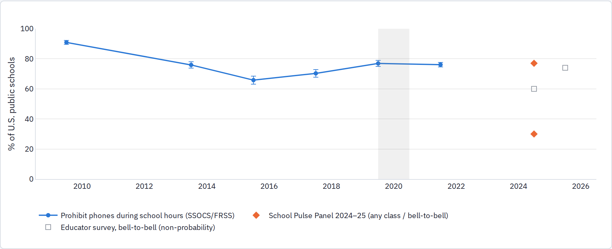

Principal-reported share of public schools prohibiting non-academic cell-phone use during school hours (NCES SSOCS; the 2013–14 point comes from a smaller Fast Response Survey, and the item wording changed in 2017–18). The 2024–25 School Pulse Panel asks about class time rather than all school hours: 77% prohibit phones in any class, and 30% prohibit them both in class and outside class.

#### State bans and what can be tested when

| Policy type                          | Effective school year | N   | States                                                                                                                                                |
|--------------------------------------|-----------------------|-----|-------------------------------------------------------------------------------------------------------------------------------------------------------|
| ban during instructional time        | 2024-25               | 1   | Indiana                                                                                                                                               |
| ban during instructional time        | 2025-26               | 5   | Iowa, Nevada, North Carolina, Tennessee, West Virginia                                                                                                |
| ban during instructional time        | 2026-27               | 2   | Michigan, Wisconsin                                                                                                                                   |
| requires districts to adopt a policy | 2024-25               | 1   | Minnesota                                                                                                                                             |
| requires districts to adopt a policy | 2025-26               | 4   | Alaska, Arizona, Idaho, New Mexico                                                                                                                    |
| requires districts to adopt a policy | 2026-27               | 5   | California, Colorado, Connecticut, Delaware, Wyoming                                                                                                  |
| statewide bell-to-bell ban           | 2023-24               | 1   | Florida                                                                                                                                               |
| statewide bell-to-bell ban           | 2024-25               | 2   | Louisiana, South Carolina                                                                                                                             |
| statewide bell-to-bell ban           | 2025-26               | 14  | Alabama, Arkansas, District of Columbia, Kentucky, Missouri, Nebraska, New Hampshire, New York, North Dakota, Ohio, Oklahoma, Oregon, Texas, Virginia |
| statewide bell-to-bell ban           | 2026-27               | 8   | Georgia, Hawaii, Kansas, Maine, New Jersey, Rhode Island, Utah, Vermont                                                                               |
| statewide bell-to-bell ban           | 2027-28               | 2   | Illinois, Maryland                                                                                                                                    |

Compiled from Ballotpedia, Education Week, KFF, and enacted state statutes; classification differences across trackers are documented in the data file. Florida's HB 379 (instructional time, 2023–24) was the earliest statewide mandate.

Nearly all statewide phone bans took effect in fall 2024, fall 2025, or fall 2026. The latest mental-health survey waves in hand are from spring 2025 (the YRBS, 26 states), fall 2025 (Pennsylvania and Washington, neither with a mandate), 2023–25 (California), spring 2024 (Illinois), and spring 2023 (Maine), so the first post-ban year is observed in the YRBS for Indiana, Louisiana, and South Carolina (mandates in force in 2024–25); Florida, the earliest mandate state, did not take part in the 2025 YRBS, and Minnesota's 2025 county tables are not yet obtainable. The next subsection reports the pre-specified difference-in-differences on those three states and the newest county waves. As subsequent waves of the state county surveys are released, the county panel will test Minnesota's 2024–25 district-policy mandate, Maine's and California's 2026–27 mandates, and Illinois's 2027–28 bell-to-bell ban using the same county-by-grade panel structure developed for LTE above. Obtaining NCES restricted-use SSOCS files (which include state and county identifiers) would also enable a school-level panel design across the 2010–2024 relaxation and re-tightening cycle.

#### Post-2021 waves and the first post-ban observations

Phase 1 ended with the observation that the post-2021 waves of the state youth surveys showed a broad decline in sadness that began before any statewide phone mandate. Two new county waves and the 2025 YRBS state files now extend that record. Pennsylvania's 2025 county profile reports (60 counties) and California's CalSCHLS county reports for 2019-21 and 2021-23 (and 2023-25 where posted) were added to the county panel; the CDC released the 2025 combined YRBS state files on 21 September 2026, which allows the pre-specified difference-in-differences for the first statewide mandates (Indiana's instructional-time ban and Louisiana's and South Carolina's bell-to-bell bans, all in force in 2024-25). Minnesota's 2022 and 2025 county tables remain behind a bot-manager CAPTCHA (`notes/state_surveys.md`), and Florida, the earliest mandate state, left the YRBS after 2021.

##### County-mean sadness through the newest waves

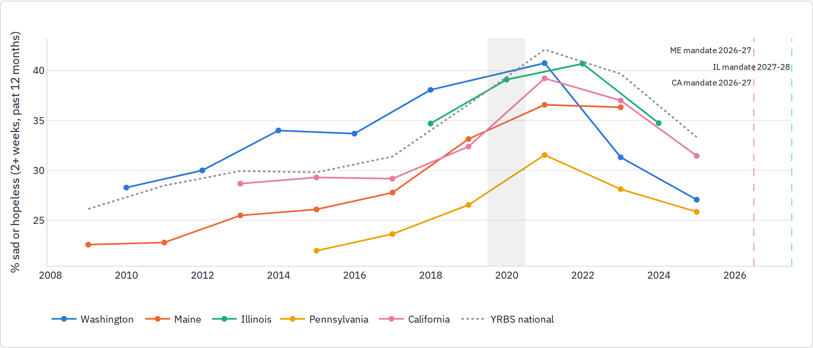

Unweighted county means of the share of students sad or hopeless for two or more weeks, over the grades each state reports in every wave (as in Part 1), with the national YRBS for comparison (dotted). Dashed verticals mark the first school year a statewide mandate is in force (Maine 2026-27; California district-policy mandate 2026-27; Illinois 2027-28); Washington has guidance only and Pennsylvania no mandate. Grey band: 2020.

Every state with a post-2021 wave has now turned down, and in every case the first wave below the peak precedes the state's mandate or the state has none. Pennsylvania's 2025 wave (fall 2025, no statewide mandate; the state funded lockable pouches) continues the 2021 to 2023 decline: county-mean sadness 31.5% (2021), 28.1% (2023), 25.8% (2025), and considered suicide 19.6%, 17.0%, 15.5%. California's county reports for 2019-21 and 2021-23 (a mandate applies only from 2026-27) put county-mean sadness at 32.4% (2017-19), 39.2% (2019-21) and 37.0% (2021-23), falling to 31.5% in 2023-25. Washington fell from 40.7% (2021) to 27.1% (2025) under guidance only, Illinois from 40.7% (2022) to 34.7% (2024) three years before its 2027-28 ban, and Maine was flat between 2021 (36.6%) and 2023 (36.3%) before its 2026-27 ban. Nationally the YRBS shows 42.1% (2021), 39.7% (2023) and 33.3% (2025) sad or hopeless (girls 56.6 to 43.4%, boys 28.6 to 23.9%), considered suicide 21.9% to 14.5%, while the share using social media several times a day or more rose from 77.1% to 80.3%.

| State (county survey) | Peak wave    | First wave below the peak | Newest wave  | Statewide policy (2026-09)           | In force from | Downturn relative to mandate |
|-----------------------|--------------|---------------------------|--------------|--------------------------------------|---------------|------------------------------|
| Washington            | 2021 (40.7%) | 2023 (31.3%)              | 2025 (27.1%) | guidance/recommendation only         | none          | before the mandate           |
| Maine                 | 2021 (36.6%) | 2023 (36.3%)              | 2023 (36.3%) | statewide bell-to-bell ban           | 2026-27       | before the mandate           |
| Illinois              | 2022 (40.7%) | 2024 (34.7%)              | 2024 (34.7%) | statewide bell-to-bell ban           | 2027-28       | before the mandate           |
| Pennsylvania          | 2021 (31.5%) | 2023 (28.1%)              | 2025 (25.8%) | none                                 | none          | before the mandate           |
| California            | 2021 (39.2%) | 2023 (37.0%)              | 2025 (31.5%) | requires districts to adopt a policy | 2026-27       | before the mandate           |

Peak and first post-peak wave of county-mean sadness in each state survey against the first school year with a statewide mandate in force (`data/compiled/phone_bans/state_phone_bans.csv`, status September 2026).

##### 2025 YRBS: states with a mandate in force in 2024-25 against states without one

Treated: Indiana (ban during instructional time, 2024-25), Louisiana (bell-to-bell ban, 2024-25), South Carolina (bell-to-bell ban, 2024-25). Controls: the 23 other states in the 2025 YRBS state files with no mandate in force before 2025-26; the "clean" subset (10 states) also excludes states that enacted a law before the end of the spring-2025 fieldwork. State-year cells are weighted equally with state and year fixed effects; standard errors are clustered by state, and because only three states are treated the bracketed p-value comes from randomization inference over every possible assignment of three treated states. The placebo repeats the design on 2017-2023 with 2021-23 as a false post period. Florida and Minnesota, the other two 2024-25 mandate states, have no 2025 YRBS data, and item coverage differs across the treated states (South Carolina asked no suicide items in 2021 and has no 2023 wave; Indiana has no 2025 attempt item), so the considered-suicide rows rest on two states and the attempt row on Louisiana alone.

| Outcome                           | Sex   | DiD 2021-23 vs 2025 (SE) \[RI p\] | Clean controls only   | Placebo: 2017-19 vs 2021-23 | Treated / control states |
|-----------------------------------|-------|-----------------------------------|-----------------------|-----------------------------|--------------------------|
| Sad or hopeless                   | all   | -4.84 (1.84) \[0.01\]             | -6.11 (1.94) \[0.00\] | -1.17 (1.39) \[0.64\]       | 3 / 21; placebo 2 / 21   |
|                                   | girls | -3.45 (2.23) \[0.17\]             | -5.82 (2.44) \[0.01\] | -3.92 (3.23) \[0.25\]       | 3 / 21; placebo 2 / 21   |
|                                   | boys  | -6.38 (1.80) \[0.00\]             | -6.43 (1.98) \[0.01\] | +1.62 (1.32) \[0.56\]       | 3 / 21; placebo 2 / 21   |
| Considered suicide                | all   | -3.46 (0.53) \[0.02\]             | -4.12 (0.61) \[0.02\] | -2.78 (0.65) \[0.13\]       | 2 / 21; placebo 2 / 20   |
|                                   | girls | -5.21 (0.73) \[0.03\]             | -6.95 (0.83) \[0.02\] | -5.08 (1.39) \[0.05\]       | 2 / 21; placebo 2 / 20   |
|                                   | boys  | -1.56 (0.69) \[0.26\]             | -1.10 (0.84) \[0.45\] | -0.42 (0.71) \[0.81\]       | 2 / 21; placebo 2 / 20   |
| Attempted suicide                 | all   | -5.77 (0.36) \[0.05\]             | -5.38 (0.52) \[0.10\] | +0.50 (2.03) \[0.75\]       | 1 / 21; placebo 2 / 19   |
|                                   | girls | -4.86 (0.49) \[0.05\]             | -4.82 (0.76) \[0.20\] | -2.14 (2.61) \[0.10\]       | 1 / 21; placebo 2 / 19   |
|                                   | boys  | -6.66 (0.44) \[0.05\]             | -5.84 (0.77) \[0.10\] | +3.22 (1.35) \[0.03\]       | 1 / 21; placebo 2 / 19   |
| Social media several times a day+ | all   | +6.04 (2.74) \[0.03\]             | +5.54 (2.95) \[0.09\] | \-                          | 2 / 14                   |
|                                   | girls | +5.02 (3.91) \[0.11\]             | +4.82 (4.12) \[0.15\] | \-                          | 2 / 14                   |
|                                   | boys  | +7.18 (1.57) \[0.02\]             | +6.44 (1.86) \[0.07\] | \-                          | 2 / 14                   |

Percentage-point difference-in-differences from `results/tables/yrbs25_ban_did.csv`; weighted state estimates from the 2023 and 2025 combined YRBS files. The social-media item (several times a day or more) exists only for 2023 and 2025, so it has no placebo. Treated/control counts are the states observed both before and after.

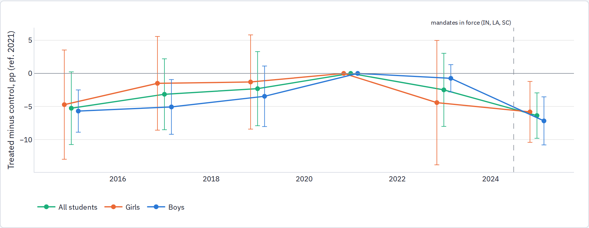

Event study for sad or hopeless: treated-minus-control difference by wave relative to 2021 (state and year fixed effects, 95% intervals from state-clustered SEs; 2015-2025, 3 treated and 23 control states).

Sadness fell by -11.2 points in the treated states between 2023 and 2025 (from 45.2% in 2021 and 43.1% in 2023 to 31.9%) against -5.0 points in the clean controls (37.1% to 32.1%). The difference-in-differences is -4.84 (1.84) points (randomization p = 0.01; -6.11 (1.94) with clean controls), larger for boys (-6.38 (1.80)) than for girls (-3.45 (2.23)), and the sadness placebo on 2017-2023 is -1.17 (1.39) (p = 0.64). Two features argue against reading this as a ban effect yet. First, the treated states had the larger 2019-2021 rise: in the event study their 2017 and 2019 levels sit 3.1 and 2.3 points further below 2021 than the controls', so part of the 2025 gap (-6.4, SE 1.8) is reversion from a higher peak; measured against 2019 rather than 2021 the differential fall is about -4.1 points. Second, considered suicide was already falling faster in Indiana and Louisiana before any mandate (placebo -2.78 (0.65)), so its 2025 estimate (-3.46 (0.53)) carries no information about the bans. The mechanism check also fails in the direction opposite to a first stage: daily-plus social-media use rose +6.04 (2.74) points more in Indiana and Louisiana than in the controls between 2023 and 2025. The item measures overall frequency rather than use at school, so this is consistent with the English and PISA findings that school bans leave total use unchanged, but it means the YRBS cannot show that in-school exposure fell.

##### What has been published on the 2025 waves

CDC's 2025 release ([Youth Health in Focus](https://www.cdc.gov/yrbs/youth-health-in-focus/index.html), 21 September 2026) reports the national fall in persistent sadness from 40% to 33% and in suicidal ideation from 20% to 14% between 2023 and 2025, with social-media use "every hour or more" unchanged at 36-37%; the accompanying MMWR supplement ([Kiplagat et al. 2026](https://dx.doi.org/10.15585/mmwr.su7501a4)) gives 33.3% overall, 43.4% for girls and 23.9% for boys, which the microdata reproduce. State releases describe the same decline in states without a mandate (Vermont 29% to 23%, [2025 executive summary](https://www.healthvermont.gov/sites/default/files/document/hsi-yrbs-executuve-summary-2025-high-school.pdf); North Carolina 29.7% with a "significant" decrease from 2023), and Pennsylvania's commission attributes its improvement to mental-health investment without mentioning phones ([PCCD, October 2026](https://www.pa.gov/agencies/pccd/newsroom/new-data-shows-youth-mental-health-is-improving--students-feel-s)). No evaluation of the Florida, Indiana, Louisiana or South Carolina mandates on a mental-health outcome was found as of October 2026: [Figlio and Özek (2025)](https://www.nber.org/papers/w34388) cover achievement, discipline and attendance in one Florida district, and the national pouch study ([Allcott et al. 2026](https://www.nber.org/papers/w35132)) is the only U.S. quasi-experiment with a well-being outcome. The estimates above are therefore the first state-survey post-ban mental-health numbers, and they should be read with that literature's warning that effects appear in the second post-ban year.

**Assessment.** The newest waves settle the timing question raised in Phase 1: the post-2021 downturn in adolescent sadness is national (42% to 33% in the YRBS) and, in every county survey with a post-2021 wave, began before the state's phone mandate or in a state without one (Washington, Pennsylvania, Illinois, California, Maine). A broad decline that precedes the policy cannot be attributed to it, which weakens the simplest reading of the Phase 1 "re-restriction" account for H3 and leaves the platform-content and cohort explanations open; it also contradicts a dose model in which sadness tracks total social-media use, which rose nationally while sadness fell (H1). On top of that common decline, the three states with mandates in force in 2024-25 fell a further 5 points in sadness (-4.84 (1.84), randomization p = 0.01; clean placebo), which is the first state-level post-ban mental-health estimate in U.S. data and points the same way as the Norwegian and Yondr-pouch studies; but with three treated states, a larger 2021 peak in those states, suicidal ideation already trending down before the bans and no first stage on in-school use, it is a lead for the 2027 wave rather than a result. The 2025-26 cohort of fourteen bell-to-bell states and the 2027 YRBS, together with Minnesota's 2025 county tables once released, will give the second post-ban year the ban literature says is needed.

#### What the causal literature already shows

| Study                                                                              | Setting                                 | Design                                                                                                                                                                                                      | Outcome domain                                                                                                     | Headline                                                                                                                                                                                                                                                                                                                                                                                                                  |
|------------------------------------------------------------------------------------|-----------------------------------------|-------------------------------------------------------------------------------------------------------------------------------------------------------------------------------------------------------------|--------------------------------------------------------------------------------------------------------------------|---------------------------------------------------------------------------------------------------------------------------------------------------------------------------------------------------------------------------------------------------------------------------------------------------------------------------------------------------------------------------------------------------------------------------|
| Beland & Murphy (2016)                                                             | England                                 | DiD across schools with staggered school-level bans (school survey on ban timing + NPD administrative data)                                                                                                 | GCSE test scores                                                                                                   | Post-ban test scores +6.41% of a SD; gains concentrated among lowest-achieving students (~+14% SD); no effect for high achievers (published: Labour Economics 41, 61-76)                                                                                                                                                                                                                                                  |
| Kessel, Hardardottir & Tyrefors (2020)                                             | Sweden                                  | DiD replication of Beland & Murphy with school survey on ban timing (~75% response) + register data                                                                                                         | grade 9 test scores / GPA                                                                                          | No impact on student performance; 'can reject even small-sized gains' (Economics of Education Review 77, 102009)                                                                                                                                                                                                                                                                                                          |
| Beneito & Vicente-Chirivella (2022)                                                | Spain                                   | Synthetic control (Galicia) + DiD (Galicia, Castilla-La Mancha) vs other regions                                                                                                                            | PISA math/science; reported bullying cases                                                                         | Galicia PISA math +10.7 and science +12.7 points by 2017 (0.6-0.8 and ~0.7-1 years of learning); CLM positive but insignificant; bullying cases per 10,000 down 15-18% (ages 12-14) and 9.5-18% (15-17), no effect under 12 (Applied Economic Analysis 30(90), 153-175)                                                                                                                                                   |
| Abrahamsson (2024)                                                                 | Norway                                  | Event study / staggered DiD using a survey of middle schools' smartphone policies linked to administrative health, education and family registers and the national pupil survey                             | GP and specialist consultations for psychological symptoms; reported bullying; GPA; academic high-school track     | Girls: fewer GP visits for psychological symptoms (about -0.2 to -0.3 visits, a sizeable share of the mean) and ~60% fewer specialist mental-health visits; bullying down for both genders (girls exposed 3 years ~-46%); girls' GPA +0.08 SD and higher academic-track enrolment; effects larger for low-SES girls; no effects for boys (NHH DP 01/2024; forthcoming Journal of Human Resources per Allcott et al. 2026) |
| Goodyear, Randhawa, Adab, et al. (SMART Schools) (2025)                            | England                                 | Cross-sectional comparison of schools with restrictive vs permissive recreational-phone policies (not causal)                                                                                               | WEMWBS mental wellbeing; anxiety; depression; sleep; attainment; phone/social-media time                           | No difference in wellbeing: adjusted mean WEMWBS difference -0.48 (95% CI -2.05 to 1.06, p=0.62); no differences in anxiety, depression, sleep, attainment or total daily phone/social-media use; less use during school hours only (Lancet Regional Health - Europe 51, 101211)                                                                                                                                          |
| Figlio & Ozek (2025)                                                               | United States (Florida)                 | DiD comparing schools with high vs low pre-ban student phone activity (Advan building-level GPS) before/after the 2023 statewide ban, within one district                                                   | test scores (3x/year), disciplinary incidents, suspensions, absences                                               | Year 1: incidents/suspensions +~25% raw, DiD +12% suspensions, in-school suspensions +~30% for Black male students, fading by year 2; year-2 test scores +0.6 percentiles overall, +1.1 percentiles on spring test (1.3 in middle/high, 1.4 for boys); unexcused absences significantly reduced in both years (NBER WP 34388)                                                                                             |
| Allcott, Baron, Dee, Duckworth, Gentzkow & Jacob (2026)                            | United States (national)                | Staggered DiD (Callaway-Sant'Anna) of Yondr lockable-pouch adoption using pouch sales records, teacher survey, GPS pings, state test scores and administrative data; pre-registered                         | phone use; test scores; attendance; discipline; student well-being; classroom attention; perceived online bullying | Phone use sharply down (teacher-reported personal use in class 61% -\> 13%); test scores ~0 on average (rules out \>0.007 student SD), high-school math +0.024 SD, middle school slightly negative; suspensions +~11% in year 1 then fade; subjective well-being -0.2 SD at adoption recovering to +0.16 SD by year 2; no effect on attendance, attention or online bullying (NBER WP 35132)                              |
| Lichand, Moreno-Louzada, da Costa & Gentzkow (2026)                                | Brazil (Rio de Janeiro)                 | DiD contrasting middle schools without strict pre-existing rules (treated) vs schools already strict (control) around the Aug 2023 municipal ban (school-wide from Feb 2024); principal survey + admin data | standardized test scores; in-school phone use                                                                      | Test scores +0.06 SD in treated relative to control schools; in-school phone use fell substantially                                                                                                                                                                                                                                                                                                                       |
| Kohnstamm Instituut & Oberon (for Dutch Ministry OCW) (2025)                       | Netherlands                             | Descriptive monitoring: school-leader surveys and group interviews; no comparison group                                                                                                                     | leader-reported concentration, social climate, learning, well-being, enforcement                                   | Secondary: 75% report better concentration, 59% better social climate, 28% better learning; share seeing non-educational phone use as a problem 62% -\> 29%; some teachers report more physical bullying/disruption and enforcement workload. Primary: mostly no effect; 23% see better well-being/climate                                                                                                                |
| OECD, PISA 2022 Results Volume II (ch. 5) and 'Managing screen time' (2024) (2023) | OECD/partner countries (cross-national) | Cross-sectional associations using PISA 2022 student/school questionnaires                                                                                                                                  | self-reported distraction by digital devices; in-school phone use; notification habits; performance                | About one in three OECD students attend schools banning phones; students in ban schools less likely to report distraction, but 29-30% of them still use a phone several times a day (+21% every day/almost) so bans are often unenforced; in 9 systems bans are concentrated in lower-performing schools; in some systems banned students are less likely to turn off notifications at night. No causal claim.            |
| Bottger & Zierer (2024)                                                            | Multi-country (review)                  | Rapid review + meta-analysis of 5 quantitative studies                                                                                                                                                      | social well-being (incl. bullying); academic performance                                                           | Pooled d = 0.162 (p\<0.05); larger for social well-being than for achievement (Education Sciences 14(8), 906)                                                                                                                                                                                                                                                                                                             |
| Campbell, Edwards, Pennell, et al. (2024)                                          | Multi-country (review)                  | Scoping review                                                                                                                                                                                              | academic outcomes; mental health and wellbeing; cyberbullying                                                      | Mixed: 4 studies report achievement gains (2 restricted to low-achieving/low-SES samples); as many null or negative; no consistent effect on mental health or cyberbullying (J. Psychologists and Counsellors in Schools)                                                                                                                                                                                                 |

Across existing evaluations, evidence on school phone bans is mixed overall but points to girl-specific benefits when mental health is measured over multiple years. The strongest mental-health evidence comes from Abrahamsson's (2024) staggered difference-in-differences study of more than 400 Norwegian middle schools, which finds that bans reduced girls' general-practitioner and specialist visits for psychological symptoms, reduced bullying for both sexes, and raised girls' GPA, with no mental-health or achievement effect for boys. By contrast, an English cross-sectional study (Goodyear et al. 2025) finds no difference in student well-being between restrictive and permissive schools, and the 2026 U.S. Yondr-pouch study (Allcott et al.) finds an initial year-one dip in subjective well-being (−0.20 SD) followed by a year-two recovery (+0.16 SD) and no change in perceived online bullying. On academic achievement, Beland and Murphy (2016) in England, Beneito and Vicente-Chirivella (2022) in Spain, Figlio and Özek (2025) in Florida, and Lichand et al. (2026) in Rio de Janeiro find small positive test-score gains, whereas Kessel et al. (2020) in Sweden and Allcott et al. (2026) in the U.S. overall find near-zero average test-score effects (with modest high-school math gains in the U.S.).

#### County social-media use and sadness

| State | County item        | Outcome            | County-grade-years | Across counties (SE) | Within county and grade (SE) |
|-------|--------------------|--------------------|--------------------|----------------------|------------------------------|
| WA    | social media daily | sad hopeless       | 172                | +0.22 (0.04)         | -0.09 (0.16)                 |
| WA    | social media daily | considered suicide | 172                | -0.01 (0.03)         | -0.15 (0.10)                 |
| WA    | screen time 3plus  | sad hopeless       | 172                | +0.25 (0.06)         | +0.01 (0.08)                 |
| WA    | screen time 3plus  | considered suicide | 172                | +0.03 (0.03)         | +0.04 (0.07)                 |
| ME    | screen time 3plus  | sad hopeless       | 43                 | +0.07 (0.11)         | -0.09 (0.10)                 |
| ME    | screen time 3plus  | considered suicide | 43                 | +0.22 (0.12)         | +0.13 (0.13)                 |

Percentage points of outcome per percentage point of the county screen-use item, estimated on county-by-grade cells so that exposure and outcome cover identical grades; "Across counties" includes year fixed effects, and "Within county and grade" includes county-by-grade and year fixed effects, with standard errors clustered by county. Washington covers grades 8, 10, and 12 in 2023 and 2025; Maine covers grades 9–12 in 2017, 2019, and 2021.

In Washington, county-grade cells where a higher share of students use social media daily also report higher rates of persistent sadness (+0.22 pp per percentage point, SE 0.04), and a similar cross-sectional relationship holds for three or more hours of daily screen time (+0.25 pp, SE 0.06). Between 2023 and 2025, both screen measures and sadness declined statewide in Washington (daily social media fell from 74.9% to 72.9%, 3+ hours of screen time from 68.9% to 65.5%, and sadness from 31.2% to 27.4%), but county-by-county changes over the two-year window do not line up: within the same county and grade, two-year changes in sadness are unrelated to changes in either screen-time measure (−0.09 pp, SE 0.16 for daily social media; +0.01 pp, SE 0.08 for 3+ hours of screen time). Maine's county panel from 2017 to 2021 likewise shows no within-county relationship. Just as in the national literature, the cross-sectional correlation between screen time and sadness is clear, while short-run within-area changes are noisy and null.

#### PISA 2022: school phone rules and well-being within countries

PISA 2022 asked school principals whether "the use of cell phones is not allowed on the school premises" and asked 15-year-old students about loneliness and belonging at school, digital-device habits, and (in 13 education systems) overall life satisfaction. Merging the student and school files yields 568,374 students across 19,885 schools in 80 systems; overall, 41% of students attend a school that bans phones on premises, ranging from 7% in Finland to 96% in Greece. We compare students in ban versus non-ban schools within the same country, controlling for student socio-economic status (ESCS), sex, grade, and private/public school status, using student survey weights and clustering standard errors by school.

Binary outcomes are in percentage points; PISA scale indices are in hundredths of a standard deviation. The ICT familiarity module (smartphone use at school) covers 51 systems; the well-being module (life satisfaction and experienced well-being) covers 13–14 systems.

| Outcome                                                  | All           | Girls         | Boys          | Mean    |
|----------------------------------------------------------|---------------|---------------|---------------|---------|
| Uses smartphone at school daily+ (ICT module)            | -12.15 (0.82) | -12.29 (0.94) | -11.97 (0.95) | 55.3 pp |
| Leisure digital use at school \>1 h/day                  | -3.65 (0.47)  | -3.70 (0.61)  | -3.57 (0.64)  | 33.4 pp |
| Leisure digital use after school \>3 h/day (placebo)     | -0.83 (0.38)  | -1.06 (0.52)  | -0.55 (0.50)  | 27.7 pp |
| Distracted by digital devices in most/every lesson       | -3.52 (0.55)  | -4.19 (0.71)  | -2.85 (0.67)  | 28.1 pp |
| Nervous/anxious without device (more than half the time) | -1.83 (0.49)  | -2.01 (0.65)  | -1.61 (0.61)  | 22.5 pp |
| Feels lonely at school (agree)                           | -0.58 (0.33)  | -1.36 (0.48)  | +0.32 (0.46)  | 19.7 pp |
| Feels they belong at school (agree)                      | -0.49 (0.40)  | -0.02 (0.53)  | -1.02 (0.60)  | 77.5 pp |
| Belonging index (SD units)                               | +0.02 (0.01)  | +0.02 (0.01)  | +0.01 (0.01)  | -0.2 SD |
| Life satisfaction index, WB module (SD units)            | +0.03 (0.02)  | +0.03 (0.02)  | +0.03 (0.03)  | -0.0 SD |
| Experienced well-being yesterday, WB module (SD units)   | +0.00 (0.02)  | +0.01 (0.03)  | -0.00 (0.03)  | 0.1 SD  |
| Stress resistance index (SD units)                       | -0.00 (0.01)  | -0.00 (0.01)  | -0.00 (0.01)  | -0.1 SD |

The within-country comparisons show three consistent patterns. First, school bans reduce in-school phone use, though compliance is far from complete: daily smartphone use at school is 12.1 percentage points lower in ban schools (from an overall mean of 55.3%, meaning roughly 43% of students in ban schools still use a phone daily), leisure digital use of more than an hour per day at school falls by 3.7 points, and after-school leisure screen use (\>3 hours/day) is nearly unchanged (−0.8 pp)—a useful check that ban schools are not simply attended by students who avoid screens outside school. Second, students in ban schools report less classroom distraction by digital devices (−3.5 pp overall; −4.2 pp for girls and −2.8 pp for boys). Third, well-being differences are small, favorable, and concentrated among girls: girls in ban schools are 2.0 pp less likely to feel nervous or anxious without their device, 1.4 pp less likely to report feeling lonely at school (versus +0.3 pp for boys), and score +0.02 to +0.03 SD higher on school belonging and life satisfaction. Because this is a cross-sectional comparison across schools, however, it cannot separate the causal effect of a phone ban from unobserved differences in school leadership or student composition.

**Assessment.** Across 80 education systems in PISA 2022, school phone prohibitions are associated with lower in-school phone use, less classroom digital distraction, and slightly lower loneliness and device anxiety among girls. While cross-sectional school comparisons cannot rule out selection into bans, the girl-specific pattern aligns with the quasi-experimental evidence from Norway's middle-school bans and underscores the value of evaluating the 2024–26 U.S. state phone bans as post-ban YRBS and state-survey waves become available.

## How this sits with Haidt's and Twenge's evidence

The [Anxious Generation research pages](https://www.jonathanhaidt.com/articles) and [collaborative reviews](https://www.anxiousgeneration.com/research/collaborative-review-docs) compile a large body of evidence linking smartphones and social media to adolescent distress, while Peter Gray and education researchers point to declining childhood autonomy, academic pressure, and the school calendar ([Gray, Lancy, and Bjorklund 2023](https://doi.org/10.1016/j.jpeds.2023.02.004); [Hansen, Sabia, and Schaller 2024](https://doi.org/10.3368/jhr.1222-12710R2)). Much of the descriptive case for the phone hypothesis comes from Jean Twenge's work with the Monitoring the Future, YRBS, and Millennium Cohort surveys (correlating screen time with depressive symptoms and tracking national trends), paired with natural experiments on broadband, early social-media rollouts, and pre-2011 carrier exclusivity. Placing both literatures alongside our pilot results clarifies what public microdata can and cannot confirm: the individual-level association between heavy phone use and distress replicates readily in new settings, both camps converge on a long-run decline in teens' in-person socializing, and the sharpest quasi-experimental effects come from initial broadband or iPhone access and the school calendar rather than 2011–13 4G speed upgrades. The Phase 2 sources added in October 2026 (NHIS, NSCH, pooled DHS-8, NVSS monthly mortality, four PISA waves, Monitoring the Future's published series, county broadband and the AT&T 2010 footprint) sharpen three of these points and revise one of Phase 1's readings, as set out below.

### What that evidence base contains

| Evidence type                                                         | Design                                                                                                                                                                                                                                                                                                                                                                                                                                                                                                                                                                                                                                                                                                                                                                                                                         | Typical result                                                                                                                                                                                                                                                                                                                                                                                                                                                                                                                                                                                                                                                 |
|-----------------------------------------------------------------------|--------------------------------------------------------------------------------------------------------------------------------------------------------------------------------------------------------------------------------------------------------------------------------------------------------------------------------------------------------------------------------------------------------------------------------------------------------------------------------------------------------------------------------------------------------------------------------------------------------------------------------------------------------------------------------------------------------------------------------------------------------------------------------------------------------------------------------|----------------------------------------------------------------------------------------------------------------------------------------------------------------------------------------------------------------------------------------------------------------------------------------------------------------------------------------------------------------------------------------------------------------------------------------------------------------------------------------------------------------------------------------------------------------------------------------------------------------------------------------------------------------|
| Cross-sectional use–symptom associations (Twenge and colleagues)      | Heavy vs. light users in national surveys (MTF, YRBS, Millennium Cohort, UK and U.S. panels)                                                                                                                                                                                                                                                                                                                                                                                                                                                                                                                                                                                                                                                                                                                                   | Heavy users are roughly twice as likely to report depression or low well-being (adjusted odds ratios 1.7–3.0), with stronger associations among girls                                                                                                                                                                                                                                                                                                                                                                                                                                                                                                          |
| Longitudinal panels                                                   | Screen or social-media use at wave *t* predicting symptoms at *t* + 1                                                                                                                                                                                                                                                                                                                                                                                                                                                                                                                                                                                                                                                                                                                                                          | Small effects; the main point of methodological debate with Orben, Przybylski, Odgers, and Ferguson                                                                                                                                                                                                                                                                                                                                                                                                                                                                                                                                                            |
| Experiments                                                           | Short-term deactivation and abstinence trials, mostly among college students and adults                                                                                                                                                                                                                                                                                                                                                                                                                                                                                                                                                                                                                                                                                                                                        | Modest improvements of a few hundredths to roughly 0.2 SD                                                                                                                                                                                                                                                                                                                                                                                                                                                                                                                                                                                                      |
| Broadband & social-media natural experiments                          | [Facebook college rollout (2004–06)](https://www.aeaweb.org/articles?id=10.1257%2Faer.20211218); four European broadband IV studies—Germany ([Golin 2022](https://doi.org/10.1002/hec.4570)), Italy ([Donati et al. 2025](https://doi.org/10.2139/ssrn.3949645)), Spain ([Arenas-Arroyo et al. 2025](https://doi.org/10.1016/j.jhealeco.2025.103014)), and the UK ([McDool et al. 2020](https://doi.org/10.1016/j.jhealeco.2019.102274))—reviewed by [McClean, Rausch, and Haidt](https://ssrn.com/abstract=5188105); U.S. state broadband against YRBS ([Churchill and Johnson 2026](https://www.nber.org/papers/w34614)); AT&T's 2007–11 iPhone carrier monopoly ([Myers and Hooper 2026](https://www.nber.org/papers/w35310)); and Elaine Guo's [British Columbia wireless study](http://hdl.handle.net/1807/130332) (2023) | Facebook arrival: ~0.1 SD worse on a mental-health index. Italy DSL (2001–13): +0.08 SD in hospital-diagnosed disorders among youth. Spain fiber-to-the-home (2007–19): significant rise in adolescent hospital mental-health and self-harm diagnoses, driven by girls. U.S. broadband × YRBS (2009–19): +9–17% suicidal ideation per SD of broadband access, concentrated among girls. AT&T 2007–11 iPhone monopoly: reduced births at ages 15–19 by 2.0–9.0% (October 2026 revision) and is consistent with less in-person interaction. British Columbia fixed wireless (2014+): +1 pp (~90% of baseline) in girls' severe school mental-health designations |
| School calendars, closures & declining autonomy (Gray and colleagues) | Monthly NVSS youth suicide seasonality across the school calendar and county school closures/reopenings in 2020–21 ([Hansen and Lang 2011](https://doi.org/10.1016/j.econedurev.2011.04.012); [Hansen, Sabia, and Schaller 2024](https://doi.org/10.3368/jhr.1222-12710R2)); synthesis of long-run declines in children's unsupervised play and independent mobility ([Gray, Lancy, and Bjorklund 2023](https://doi.org/10.1016/j.jpeds.2023.02.004))                                                                                                                                                                                                                                                                                                                                                                          | Adolescent suicides (ages 12–18, unlike 19–25) drop sharply every summer and winter break, fell by about a quarter (25–38% relative to January 2020) during the spring 2020 pandemic school closures despite record screen time, and rose 12–18% as counties reopened in-person schooling. Multi-decade declines in independent play and teen face-to-face socializing (also emphasized in Part II of *The Anxious Generation*) predate smartphones and continued through the 2010s                                                                                                                                                                            |
| Aggregate timing                                                      | The [mood-disorders review](https://docs.google.com/document/d/1diMvsMeRphUH7E6D1d_J7R6WbDdgnzFHDHPx9HXzR5o/edit) and the [World Happiness Report chapter](https://www.worldhappiness.report/ed/2026/social-media-is-harming-adolescents-at-a-scale-large-enough-to-cause-changes-at-the-population-level/)                                                                                                                                                                                                                                                                                                                                                                                                                                                                                                                    | Flat trends through the Great Recession, an inflection around 2012 led by girls across the Anglosphere and Western Europe, and declining PISA life satisfaction in 40 of 47 countries between 2015 and 2018                                                                                                                                                                                                                                                                                                                                                                                                                                                    |

### Where the pilot agrees

- In the 2022–23 GSHS rounds across five countries, girls who use a mobile phone three or more hours a day report loneliness 8 percentage points higher and suicidal ideation 10 points higher than girls who use a phone less, with rates rising steadily at higher hours. That corresponds to an odds ratio of roughly 1.5 to 1.7, similar to the cross-sectional estimates in U.S. and European surveys.
- In the DHS-8 self-report modules, the within-cluster association between daily internet use and screening positive for depression or anxiety is positive at ages 15–19 and zero or negative at 25–49, in Nepal alone and when Mozambique and Bangladesh are pooled (women 15–19, n up to 5,841); but the pooled estimates (+0.8 pp on PHQ-9 ≥ 10 and +1.8 pp on GAD-7 ≥ 10, SE 1.5) are a third to a half of the GSHS gradients and not distinguishable from zero.
- The national U.S. trends line up across sources: NSDUH youth depression turns upward in 2011–12 and YRBS sadness follows, the increases are consistently larger for girls than for boys, and the ACS cognitive-difficulty rate among adults 65 and older falls over the same decade. In ATUS time diaries, weekday homework time rose by roughly 40% between 2003–08 and 2015–19 and stood near 75 minutes in 2023–25, while teens' in-person socializing fell from about 40 minutes a day to 16—consistent with both Gray's emphasis on rising academic structure and Haidt's account of declining face-to-face peer time. Parent reports in the NSCH show the same female-led rise (girls' current anxiety 11.5% in 2016 to 21.7% in 2024).
- In state-level panels, the NTIA share of teen households using smartphones for internet access predicts YRBS girls' sadness (+0.9 pp per 10 percentage points, SE 0.43). That aligns directionally with [Churchill and Johnson (2026)](https://www.nber.org/papers/w34614), who link FCC state broadband expansion to the 2009–2019 YRBS and find a 9–17% increase in adolescent suicidal ideation per standard deviation of broadband access (concentrated among girls alongside cyberbullying and body dissatisfaction), though in our county-level youth survey panels the adoption relationship does not hold within states.
- U.S. caregivers do report a steep screen-time gradient when asked about diagnosed conditions with a graded hours item: in the NSCH, girls aged 12–17 at four or more weekday hours are +14.5 pp more likely to have current anxiety and +10.2 pp more likely to have current depression than girls at one hour, and NCHS's NHIS-Teen estimates give teenagers at four or more hours prevalence ratios of 2.2 for anxiety and 2.7 for depression. These are the cross-sectional associations of the Twenge literature, reproduced in two further national surveys.
- Across four PISA waves, the student-level association between out-of-school internet hours and lower life satisfaction is J-shaped, steeper for girls, and steepened by about a third between 2015 and 2018, and school loneliness rose in most systems after 2012 (OECD girls 8.6% to 18.4%), matching the trend evidence that Twenge, Haidt and colleagues draw from the same source—with the caveat that the largest step (2012 to 2015) coincides with the switch to computer-based questionnaires.

### Where the pilot finds no effect, and how to interpret the difference

1.  **LTE rollout at the metro and county levels.** Most of the natural experiments cited in the *Anxious Generation* literature estimate the effect of *first* high-speed broadband access ([Donati et al. 2025](https://doi.org/10.2139/ssrn.3949645); [Arenas-Arroyo et al. 2025](https://doi.org/10.1016/j.jhealeco.2025.103014)), of Facebook first arriving on college campuses, or of early U.S. smartphone exclusivity. On that last point, [Myers and Hooper (2026)](https://www.nber.org/papers/w35310) show that during AT&T's exclusive U.S. carrier monopoly on the iPhone from June 2007 to February 2011, pre-existing county-level AT&T 3G coverage strongly predicted early iPhone adoption, with time-use and sexual-behavior trends consistent with less in-person interaction, and reducing births at ages 15–19 by 2.0–9.0% (the paper's October 2026 revision; its June 2026 version gave 4.5–8.0%). By the time commercial 4G LTE rolled out across U.S. metros in 2011–2013—and after Verizon began carrying the iPhone in February 2011—3G smartphones and mobile social media were already spreading nationwide, and most large metros received LTE within a narrow two-year window. Finding a null effect for 4G LTE launch dates therefore shows that 2011–13 metro speed upgrades are too late and compressed to isolate the U.S. smartphone transition, whereas pre-2011 AT&T 3G coverage and county broadband availability offer sharper variation.  
      
    The closest post-2010 geographic parallel that does find a mental-health effect is Elaine Guo's [British Columbia study](http://hdl.handle.net/1807/130332) (alongside [Arenas-Arroyo et al.'s](https://doi.org/10.1016/j.jhealeco.2025.103014) Spanish fiber-to-the-home study using hospital records). Guo compares teenagers in rural mountain communities that gained high-speed fixed wireless internet (25 Mbps over cellular infrastructure) with teenagers in mountain communities that remained unserved, comparing girls with boys before and after 2014 using administrative school records on severe mental-health designations (which require a clinical diagnosis). Starting in 2014, girls in covered communities experienced a roughly 1 percentage point increase in severe designations relative to boys—about 90% of their baseline rate—with no corresponding shift for boys, moderate designations, or unrelated disabilities. Three features distinguish Guo's setting from our U.S. LTE panel: the treatment is a transition from little or no home broadband to high-speed access in isolated towns rather than a 3G-to-4G upgrade in metropolitan areas; the outcome is a clinical school designation rather than a census disability screener; and the time contrast compares pre- and post-2014 periods against a 2019 coverage map rather than staggered rollout dates (which is also a limitation of that study, since earlier annual coverage maps were unavailable). Taken together, these studies suggest that geographic designs detect a 2010s connectivity effect when they capture initial high-speed access or pre-2011 carrier exclusivity and measure clinical or self-reported internalizing outcomes.  
      
    Phase 2 ran that sharper test. Continuous county coverage from the National Broadband Map and FCC Form 477 (2010–2021) shows a small positive association between wireline speed upgrades and suicidal ideation in the county youth surveys (+0.37 pp per 10 points of ≥25 Mbps availability, SE 0.10, 293 counties) and none for sadness or for mobile coverage; and the AT&T December 2010 footprint that Myers and Hooper use predicts no post-2007 rise in Minnesota's county suicidal ideation, attempts or sadness (−1.6 pp for full coverage, SE 0.8, no pre-trend) and no differential 2010–19 trend across six states. The early-smartphone geography that moved teen births left no mark on the one U.S. county distress series that spans it.
2.  **Country-level GSHS panels with national internet, mobile-broadband, and 3G/4G series.** Regressing country-round survey means on national ITU penetration series is subject to the same aggregation problems that Haidt and coauthors [highlight](https://journals.sagepub.com/doi/10.1177/21677026261425910) in Vuorre and Przybylski's 72-country Facebook study: national averages pool adult and youth access and move with broader economic trends. Our country-level GSHS regressions should be read with the same caution.
3.  **Caregiver reports in 68 MICS surveys.** The MICS analysis provides a more substantive null result. Across 544,018 children in low- and middle-income countries, caregiver-reported anxiety and depression among 10–17-year-olds show no meaningful relationship with local young-adult internet use or with a teenage girl's own daily phone or internet use within the same sampling cluster; the small positive cluster correlation for girls' anxiety is mirrored among 5–9-year-olds who do not use phones. Two interpretations were open after Phase 1: either the self-report correlations partly reflect reverse causation and shared reporting style, or caregivers miss internalizing symptoms. Phase 2 finds both at work. In the NHIS, parents and teenagers describing the same 12–17-year-olds in the same months give the same overall anxiety rate, but parents compress the girl–boy gap (1.6× against 2.7×) and the age gradient and report less than half the depression (7.9% against 17.8%), so caregivers do miss much of the internalizing signal that carries the self-report findings (the person-level link needs the NHIS-Teen Research Data Center file). In the NSCH, however, caregivers asked about diagnosed conditions with a graded hours item report a gradient at least as steep as the adolescents' own, so the MICS null is also specific to its "seems anxious" items and to exposure measured on the household or cluster rather than the child. That the NSCH gradient is equally present at ages 6–11 and for ADHD and conduct problems keeps selection and reverse causation in play for the self-report gradients as well, and pooling the DHS-8 self-report modules weakens rather than strengthens the Nepal pattern.

### Two empirical patterns the existing debate has largely overlooked

- Perceived schoolwork pressure rose after 2010 across roughly 45 HBSC countries, not only in the United States, and psychosomatic complaints rose more in countries where pressure increased more. Although the within-country slope is modest and matches the pre-2010 baseline relationship, the post-2010 rise in perceived academic pressure is a broad cross-national trend that dismissals based on single-country exam reforms do not address. The school calendar also sets the level of the most serious outcome: in the national NVSS series, adolescent suicide is 19% lower in June–August than in September–May, 19% higher on school days than at weekends, and was 33% below trend during the spring 2020 closures, with none of this at ages 18–24 (replicating [Hansen, Sabia, and Schaller 2024](https://doi.org/10.3368/jhr.1222-12710R2)). But the post-2010 rise did not follow that calendar: between 2008–10 and 2015–19 the 12–17 suicide rate rose 65% in school months and 58% in summer (ratio of ratios 1.04, 95% CI 0.94–1.16), for girls and boys alike, and the PISA 2015 test-anxiety scale does not amplify the association between digital use and loneliness or life satisfaction. The school day raises the level; whatever raised the trend operated through the summer as well. Phase 1 read the calendar evidence as pointing toward an interaction confined to the school year; Phase 2 revises that: the pattern fits a year-round driver, such as continuous phone and social-media exposure (H1), or an interaction that does not stop in June.
- In U.S. state youth surveys with post-2021 waves, adolescent sadness and suicidal ideation have fallen substantially from their 2021 peaks—in Washington, 2025 sadness is below its 2010 rate—and the NSCH parent reports now show the same turn: girls' current anxiety fell from 21.7% in 2024 to 17.3% in 2025, the first decline in that series. Pennsylvania's 2025 county wave (no mandate) and California's 2023–25 wave (mandate only from 2026–27) continue the decline, and the national YRBS fell from 42% to 33% between 2021 and 2025 while daily-plus social-media use rose from 77% to 80%; in the three states with mandates in force in 2024–25 (Indiana, Louisiana, South Carolina), sadness fell a further 4.8 pp relative to non-mandate states (SE 1.8, randomization p = 0.01), a first post-ban lead rather than a result. The downturn came without a corresponding drop in daily smartphone or social-media use and, in the first look at the 2023–25 state phone mandates in the NSCH, without a ban-specific signal (parent-reported anxiety fell in the early-ban states, but so did ADHD, and depression did not). Neither a simple screen-dose account nor a simple academic-pressure account explains that downturn without additional mechanisms, such as the re-tightening of school phone restrictions or shifts in platform content; the 2025–27 YRBS and county waves are where those mechanisms can be told apart.

**Summary.** Prior literature documents a consistent individual-level correlation between heavy screen use and adolescent distress alongside causal effects from initial broadband rollouts ([Donati et al. 2025](https://doi.org/10.2139/ssrn.3949645); [Arenas-Arroyo et al. 2025](https://doi.org/10.1016/j.jhealeco.2025.103014); [Churchill and Johnson 2026](https://www.nber.org/papers/w34614); [Guo 2023](http://hdl.handle.net/1807/130332)), early iPhone carrier exclusivity ([Myers and Hooper 2026](https://www.nber.org/papers/w35310)), and the school calendar ([Hansen, Sabia, and Schaller 2024](https://doi.org/10.3368/jhr.1222-12710R2)). Our pilot reproduces the individual-level association in developing-country school surveys and, in Phase 2, in U.S. parent and teen reports and across four PISA waves, but finds that 2011–13 U.S. 4G launch dates, county smartphone-adoption rates, continuous county broadband coverage, the AT&T 2010 footprint, and caregiver reports in 68 MICS surveys show no corresponding geographic or informant-robust effect. Phase 2 also shows that the rise in adolescent suicide was proportional across school and summer months, that caregivers compress exactly the sex and age contrasts that carry the self-report findings, that test anxiety does not amplify the digital-use association in PISA 2015, and that Monitoring the Future's own published series show 12th-grade homework falling rather than rising. Resolving where the causal effect lies still requires pairing self-reported and clinical outcomes with sharper variation: the 2025–27 YRBS and county waves around the state phone mandates, the NHIS-Teen Research Data Center file, the ICPSR Monitoring the Future microdata, and restricted NVSS county counts.

## Conclusions and next steps

Combining public microdata across the United States and more than 80 other countries narrows the debate in several ways while leaving the core causal question open. The verdicts below fold in the Phase 2 sources added in October 2026.

| Hypothesis                   | Where it stands after Phase 2                                                                                                                                                                                                                                                                                                                                                                                                                                                                                                                                                                                                                                                                                                                                                                                                                                                                                                                                                                                                                                                                                                                                                                                                                                                                                                                                                                                                                                                                                                                                                                                                                                                                                                                                                                                                                                                                                                                                                        |
|------------------------------|--------------------------------------------------------------------------------------------------------------------------------------------------------------------------------------------------------------------------------------------------------------------------------------------------------------------------------------------------------------------------------------------------------------------------------------------------------------------------------------------------------------------------------------------------------------------------------------------------------------------------------------------------------------------------------------------------------------------------------------------------------------------------------------------------------------------------------------------------------------------------------------------------------------------------------------------------------------------------------------------------------------------------------------------------------------------------------------------------------------------------------------------------------------------------------------------------------------------------------------------------------------------------------------------------------------------------------------------------------------------------------------------------------------------------------------------------------------------------------------------------------------------------------------------------------------------------------------------------------------------------------------------------------------------------------------------------------------------------------------------------------------------------------------------------------------------------------------------------------------------------------------------------------------------------------------------------------------------------------------|
| H1 · Phones and social media | The cross-sectional individual association is robust and now reproduced in five kinds of data: teenage girls who use mobile phones heavily report substantially higher loneliness and suicidal ideation in Ghana, India, Jamaica, and Morocco (GSHS); U.S. parents in the NSCH report a steep screen gradient in diagnosed current anxiety and depression (girls 12–17 at four or more weekday hours +14.5 and +10.2 pp); NCHS's NHIS-Teen estimates give teenagers at four or more hours prevalence ratios of 2.2 and 2.7; the PISA student-level dose–response is J-shaped, steeper for girls, and steepened between 2015 and 2018; and the pooled DHS-8 self-reports are weakly positive at ages 15–19 and null at 25–49. Yet every test based on geographic rollout or on adult- and cluster-measured exposure is still null after Phase 2: 4G launch dates across U.S. metros and counties, metro adoption rates, continuous county broadband coverage (apart from a small wireline-upgrade association with ideation that tracks late rural cable upgrades), the AT&T 2007–11 iPhone footprint against Minnesota's 1998–2019 county series, cluster connectivity and own use in 68 MICS caregiver surveys, and national 3G/4G coverage in 34 GSHS countries. Published natural experiments that do find causal effects exploit initial fixed or wireless broadband ([Donati et al. 2025](https://doi.org/10.2139/ssrn.3949645); [Arenas-Arroyo et al. 2025](https://doi.org/10.1016/j.jhealeco.2025.103014); [Churchill and Johnson 2026](https://www.nber.org/papers/w34614); [Guo 2023](http://hdl.handle.net/1807/130332)) or the iPhone exclusivity ([Myers and Hooper 2026](https://www.nber.org/papers/w35310)); our county reconstruction of the latter finds no mental-health trace. One Phase 2 result does favor a year-round driver such as H1 over any school-confined mechanism: the rise in adolescent suicide was proportional across summer and school months. |
| H2 · School pressure         | The descriptive premise holds in some measures and not in others. Perceived schoolwork pressure rose after 2010 across most HBSC countries and ATUS weekday homework diaries rose by roughly 40% (to about 75 minutes a day in 2023–25) while in-person socializing fell ([Gray, Lancy, and Bjorklund 2023](https://doi.org/10.1016/j.jpeds.2023.02.004)); but Monitoring the Future's published 12th-grade self-reports show homework hours falling from 6.9 to 5.9 a week between 1996 and 2012 (and falling among 8th and 10th graders from 1991 to 2014) while loneliness and depressive affect improved through 2012. The school calendar sets the level of the most serious outcome: adolescent suicide is 19% lower in summer than in the school year and 19% higher on school days than at weekends, and fell a third below trend when schools closed in spring 2020 ([Hansen, Sabia, and Schaller 2024](https://doi.org/10.3368/jhr.1222-12710R2)). But the post-2010 rise was no larger in school months than in summer (ratio of ratios 1.04, 95% CI 0.94–1.16). Within our panels, perceived pressure behaves like a steady correlate of complaints rather than the driver of the break, U.S. state accountability reforms show no effect, and the ACS age gradient does not peak in the high-stakes high-school years. School pressure cannot carry the rise on its own.                                                                                                                                                                                                                                                                                                                                                                                                                                                                                                                                                                                                |
| H3 · Interaction             | The sharp form—digital harm concentrated among academically anxious students during the school day—is not supported where Phase 2 could test it directly. In PISA 2015 the test-anxiety scale is the strongest correlate of school loneliness and low life satisfaction, but it does not amplify the association with in-school or out-of-school internet use (the interactions are small and opposite in sign), and the NVSS decomposition shows the rise ran through the summer. A location-specific form survives: in-school internet use relates to school loneliness (+0.5 to +1.0 pp per hour) while out-of-school use relates to lower life satisfaction; PISA 2022 school phone bans reduce in-school use and distraction and modestly reduce girls' loneliness; Norway's middle-school bans reduced girls' psychological consultations; and U.S. adolescent sadness moved inversely to national school phone restrictions. The first post-mandate observations are mixed: parent reports in the NSCH 2024–25 show no ban-specific signal, while in the 2025 YRBS the three states with mandates in force in 2024–25 (Indiana, Louisiana, South Carolina) fell a further 4.8 points in sadness relative to non-mandate states (SE 1.8) with a clean pre-period placebo but a larger 2021 peak and no first stage on in-school use; at least two post-ban waves are needed before the 2023–27 state mandates can be evaluated.                                                                                                                                                                                                                                                                                                                                                                                                                                                                                                                                                |
| H0 · Measurement             | Ruled out as the primary explanation: the post-2010 rise appears simultaneously across diagnostic interviews, self-report school surveys, parent reports, counted suicide deaths, and the ACS cognitive-difficulty item; the 65+ comparison group trends downward over the same decade; and the increase is consistently concentrated among girls. Phase 2 adds two measurement cautions that bear on specific findings rather than on the rise itself: parents and adolescents describing the same population agree on the overall anxiety rate but parents compress the sex and age contrasts and report less than half the depression, and the largest step in PISA's school-loneliness trend (2012 to 2015) coincides with the switch to computer-based questionnaires. Differential awareness and diagnosis-seeking likely contribute to the steeper relative rise among affluent and private-school teens, and to the steepness of the NSCH diagnosis gradient, but do not account for the overall trend.                                                                                                                                                                                                                                                                                                                                                                                                                                                                                                                                                                                                                                                                                                                                                                                                                                                                                                                                                                      |

Four empirical findings from the two phases stand out beyond the existing book-length arguments. First, the 2010s rise in adolescent distress occurred almost simultaneously across U.S. states and counties with very different 4G-rollout, broadband, early-iPhone, and school-policy timelines, which explains why geographic designs struggle to separate the competing hypotheses and why national time series can be cited in support of either view. Second, the rise in adolescent suicide was proportional across school and summer months even though the school calendar sets the level of that outcome: whatever drove the trend did not stop in June. Third, who reports the symptoms matters. Caregivers in 68 MICS surveys see no relation between a teenager's phone use and her anxiety; U.S. parents compress exactly the girl-specific and adolescence-specific contrasts that carry the self-report findings; yet U.S. parents asked about diagnoses with a graded hours item report a gradient as steep as the adolescents' own, one that is equally present at ages 6–11 and for ADHD, which keeps selection and reverse causation in play for every cross-sectional gradient in this report. Fourth, post-2021 waves of the state youth surveys and now the NSCH parent reports show a substantial decline in sadness, suicidal ideation, and parent-reported anxiety without a matching drop in daily phone or social-media use, in Pennsylvania and California as well as Washington and Illinois, and nationally (YRBS sadness fell from 42% to 33% between 2021 and 2025 while daily-plus social-media use rose from 77% to 80%); any dose-based account of screens or of school pressure has to accommodate that downturn.

**What Phase 2 delivered, and what remains (plan in `notes/phase2_plan.md`; access and methods in `notes/<source>.md`).**

- **Done from public files or IPUMS copies:** NHIS Sample Child 2021–2024 against the published NHIS-Teen estimates; NSCH 2016–2025; the DHS-8 mental-health modules pooled across Nepal, Mozambique, and Bangladesh with the module inventory of all 31 DHS-8 reports; NVSS monthly suicide seasonality 1999–2024; the PISA 2012–2022 four-wave panel with the 2015 test-anxiety interaction; Monitoring the Future's published 12th-grade series 1996–2012; county broadband coverage 2010–2021 and the AT&T 2010 footprint; the Pennsylvania 2025 and California 2019–25 county waves; the 2025 YRBS state files with the pre-specified phone-ban difference-in-differences; and the ATUS 2025 and Bangladesh MICS 2025 releases.
- **Blocked, with the pipeline written and waiting for access:** the NHIS-Teen microdata (Research Data Center only), the Monitoring the Future microdata (ICPSR login; `scripts/analysis/31_mtf.py` runs its student-level homework × social-media models once the files are placed), the DHS-8 men's files, Zambia 2024 and Lesotho's PHQ-9 (DHS Program data request), county youth-suicide counts under 10 (restricted NVSS), and Minnesota's 2022 and 2025 county tables (bot-manager CAPTCHA; the request specification is in `notes/state_surveys.md`).
- **To add as released:** NSCH 2026 (first full post-mandate year for the 19 states of the 2025–26 wave), YRBS 2025 and 2027 (the pre-specified ban difference-in-differences in `scripts/analysis/33_yrbs_ban_did.py`), the 2026–27 county waves around the Minnesota, Maine, California, and Illinois mandates, and PISA 2025 (the first wave with both the phone-ban item and hours).
- **Licensed data still worth requesting:** GSMA mobile-coverage polygons with MICS and DHS cluster coordinates; student-level HBSC microdata (schoolwork pressure × social-media use × school phone rules); NCHS Research Data Center access to NHIS-Teen linked to the Sample Child. Further extensions of the ACS market event study or the IPUMS International census item are not warranted.

Reproducibility: analysis scripts are in `scripts/` and output tables are in `results/tables/` of the project repository. Data sources: IPUMS USA (ACS 1-year 2005–2024), IPUMS ATUS 2003–2025, IPUMS MICS (69 surveys), IPUMS International (Kenya 2009/2019, Mexico 2010/2020), IPUMS DHS (Nepal, Mozambique, Bangladesh, Kenya, Madagascar) with 31 DHS-8 final reports, Census CPS Computer and Internet Use Supplements (2009–2023), OECD PISA 2012, 2015, 2018 and 2022, WHO GSHS (165 country-rounds), WHO HBSC, NCHS NHIS Sample Child 2021–2024 and NHIS-Teen published estimates, HRSA/Census NSCH 2016–2025, CDC WONDER/NVSS mortality 1999–2024, Monitoring the Future data volumes 1996–2012, the NTIA National Broadband Map and FCC Form 477, and public NSDUH, NHANES, YRBS, NCES SSOCS/School Pulse, and state youth survey files as documented in each section.

