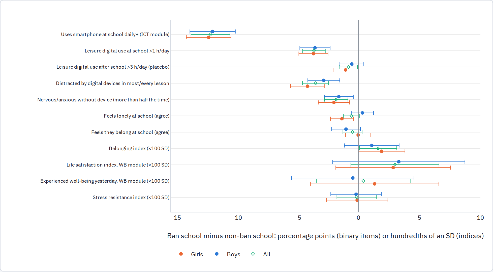

<!-- Generated review chunk: county-social-media-use-and-sadness -->

[Index](../README.md) · [Full paper](../../Teen_Distress_Pilot.md#review-county-social-media-use-and-sadness)

Context: Teen Distress Pilot → Part 4 · The interaction (H3): phones in the same hours as high-pressure school → School phone bans → County social-media use and sadness

Editable source entry points: [scripts/report/90_build_report.py:426](../../../scripts/report/90_build_report.py#L426)

---

In Washington, county-grade cells where a higher share of students use social media daily also report higher rates of persistent sadness (+0.22 pp per percentage point, SE 0.04), and a similar cross-sectional relationship holds for three or more hours of daily screen time (+0.25 pp, SE 0.06). Between 2023 and 2025, both screen measures and sadness declined statewide in Washington (daily social media fell from 74.9% to 72.9%, 3+ hours of screen time from 68.9% to 65.5%, and sadness from 31.2% to 27.4%), but county-by-county changes over the two-year window do not line up: within the same county and grade, two-year changes in sadness are unrelated to changes in either screen-time measure (−0.09 pp, SE 0.16 for daily social media; +0.01 pp, SE 0.08 for 3+ hours of screen time). Maine's county panel from 2017 to 2021 likewise shows no within-county relationship. Just as in the national literature, the cross-sectional correlation between screen time and sadness is clear, while short-run within-area changes are noisy and null.

#### PISA 2022: school phone rules and well-being within countries

PISA 2022 asked school principals whether "the use of cell phones is not allowed on the school premises" and asked 15-year-old students about loneliness and belonging at school, digital-device habits, and (in 13 education systems) overall life satisfaction. Merging the student and school files yields 568,374 students across 19,885 schools in 80 systems; overall, 41% of students attend a school that bans phones on premises, ranging from 7% in Finland to 96% in Greece. We compare students in ban versus non-ban schools within the same country, controlling for student socio-economic status (ESCS), sex, grade, and private/public school status, using student survey weights and clustering standard errors by school.

Binary outcomes are in percentage points; PISA scale indices are in hundredths of a standard deviation. The ICT familiarity module (smartphone use at school) covers 51 systems; the well-being module (life satisfaction and experienced well-being) covers 13–14 systems.

| Outcome                                                  | All           | Girls         | Boys          | Mean    |
|----------------------------------------------------------|---------------|---------------|---------------|---------|
| Uses smartphone at school daily+ (ICT module)            | -12.15 (0.82) | -12.29 (0.94) | -11.97 (0.95) | 55.3 pp |
| Leisure digital use at school \>1 h/day                  | -3.65 (0.47)  | -3.70 (0.61)  | -3.57 (0.64)  | 33.4 pp |
| Leisure digital use after school \>3 h/day (placebo)     | -0.83 (0.38)  | -1.06 (0.52)  | -0.55 (0.50)  | 27.7 pp |
| Distracted by digital devices in most/every lesson       | -3.52 (0.55)  | -4.19 (0.71)  | -2.85 (0.67)  | 28.1 pp |
| Nervous/anxious without device (more than half the time) | -1.83 (0.49)  | -2.01 (0.65)  | -1.61 (0.61)  | 22.5 pp |
| Feels lonely at school (agree)                           | -0.58 (0.33)  | -1.36 (0.48)  | +0.32 (0.46)  | 19.7 pp |
| Feels they belong at school (agree)                      | -0.49 (0.40)  | -0.02 (0.53)  | -1.02 (0.60)  | 77.5 pp |
| Belonging index (SD units)                               | +0.02 (0.01)  | +0.02 (0.01)  | +0.01 (0.01)  | -0.2 SD |
| Life satisfaction index, WB module (SD units)            | +0.03 (0.02)  | +0.03 (0.02)  | +0.03 (0.03)  | -0.0 SD |
| Experienced well-being yesterday, WB module (SD units)   | +0.00 (0.02)  | +0.01 (0.03)  | -0.00 (0.03)  | 0.1 SD  |
| Stress resistance index (SD units)                       | -0.00 (0.01)  | -0.00 (0.01)  | -0.00 (0.01)  | -0.1 SD |

The within-country comparisons show three consistent patterns. First, school bans reduce in-school phone use, though compliance is far from complete: daily smartphone use at school is 12.1 percentage points lower in ban schools (from an overall mean of 55.3%, meaning roughly 43% of students in ban schools still use a phone daily), leisure digital use of more than an hour per day at school falls by 3.7 points, and after-school leisure screen use (\>3 hours/day) is nearly unchanged (−0.8 pp)—a useful check that ban schools are not simply attended by students who avoid screens outside school. Second, students in ban schools report less classroom distraction by digital devices (−3.5 pp overall; −4.2 pp for girls and −2.8 pp for boys). Third, well-being differences are small, favorable, and concentrated among girls: girls in ban schools are 2.0 pp less likely to feel nervous or anxious without their device, 1.4 pp less likely to report feeling lonely at school (versus +0.3 pp for boys), and score +0.02 to +0.03 SD higher on school belonging and life satisfaction. Because this is a cross-sectional comparison across schools, however, it cannot separate the causal effect of a phone ban from unobserved differences in school leadership or student composition.

**Assessment.** Across 80 education systems in PISA 2022, school phone prohibitions are associated with lower in-school phone use, less classroom digital distraction, and slightly lower loneliness and device anxiety among girls. While cross-sectional school comparisons cannot rule out selection into bans, the girl-specific pattern aligns with the quasi-experimental evidence from Norway's middle-school bans and underscores the value of evaluating the 2024–26 U.S. state phone bans as post-ban YRBS and state-survey waves become available.
