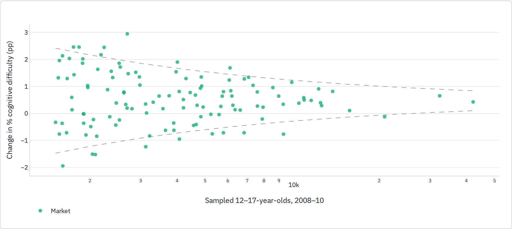
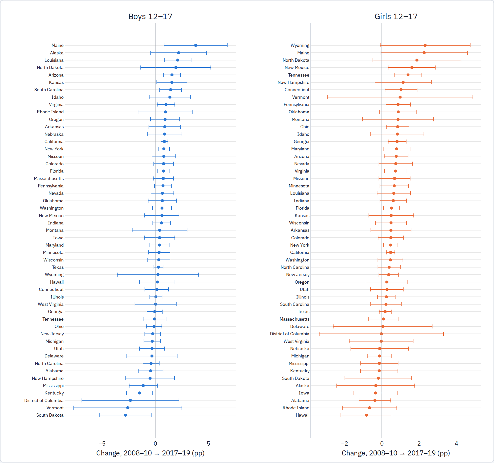

<!-- Generated review chunk: geo -->

[Index](../README.md) · [Full paper](../../Teen_Distress_Pilot.md#review-geo)

Context: Teen Distress Pilot → Part 1 · The rise, and whether public data can measure it → Geographic variation: is there anything to explain?

Editable source entry points: [scripts/report/90_build_report.py:69](../../../scripts/report/90_build_report.py#L69)

---

### Geographic variation: is there anything to explain?

For a geographic rollout design to have statistical power, 2010s changes in adolescent distress must vary across local markets by more than sampling noise. Grouping the ACS into metropolitan areas (plus each state's non-metro remainder), the weighted mean change from 2008–10 to 2017–19 among 12–17-year-olds is +0.47 percentage points, the estimated true between-market standard deviation is 0.46 points, and the median market-level sampling error is 0.64 points (Cochran's Q = 218 on 116 df, I² ≈ 0.47). Real cross-market differences exist, but individual metro estimates are noisy and must be pooled in regression models.

117 markets with at least 1,500 sampled 12–17-year-olds in 2008–10. Dashed curves show the ±1.96 SE funnel around the pooled mean for a market of a given sample size.

#### States, by sex

Disaggregating state-level changes by sex reveals a major constraint for U.S. geographic designs: while boys' changes vary substantially across states (I² ≈ 0.46), girls' changes are nearly uniform nationwide (I² ≈ 0.05). Because the female series is the component that reflects internalizing distress, there is very little cross-state variation in the ACS for either a phone-rollout or a school-policy design to exploit.

#### Who is driving the rise

Relative changes by demographic and socioeconomic subgroup, ages 12–17. The largest proportional increases occur among adolescents in higher-income families and private schools.

#### By family income relative to poverty line

| Group       | Sex   | 2008–10 % | 2017–19 % | Rel. change to 2017–19 | Rel. change to 2022–24 | Share of 12–17, 2008–10 |
|-------------|-------|-----------|-----------|------------------------|------------------------|-------------------------|
| 100-199%    | boys  | 6.67      | 7.05      | +6%                    | +15%                   | 11%                     |
| 100-199%    | girls | 3.50      | 4.30      | +23%                   | +46%                   | 10%                     |
| 200-399%    | boys  | 4.55      | 5.17      | +14%                   | +31%                   | 16%                     |
| 200-399%    | girls | 2.38      | 2.91      | +22%                   | +78%                   | 16%                     |
| 400%+       | boys  | 2.95      | 3.73      | +26%                   | +48%                   | 16%                     |
| 400%+       | girls | 1.55      | 2.04      | +32%                   | +89%                   | 15%                     |
| poor \<100% | boys  | 8.61      | 9.02      | +5%                    | +11%                   | 8%                      |
| poor \<100% | girls | 4.88      | 5.45      | +12%                   | +36%                   | 8%                      |

#### By school type

| Group         | Sex   | 2008–10 % | 2017–19 % | Rel. change to 2017–19 | Rel. change to 2022–24 | Share of 12–17, 2008–10 |
|---------------|-------|-----------|-----------|------------------------|------------------------|-------------------------|
| not in school | boys  | 8.32      | 8.54      | +3%                    | +15%                   | 1%                      |
| not in school | girls | 6.21      | 5.82      | -6%                    | +25%                   | 1%                      |
| private       | boys  | 4.53      | 5.91      | +30%                   | +44%                   | 5%                      |
| private       | girls | 2.57      | 3.61      | +40%                   | +70%                   | 5%                      |
| public        | boys  | 5.33      | 5.71      | +7%                    | +17%                   | 45%                     |
| public        | girls | 2.82      | 3.26      | +16%                   | +50%                   | 43%                     |

#### By race / ethnicity

| Group          | Sex   | 2008–10 % | 2017–19 % | Rel. change to 2017–19 | Rel. change to 2022–24 | Share of 12–17, 2008–10 |
|----------------|-------|-----------|-----------|------------------------|------------------------|-------------------------|
| Asian-PI NH    | boys  | 1.66      | 2.24      | +35%                   | +90%                   | 2%                      |
| Asian-PI NH    | girls | 1.10      | 1.47      | +33%                   | +107%                  | 2%                      |
| Black NH       | boys  | 6.67      | 7.14      | +7%                    | +13%                   | 7%                      |
| Black NH       | girls | 3.69      | 3.94      | +7%                    | +26%                   | 7%                      |
| Hispanic       | boys  | 4.09      | 5.16      | +26%                   | +48%                   | 10%                     |
| Hispanic       | girls | 2.37      | 2.95      | +24%                   | +74%                   | 10%                     |
| Other-multi NH | boys  | 7.64      | 7.96      | +4%                    | -8%                    | 2%                      |
| Other-multi NH | girls | 4.50      | 4.73      | +5%                    | +7%                    | 2%                      |
| White NH       | boys  | 5.54      | 5.88      | +6%                    | +12%                   | 29%                     |
| White NH       | girls | 2.87      | 3.44      | +20%                   | +51%                   | 28%                     |
