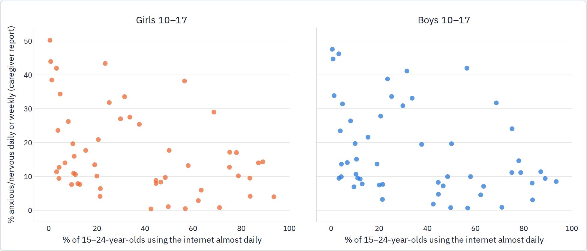
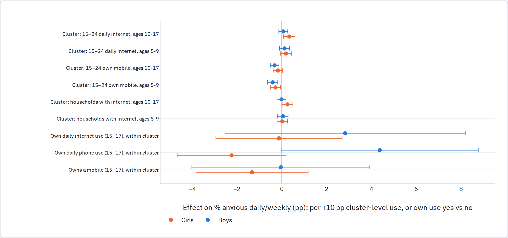

<!-- Generated review chunk: phone-first-countries-mics-child-functioning-module-68-surveys-20172024 -->

[Index](../README.md) · [Full paper](../../Teen_Distress_Pilot.md#review-phone-first-countries-mics-child-functioning-module-68-surveys-20172024)

Context: Teen Distress Pilot → Part 2 · Phones and social media (H1) → Phone-first countries: MICS Child Functioning Module (68 surveys, 2017–2024)

Editable source entry points: [scripts/report/90_build_report.py:316](../../../scripts/report/90_build_report.py#L316)

---

### Phone-first countries: MICS Child Functioning Module (68 surveys, 2017–2024)

MICS6 and MICS7 surveys (2017 onward) administer the Washington Group / UNICEF Child Functioning Module for children aged 5–17, asking the mother or primary caregiver how often the child "seems very anxious, nervous or worried" and how often the child seems "very sad or depressed" (daily, weekly, monthly, a few times a year, or never), using identical wording across countries. In the same households, women aged 15–49 (and men in roughly half the surveys) report mobile-phone ownership and how often they used the internet and a mobile phone over the past three months, while the household questionnaire records home internet access. Reading all 68 MICS samples with the module on the IPUMS-MICS server yields 507,478 children with valid responses and weights across 67 surveys (53 of which also include the young-adult internet items).

##### Prevalence across surveys

One point per survey (ages 10–17, across the 53 surveys that also record young-adult internet use). Cross-survey variation in caregiver-reported anxiety is wide—ranging from under 1% in Laos, Tuvalu, Vietnam, and Turkmenistan to 40–50% in Tunisia, Afghanistan, the Central African Republic, and Chad—and largely reflects national reporting norms, which is why all tests below compare children within the same country and region.

##### Use and symptoms within countries

Cluster rows regress children's daily/weekly anxiety on the share of 15–24-year-olds in their sampling cluster who use the internet almost daily (or own a mobile phone, or the household internet share), with survey-by-region fixed effects, household wealth quintile, urban/rural status, and age controls, and standard errors clustered by sampling cluster. Own-use rows link 15–17-year-olds to their own individual record in the women's or men's questionnaire (85% of girls matched, 24% of boys) and compare users with non-users within the same sampling cluster.

Girls aged 10–17 living in sampling clusters where more young adults use the internet daily are reported as slightly more anxious (+0.34 pp per 10-percentage-point rise in the cluster share, SE 0.13). However, a similar positive association appears for 5–9-year-old girls (+0.19 pp, SE 0.13), who are too young to use phones themselves, indicating that this reflects characteristics of more connected communities rather than adolescent phone use. Cluster-level mobile-phone ownership is *negatively* associated with caregiver-reported anxiety across all age and sex groups; household internet access shows a small positive association for 10–17-year-old girls (+0.26 pp per 10 points, SE 0.12, and +0.02 pp at ages 5–9); and caregiver-reported depression shows no positive relationship with any connectivity measure. Comparing 15–17-year-olds who use the internet or a phone daily with non-users in the same sampling cluster—the closest MICS equivalent to individual-level screen exposure—yields point estimates for girls that are near zero or slightly negative: −0.1 pp on anxiety (SE 1.4) and −1.8 pp on depression (SE 1.3) for daily internet use, and −2.2 pp on anxiety (SE 1.2) for daily phone use. For boys, the within-cluster own-phone-use coefficients are positive (+4.4 pp on anxiety and +5.5 pp on depression, SE ~2.0), though these rely on the roughly one-quarter of boys interviewed in the men's sub-sample. The learning and friendship functioning items show no meaningful association in either sex.

##### Two-round countries

| Country | Ages  | Sex   | Rounds      | Anxious daily/weekly % | Depressed daily/weekly % |
|---------|-------|-------|-------------|------------------------|--------------------------|
| KGZ     | 10-14 | boys  | 2018 → 2023 | 11.3 → 7.5             | 7.0 → 6.3                |
| KGZ     | 10-14 | girls | 2018 → 2023 | 13.1 → 8.2             | 7.5 → 7.4                |
| KGZ     | 15-17 | boys  | 2018 → 2023 | 10.7 → 9.3             | 5.5 → 4.3                |
| KGZ     | 15-17 | girls | 2018 → 2023 | 11.9 → 12.7            | 6.5 → 6.8                |
| MNG     | 10-14 | boys  | 2018 → 2023 | 7.5 → 11.2             | 4.4 → 7.6                |
| MNG     | 10-14 | girls | 2018 → 2023 | 9.9 → 13.3             | 6.3 → 9.0                |
| MNG     | 15-17 | boys  | 2018 → 2023 | 15.0 → 11.9            | 7.4 → 7.5                |
| MNG     | 15-17 | girls | 2018 → 2023 | 20.5 → 16.0            | 13.7 → 10.6              |
| TKM     | 10-14 | boys  | 2019 → 2024 | 0.8 → 4.7              | 0.7 → 2.8                |
| TKM     | 10-14 | girls | 2019 → 2024 | 0.8 → 2.1              | 0.9 → 1.7                |
| TKM     | 15-17 | boys  | 2019 → 2024 | 0.8 → 4.3              | 0.6 → 1.3                |
| TKM     | 15-17 | girls | 2019 → 2024 | 1.7 → 4.8              | 0.8 → 3.1                |
| TUN     | 10-14 | boys  | 2018 → 2023 | 42.7 → 30.1            | 15.8 → 13.8              |
| TUN     | 10-14 | girls | 2018 → 2023 | 37.5 → 28.0            | 12.9 → 14.5              |
| TUN     | 15-17 | boys  | 2018 → 2023 | 40.7 → 34.6            | 15.5 → 17.5              |
| TUN     | 15-17 | girls | 2018 → 2023 | 39.6 → 30.9            | 16.3 → 20.8              |

Countries with both a MICS6 and a MICS7 round on the server (Pakistan is excluded because its rounds sample different provinces). Turkmenistan rises from a very low baseline; Kyrgyzstan and Tunisia decline; Mongolia is mixed.

##### DHS-8 self-reports: Nepal 2022

The DHS-8 mental-health module provides a self-reported counterpart to the MICS caregiver reports. In 2022, Nepal administered the PHQ-9 and GAD-7 screeners to a subsample of 7,442 women aged 15–49 alongside questions on internet-use frequency and smartphone ownership (Kenya 2022 asked only whether a doctor had ever diagnosed depression or anxiety). Among Nepali women aged 15–19 (n = 1,379; 4.5% with PHQ-9 ≥ 10, 42% using the internet almost daily), daily internet users are 2.3 pp more likely to screen positive for depression (SE 2.4) and 3.5 pp more likely to screen positive for anxiety (SE 2.9) than non-users in the same sampling cluster (n = 1,293 in within-cluster regressions controlling for wealth, education, and age); the corresponding estimates are also positive at ages 20–24 and turn negative at ages 25–49. Smartphone ownership itself shows no positive association, and in Kenya diagnosed depression among 15–19-year-olds is unrelated to owning a smartphone (−0.1 pp, SE 1.3). Although these single-survey cross-sections are too small to be precise, their pattern matches the self-reported GSHS phone-hours gradient rather than the null results in the MICS caregiver reports: the positive association with screen use appears when adolescents report both their own use and their own symptoms.

**Assessment.** Across 67 MICS surveys, neither local young-adult connectivity nor a teenage girl's own daily internet or phone use predicts caregiver-reported anxiety or depression within sampling clusters, and the small positive cluster correlation for girls' anxiety is shared by 5–9-year-olds. Three qualifications apply: the outcome is reported by caregivers rather than adolescents themselves; the exposure measures current use rather than exogenous network rollout timing; and only four countries currently offer repeated MICS rounds with the module.
