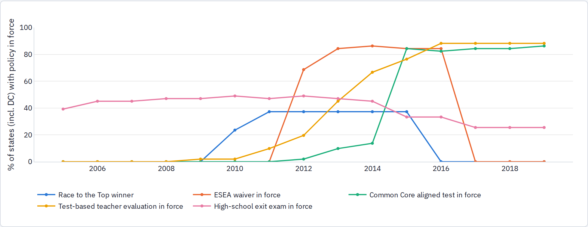
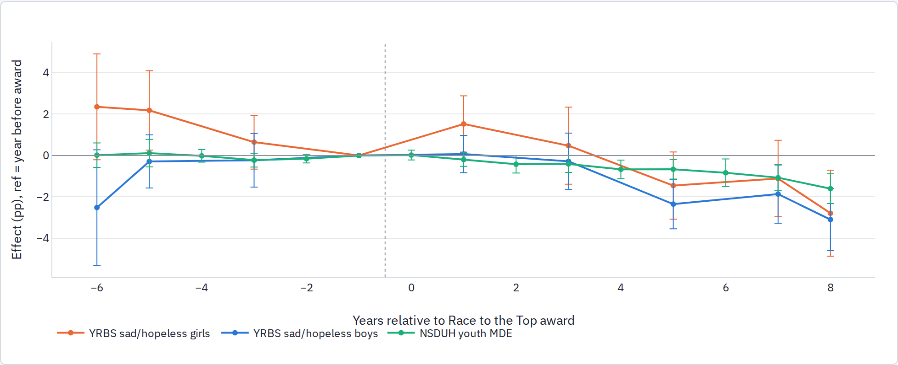

<!-- Generated review chunk: policy -->

[Index](../README.md) · [Full paper](../../Teen_Distress_Pilot.md#review-policy)

Context: Teen Distress Pilot → Part 3 · School pressure (H2) → U.S. school accountability policy

Editable source entry points: [scripts/report/90_build_report.py:274](../../../scripts/report/90_build_report.py#L274)

---

### U.S. school accountability policy

In the United States, states adopted test-based accountability reforms on staggered schedules between 2009 and 2017; if those policy shifts drove adolescent distress, states implementing them should show corresponding increases in youth depression and sadness.

We compiled implementation dates across all 51 jurisdictions for five major state accountability policies, documenting a primary source for each cell: Race to the Top awards (2010–11), ESEA/NCLB flexibility waivers (2012–16), the first operational Common Core–aligned state assessment (2012–2019, concentrated in spring 2015), statewide test-based teacher evaluation (2009–2017), and mandatory high-school exit exams (which declined from 25 states to 13 over the decade). Years refer to the school year ending that spring.

Share of states (including DC) with each policy in force. Most states adopted ESEA waivers, teacher-evaluation rules, and Common Core–aligned tests within a narrow 2012–2015 window, leaving limited timing variation across states.

#### State-year regressions

| Policy (each estimated alone)            | ACS girls    | ACS boys     | YRBS sad girls   | YRBS sad boys    | NSDUH youth MDE |
|------------------------------------------|--------------|--------------|------------------|------------------|-----------------|
| Race to the Top winner (award year–2015) | -0.06 (0.07) | -0.00 (0.10) | **+1.21 (0.41)** | **+0.68 (0.34)** | +0.16 (0.14)    |
| ESEA waiver in force                     | -0.01 (0.08) | +0.13 (0.07) | -0.99 (0.58)     | -0.16 (0.48)     | -0.18 (0.25)    |
| Common Core aligned test in force        | -0.00 (0.08) | +0.01 (0.12) | -0.80 (0.79)     | -0.80 (0.77)     | -0.35 (0.30)    |
| Test-based teacher evaluation in force   | -0.03 (0.06) | -0.13 (0.09) | -0.38 (0.60)     | -0.28 (0.36)     | -0.03 (0.17)    |
| High-school exit exam in force           | -0.04 (0.07) | -0.03 (0.12) | -0.47 (0.82)     | -0.09 (0.86)     | +0.34 (0.27)    |
| Pressure index (sum of the five)         | -0.03 (0.03) | -0.01 (0.04) | -0.11 (0.25)     | -0.04 (0.20)     | +0.02 (0.09)    |

Coefficients in percentage points from regressions with state and year fixed effects, inverse-variance weights, and standard errors clustered by state, 2008–2019 (YRBS biennial across 39 states). NSDUH estimates are reported in two-year waves and matched to the average policy indicator across the two survey years; state clustering accounts for the half-sample overlap between consecutive waves (restricting to non-overlapping waves changes every NSDUH coefficient by less than 0.15 pp). Bold = \|t\| \> 1.96.

Common Core–aligned testing, ESEA waivers, test-based teacher evaluations, high-school exit exams, and the five-policy sum show no positive relationship with any of the three distress measures; several point estimates are slightly negative. The only statistically significant positive coefficient in the table is for Race to the Top on YRBS sadness (+1.21 pp for girls, SE 0.41; +0.68 pp for boys, SE 0.34), while the corresponding NSDUH estimate is +0.16 pp (SE 0.14) and the ACS coefficients are near zero. However, the 19 Race to the Top winners were a selected group of states (including DC, New York, Massachusetts, and Florida), and the static indicator was coded as 1 only during the 2010–2015 grant window—treating the winners' higher post-2015 sadness levels as part of the control baseline. When we trace the winning states year by year around the award date in the event study below, the apparent effect disappears.

#### Race to the Top, traced year by year

State and year fixed effects, plotting coefficients relative to the year before the award (the school year ending spring 2010 for Phase 1 and 2 winners, and spring 2012 for the December 2011 Phase 3 winners), 2005–2019. Both award cohorts are observed in the YRBS wave prior to their award (2009 and 2011); event years 6 or more before and 8 or more after are pooled into endpoint bins.

Tracing Race to the Top winners year by year around the grant award shows why the static regression coefficient in the previous section was misleading: after winning an award, states' YRBS sadness and NSDUH youth depression rates actually trended flat to downward relative to non-winning states. The positive static coefficient was an artifact of coding the grant indicator as 1 only during 2010–2015, which placed the winning states' post-2015 observations into the reference group. The event study provides no evidence that Race to the Top increased adolescent distress. Within the U.S. public data, state accountability policy shocks do not explain the post-2010 rise.
