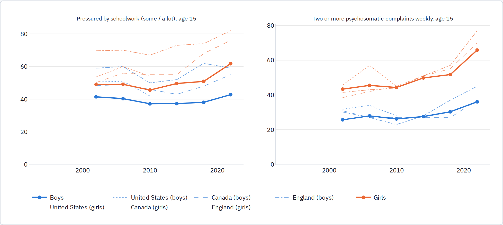
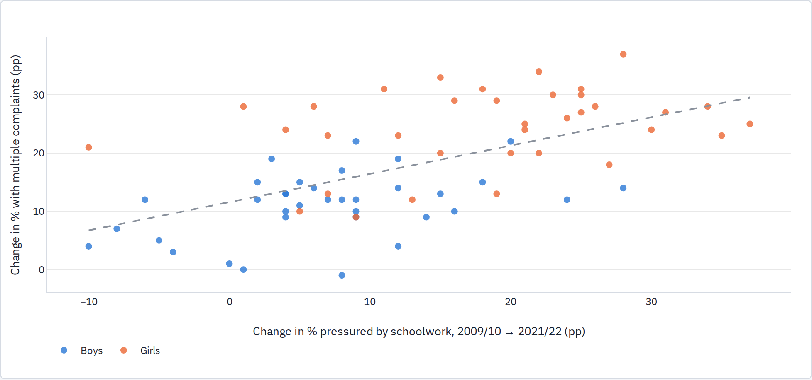

<!-- Generated review chunk: schoolwork-pressure-across-countries-hbsc -->

[Index](../README.md) · [Full paper](../../Teen_Distress_Pilot.md#review-schoolwork-pressure-across-countries-hbsc)

Context: Teen Distress Pilot → Part 3 · School pressure (H2) → Schoolwork pressure across countries (HBSC)

Editable source entry points: [scripts/report/90_build_report.py:172](../../../scripts/report/90_build_report.py#L172)

---

### Schoolwork pressure across countries (HBSC)

The WHO Health Behaviour in School-aged Children (HBSC) surveys ask 11-, 13-, and 15-year-olds across roughly 45 European and North American countries the same question on schoolwork pressure and the same psychosomatic-complaints checklist every four years. Published country tables from 1997/98 through 2021/22 (supplemented by the HBSC data browser for 2014–2022) allow a direct cross-national test of Gray's school-pressure mechanism. Because the United States participated only through the 2009/10 wave, post-2010 U.S. trends cannot be tracked in HBSC.

Unweighted means across participating countries (thick lines), with the United States, Canada, and England shown as thin dashed lines. Age 15.

Both series were flat or declining through 2009/10 and then rose in tandem: among 15-year-old girls, the cross-country mean of perceived schoolwork pressure increased from 46% in 2010 to 50% in 2014, 51% in 2018, and 62% in 2022, while the share reporting two or more weekly psychosomatic complaints rose from 44% to 50%, 52%, and 66%. In the 2000s, American 15-year-olds reported above-average schoolwork pressure, though U.S. pressure fell between 2006 and 2010, the final U.S. wave.

##### Did complaints rise where pressure rose?

Each point is a country-sex cell at age 15; the dashed line is the pooled OLS fit (slope 0.24, SE 0.07, r = 0.59). Over the pre-pandemic 2010 → 2018 window alone, the slope is 0.16 (SE 0.07, r = 0.31).

| Specification (ages 11–15 pooled unless noted)                                                                         | Estimate                                                 | Interpretation                                                           |
|------------------------------------------------------------------------------------------------------------------------|----------------------------------------------------------|--------------------------------------------------------------------------|
| Within-country panel regression of complaints on pressure, with country×age×sex and wave×age×sex FE (1,440 cells)      | 0.14 (SE 0.04); girls 0.16, boys 0.12                    | A 10-pp rise in pressure corresponds to a 1.4-pp rise in complaints      |
| Long difference 2010 → 2018, age 15 (72 country-sex pairs)                                                             | mean Δpressure +5.5 pp, Δcomplaints +6.6 pp; slope 0.16  | Cross-country pressure differences account for ~1 pp of the 6.6-pp rise  |
| Long difference 2010 → 2022, age 15 (70 pairs)                                                                         | Δpressure +12.7, Δcomplaints +17.7; slope 0.24, r = 0.59 | Stronger relationship, though 2022 includes pandemic disruptions         |
| Pre-smartphone baseline period 2002 → 2010                                                                             | Δpressure −2.9, Δcomplaints −0.1; slope 0.14             | Same within-country slope during a period when neither series was rising |
| 2018 & 2022 cross-country: complaints on problematic social media use (PSMU) and pressure, wave×age×sex FE (496 cells) | PSMU 0.53 (SE 0.15); pressure 0.13 (SE 0.06)             | Both predictors are independently associated with complaints             |
| Within-country change 2018 → 2022 on PSMU and pressure                                                                 | PSMU 0.25 (SE 0.18); pressure 0.12 (SE 0.10)             | Imprecisely estimated with a single four-year change per country         |

**Assessment.** Perceived schoolwork pressure rose after 2010 across most HBSC countries, and psychosomatic complaints rose more in countries where pressure increased more. However, the within-country slope is modest (0.14) and identical to the slope during the 2002–2010 baseline period when neither measure was rising. Perceived pressure thus behaves like a steady correlate of complaints rather than the sole driver of the post-2010 inflection, most of which is absorbed by common wave effects across countries. Testing whether complaints became more concentrated among high-pressure students within countries requires the student-level HBSC microdata.
