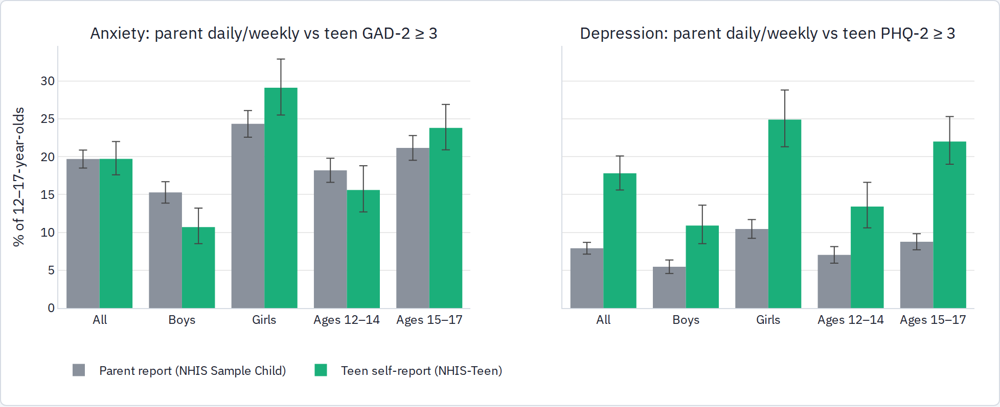

<!-- Generated review chunk: the-first-statewide-school-phone-bans-a-first-look -->

[Index](../README.md) · [Full paper](../../Teen_Distress_Pilot.md#review-the-first-statewide-school-phone-bans-a-first-look)

Context: Teen Distress Pilot → Part 2 · Phones and social media (H1) → Who reports the symptoms: U.S. caregivers and adolescents (NSCH 2016–2025, NHIS 2021–2024) → Parent-reported anxiety and depression in the United States: NSCH 2016–2025 → The first statewide school phone bans: a first look

Editable source entry points: [scripts/report/90_build_report.py:1](../../../scripts/report/90_build_report.py#L1)

---

State-year difference-in-differences (ages 12–17 unless noted; state and year fixed effects) with two weightings, and permutation inference: the observed mandate schedule (one state from 2023–24, three from 2024–25, the rest from 2025–26) is reassigned to random states 400 times; "permutation SD" is the standard deviation of the placebo coefficients and "permutation p" the share of placebo draws at least as large in absolute value as the observed one.

Two checks argue against reading these declines as a ban effect. First, the ADD/ADHD contrast moves as much as anxiety: -3.83 (2.47) pp for girls with equal state weights (permutation p 0.03) and -4.03 (1.20) pp with population weights, whereas depression, the other internalizing outcome, is +0.04 (0.87) and -0.91 (0.70) pp. Whatever lowered parent-reported anxiety diagnoses in the early-ban states in 2024–25 lowered reported ADHD diagnoses by about as much, which a phone ban does not predict. Second, the only state observed two years after its mandate is Florida, whose full-year coefficient of -6.25 pp for girls' anxiety is lower than the placebo coefficient of every one of the 16 states without any mandate when each is treated alone from 2023–24 (placebo SD 2.79, two-sided p 0.06); for boys the Florida coefficient is -2.09 (p 0.38), and for girls' ADHD it is -4.06 (p 0.00), again lower than every placebo state. Florida's post-2023 decline is therefore unusual, but it is a decline in reported diagnoses of every kind. With one state identifying the second post-ban year, four the first, and 2025 the year the national series turned down everywhere, this is a first look rather than an evaluation: it finds no ban-specific signal, and the design will sharpen as the 2026 and 2027 files add full post-ban years for the 19 states that started in 2025–26.

##### Published NSCH analyses

| Study                                                                                                                                                                                                                               | NSCH data                                                                 | Finding                                                                                                                                                                                                                     |
|-------------------------------------------------------------------------------------------------------------------------------------------------------------------------------------------------------------------------------------|---------------------------------------------------------------------------|-----------------------------------------------------------------------------------------------------------------------------------------------------------------------------------------------------------------------------|
| [Twenge & Campbell (2018)](https://doi.org/10.1016/j.pmedr.2018.10.003)                                                                                                                                                             | NSCH 2016, ages 2-17, n = 40,337 (unweighted)                             | Adolescents 14-17 at 7+ h/day vs 1 h/day: anxiety diagnosis RR 2.26 (95% CI 1.59-3.22), depression RR 2.39 (1.54-3.70); inflection after about 1 h/day; stronger for adolescents than younger children                      |
| [Leung & Torres (2021)](https://doi.org/10.1016/j.sleep.2021.02.031)                                                                                                                                                                | NSCH 2018, ages 13-17, n = 10,907                                         | 4+ h vs \<1 h weekday screen time: depression OR 2.23 (1.27-3.91), anxiety OR 1.85 (1.26-2.72) fully adjusted; no association at 1-3 h; sleep duration did not mediate                                                      |
| [Lebrun-Harris, Ghandour, Kogan & Warren (2022)](https://doi.org/10.1001/jamapediatrics.2022.0056)                                                                                                                                  | NSCH 2016-2020, ages 0-17, n = 174,551                                    | Anxiety 7.1% to 9.2% (+29%), depression 3.1% to 4.0% (+27%), 2016 to 2020; mental-health care use flat                                                                                                                      |
| [Wu, Li & Tsurumi (2024)](https://doi.org/10.1186/s13034-023-00688-7)                                                                                                                                                               | NSCH 2018-2021, ages 6-17, n = 88,823                                     | Share with 4+ h weekday screen time 22.7% (2018) to 32.8% (2020) and 29.4% (2021); each screen hour associated with +0.32 points on a 0-6 problem index; 2016-17 excluded because TV and device hours were asked separately |
| [HRSA MCHB data brief, Adolescent mental and behavioral health (2024)](https://mchb.hrsa.gov/sites/default/files/mchb/data-research/nsch-data-brief-adolescent-mental-behavioral-health-2023.pdf) (not verified against the source) | NSCH 2016-2023, ages 12-17                                                | Diagnosed anxiety 10.0% (2016) to 16.1% (2023), depression 5.8% to 8.4%; 61% of adolescents with a current condition who needed treatment had difficulty obtaining it in 2023                                               |
| [Forrest, Koenigsberg, Harvey, Maltenfort & Halfon (2025)](https://doi.org/10.1001/jama.2025.9855) (not verified against the source)                                                                                                | NSCH and four other national surveys, mortality files, PEDSnet, 2007-2023 | Chronic-condition prevalence among 3-17-year-olds rose from 25.8% to 31.0% in the general population; anxiety and depression among the fastest-rising diagnoses                                                             |

**Assessment.** The NSCH shows that U.S. caregivers do report a steep screen-time gradient in diagnosed, current anxiety and depression, larger for girls and at least as large as the adolescents' own GSHS gradient, so the MICS null is not a general property of caregiver reports; it is specific to asking caregivers how often a child *seems* anxious in settings where phone use is measured for the household rather than the child. But the U.S. gradient is equally present at ages 6–11, for ADHD and conduct problems, and before and after the pandemic screen-time surge, which points to selection and reverse causation as much as to H1. The parent series reproduces the female-led 2016–2024 rise and, in 2025, the first decline, placing a national parent-report marker beside the post-2021 state-survey downturn documented in the state youth surveys. The adoption test has no variation left to use (H1 untestable here). The phone-ban difference-in-differences (H1/H3) shows lower parent-reported anxiety in the early-ban states after their mandates, but the decline is matched by ADD/ADHD, absent for depression, sensitive to weighting, and identified two years out by Florida alone; it is not evidence of a ban effect and should be re-run when the 2026 NSCH file is released.

#### United States: parents and teenagers describing the same population (NHIS 2021–2024 and NHIS-Teen)

The National Health Interview Survey's Sample Child interview asks a parent the Washington Group / UNICEF child-functioning items used in MICS, with identical wording: how often the child "seems very anxious, nervous, or worried" and how often the child "seems very sad or depressed" (daily, weekly, monthly, a few times a year, never). From July 2021 NCHS invited the 12–17-year-old sample children themselves to complete NHIS-Teen, a self-administered web questionnaire with the PHQ-2 and GAD-2 screeners, weekday non-school screen hours, sleep, bullying and support items. It is the one national U.S. survey in which the MICS caregiver items and an adolescent self-report screener describe the same children in the same months. The public-use Sample Child files for 2021–2024 give 12,058 adolescents aged 12–17 (12,020 with a valid anxiety item; the screen-time item was asked in 2022 and 2024, n = 5,834, and the bullying item in 2021–2022, n = 5,779). The NHIS-Teen microdata, however, are released only through the NCHS Research Data Center ("there is no public-use NHIS-Teen file"), so the person-level link cannot be made from public data. Of 7,323 eligible sample children, 60.4% of parents gave permission and 46.2% of permitted teenagers responded (overall 27.9%, n = 1,958); NCHS publishes weighted estimates from this sample by parent-reported subgroup in its Interactive Summary Health Statistics for Teens and in a series of data briefs. This section therefore compares the two informants at the population level (the same months, the same subgroups) and compares each informant's own screen-time gradient, rather than agreement on linked individuals.

##### Prevalence under the two informants

Children aged 12–17, July 2021–December 2023. Parent report: NHIS Sample Child public-use files (2021 Q3–Q4, 2022, 2023; weighted with WTFA_C, 2021 weights doubled for the half year; 95% CIs from SEs clustered on pseudo-stratum × PSU). Teen report: NCHS Interactive Summary Health Statistics for Teens (NHIS-Teen weight, Korn–Graubard CIs). Subgroups follow the parent-reported classification used in both sources.
